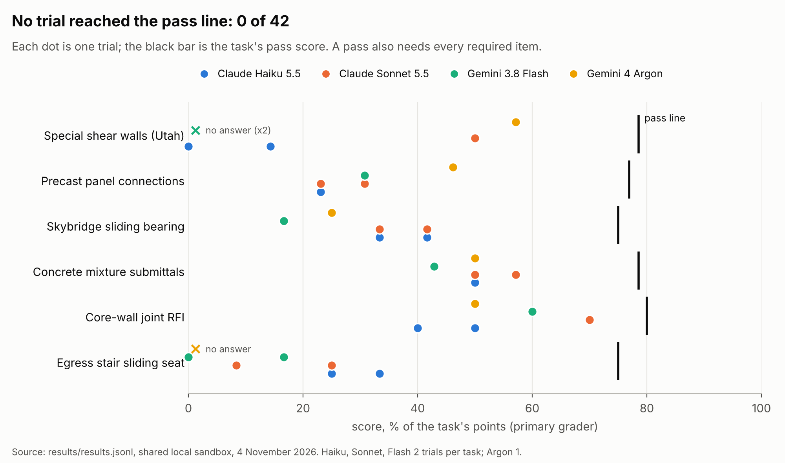
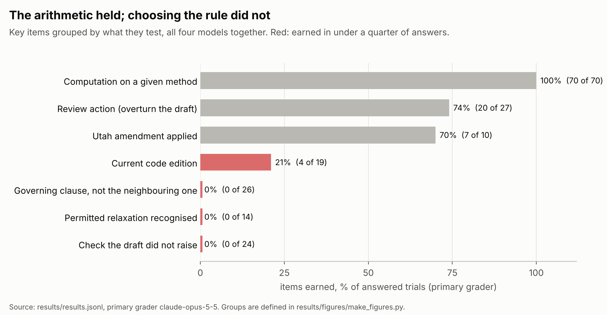
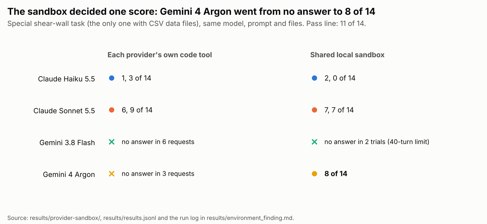
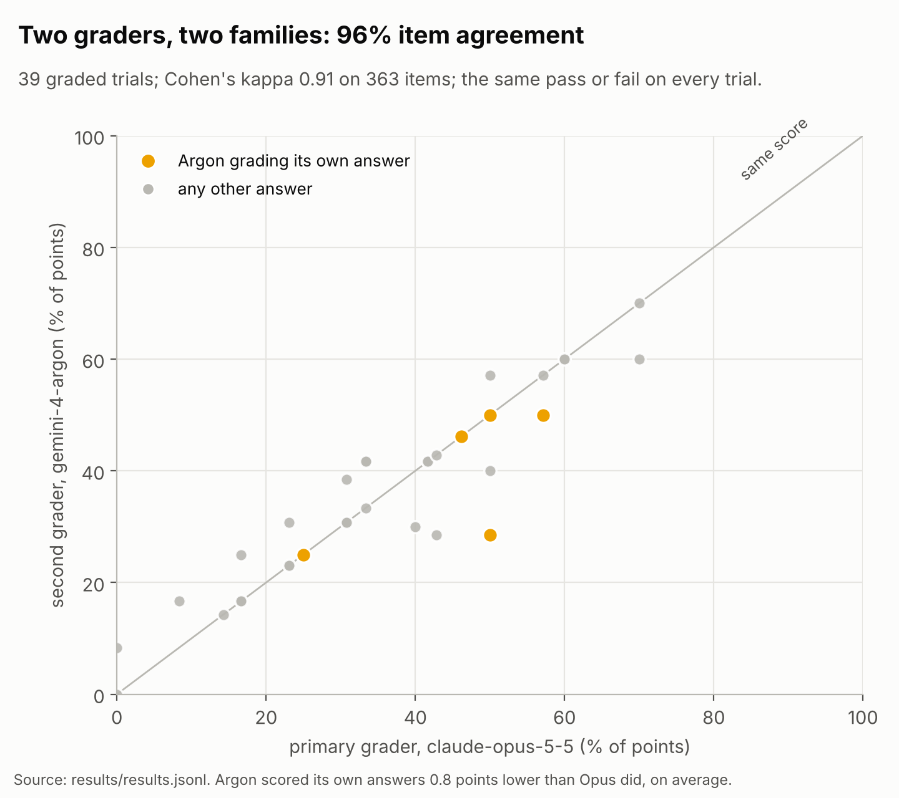
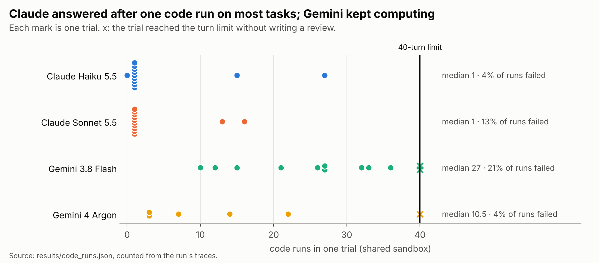
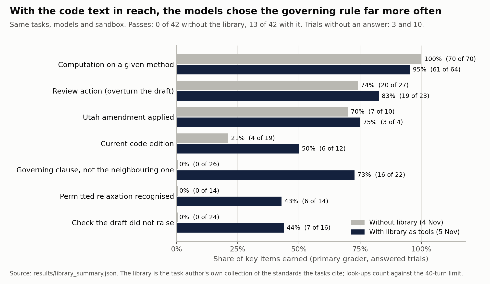

# Results: micro1 Eval Hackathon, November 2026

Aggregate results only. The task prompts, keys and raw answers are not published; the numbers below come from [`results/hackathon_summary.json`](results/hackathon_summary.json). The tasks are described in [hackathon-tasks.md](hackathon-tasks.md).

**Setup.** Six tasks, four models under test: Claude Haiku 5.5, Claude Sonnet 5.5 and Gemini 3.8 Flash with two trials per task, Gemini 4 Argon with one (42 trials per run). Primary grader Claude Opus 5.5, second grader Gemini 4 Argon. Two runs on the same task versions, models and shared local sandbox: without the code library (4 November 2026) and with the library as look-up tools (5 November 2026). A trial passes when its score reaches the task's pass score and every required item is earned. Scores below are points on each task's own scale; the figures show them as a percentage of the task's points (0 to 100).

## Headline

| | Without the library | With the library |
|---|---|---|
| Passes | 0 of 42 (95% CI 0% to 8%) | 13 of 42 (95% CI 19% to 46%) |
| Trials without an answer | 3 | 10 |
| Required items earned (answered trials) | 46 of 143 | 78 of 115 |
| Grader agreement, items | 347 of 363 (96%) | 285 of 294 (97%) |
| Grader agreement, pass or fail | 39 of 39 | 32 of 32 |

## Model comparison

| Model | Trials | Passes without | Passes with | Mean score without | Mean score with | No answer without | No answer with | Median look-ups with |
|---|---|---|---|---|---|---|---|---|
| Claude Haiku 5.5 | 12 | 0 | 2 | 32% | 55% | 0 | 0 | 20.5 |
| Claude Sonnet 5.5 | 12 | 0 | 5 | 42% | 63% | 0 | 2 | 31 |
| Gemini 3.8 Flash | 12 | 0 | 3 | 26% | 35% | 2 | 6 | 20.5 |
| Gemini 4 Argon | 6 | 0 | 3 | 38% | 54% | 1 | 2 | 30.5 |

Mean score is the average share of the task's points over all trials, with a trial without an answer counted as 0.

## Scores by task and model

Each cell lists the trials (points). Pass score and maximum in the first column.

### Without the library

| Task (pass / max) | Claude Haiku 5.5 | Claude Sonnet 5.5 | Gemini 3.8 Flash | Gemini 4 Argon | Passes |
|---|---|---|---|---|---|
| Special shear walls (Utah) (11 / 14) | 2, 0 | 7, 7 | no answer, no answer | 8 | 0 |
| Precast screen panel connections (10 / 13) | 3, 3 | 3, 4 | 4, 4 | 6 | 0 |
| Skybridge sliding bearing (9 / 12) | 5, 4 | 5, 4 | 2, 2 | 3 | 0 |
| Concrete mixture submittals (11 / 14) | 7, 7 | 7, 8 | 6, 6 | 7 | 0 |
| Core wall joint RFI (8 / 10) | 4, 5 | 7, 7 | 6, 6 | 5 | 0 |
| Egress stair sliding seat (9 / 12) | 4, 3 | 1, 3 | 2, 0 | no answer | 0 |

### With the library

| Task (pass / max) | Claude Haiku 5.5 | Claude Sonnet 5.5 | Gemini 3.8 Flash | Gemini 4 Argon | Passes |
|---|---|---|---|---|---|
| Special shear walls (Utah) (11 / 14) | 8, 6 | no answer, no answer | no answer, no answer | no answer | 0 |
| Precast screen panel connections (10 / 13) | 7, 4 | 9, 11 | no answer, no answer | 10 | 2 |
| Skybridge sliding bearing (9 / 12) | 3, 11 | 11, 11 | no answer, 11 | 12 | 5 |
| Concrete mixture submittals (11 / 14) | 7, 8 | 6, 8 | 13, 12 | 14 | 3 |
| Core wall joint RFI (8 / 10) | 4, 7 | 6, 6 | 6, 6 | 5 | 0 |
| Egress stair sliding seat (9 / 12) | 10, 7 | 12, 12 | no answer, 3 | no answer | 3 |

## Items by kind

Share of key items earned in answered trials, primary grader.

| Kind of item | Without the library | With the library |
|---|---|---|
| Computation on a given method | 70 of 70 (100%) | 61 of 64 (95%) |
| Review action (overturn the draft) | 20 of 27 (74%) | 19 of 23 (83%) |
| Utah amendment applied | 7 of 10 (70%) | 3 of 4 (75%) |
| Current code edition | 4 of 19 (21%) | 6 of 12 (50%) |
| Governing clause, not the neighbouring one | 0 of 26 (0%) | 16 of 22 (73%) |
| Permitted relaxation recognised | 0 of 14 (0%) | 6 of 14 (43%) |
| Check the draft did not raise | 0 of 24 (0%) | 7 of 16 (44%) |

## Figures

Figure 1. Every trial's score against the task's pass line, without the library: no trial reached it.

Figure 2. Key items by kind, without the library: the arithmetic held, choosing the rule did not.

Figure 3. The same special shear wall task in each provider's own code tool and in the shared local sandbox.

Figure 4. Primary and second grader, two model families, item agreement and pass or fail on every trial.

Figure 5. Code runs per trial in the shared sandbox, and trials that reached the 40-turn limit without an answer.

Figure 6. Items by kind without and with the code library as look-up tools.

## Reading the results

- Without the library the models did the arithmetic (100% of computation items) but chose the neighbouring clause, an older edition, or skipped a check the draft did not raise. No trial passed.
- The environment matters. In each provider's own code tool Gemini 4 Argon wrote no answer on the task with CSV files; in the shared local sandbox it scored 8 of 14 (figure 3). Claude models mostly answered after one code run, while Gemini 3.8 Flash kept computing and twice reached the turn limit (figure 5).
- With the code text in reach 13 of 42 trials passed, and governing-clause items rose from 0% to 73%. Look-ups count against the same turn limit, so trials without an answer rose from 3 to 10, most of them Gemini 3.8 Flash. Two tasks still had no pass. The library holds exactly the sources the tasks cite, so this is the best case for look-up.
