# Module 1: Load path and static equilibrium

*A Review Notebook for Civil Engineers to Evaluate Frontier Models*, by Saba Azadegan

Every load needs a continuous path to the ground. This module follows that path from the simplest beam to transfer structures, diaphragms, alternate paths and bridges. Each section has the idea, a worked example with a figure, a practice problem with its answer, a trap to test on AI models, and the check an AI review agent should run.

**How to read the numbers.** Loads are service loads in kN and m unless a section says otherwise. Every number was computed in a script ([module-01-calc.py](module-01-calc.py)) and checked twice (by load path and by area, or by equilibrium), then checked again by an independent reviewer. Code clauses are pointers to check in the edition in force; no code text is reproduced.

**Status of the model tests.** The traps listed here are hypotheses: errors to test on Claude and Gemini models with this harness. Results will be added with the model version and date. Until then, nothing here claims how often a model fails.

## Contents

- Part A. Equilibrium: 1.1
- Part B. Gravity load path in beam and girder floors: 1.2 to 1.5
- Part C. Slab systems: 1.6 to 1.9
- Part D. Special loads and irregular geometry: 1.10 to 1.13
- Part E. Vertical load path and foundations: 1.14 to 1.16
- Part F. Transfer structures: 1.17 to 1.20
- Part G. Lateral load path: 1.21 to 1.26
- Part H. Alternate load paths and construction: 1.27 to 1.29
- Part I. Bridges: 1.30 and 1.31
- Agent checks, traps to test, answer keys

---

## Part A. Equilibrium

### 1.1 Equilibrium and determinacy

**Idea.** In 2D, ΣFx = 0, ΣFy = 0 and ΣM = 0; in 3D there are six equations. Every check starts from a free-body diagram. For one rigid body, three reactions make it statically determinate and each extra reaction adds one degree of indeterminacy. Counting is not enough: reactions that are all parallel, or all pass through one point, leave the body unstable.

**Worked example.** A 6 m beam on a pin at A and a roller at B carries 50 kN at 30° below the horizontal, 2 m from A.

- Components: Px = 50 cos 30° = 43.3 kN, Py = 50 sin 30° = 25 kN.
- ΣFx = 0: Ax = 43.3 kN. Only the pin can take it.
- ΣMA = 0: By × 6 = 25 × 2, so By = 8.33 kN.
- ΣFy = 0: Ay = 25 − 8.33 = 16.67 kN.

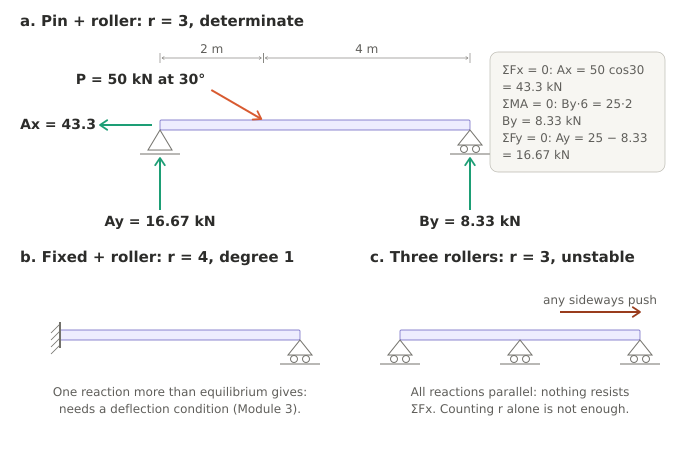

A propped cantilever has four reactions (degree 1) and needs a deflection condition (Module 3). A beam on three rollers has three reactions, but all are vertical, so nothing resists a sideways push.

**Practice.** The same beam carries a vertical 30 kN load 4.5 m from A. Find the reactions.

*Answer:* By = 30 × 4.5 / 6 = 22.5 kN, Ay = 7.5 kN, Ax = 0.

**Trap to test.** Counting three reactions and calling a support set "determinate" without checking that the reactions are not parallel or concurrent; dropping the horizontal reaction of an inclined load.

**Agent check.** Support stability: the model must solve without a singularity or mechanism warning, and the sum of reactions in each direction must equal the applied load in that direction.

---

## Part B. Gravity load path in beam and girder floors

### 1.2 Slab to beam to girder to column

**Idea.** Gravity load runs slab → secondary beam → girder → column → foundation → soil. Follow it member by member, then check the total against the tributary area. If the two routes agree, no load was lost or counted twice.

**Worked example.** Interior column of a parking floor.

| Item | Value |
|---|---|
| Column grid | 9 m × 9 m |
| Girders | on column lines, one direction, span 9 m |
| Secondary beams | every 3 m, span 9 m, on the girders; beams on column lines sit on the columns |
| Slab | one-way, 200 mm, spans 3 m between beams |
| Beam web below slab | 300 × 450 mm |
| Girder web below slab | 400 × 600 mm |
| Concrete | 25 kN/m³ |
| Finishes | 0.5 kN/m² |
| Live load | 2.0 kN/m² (assumed for the example) |


1. Unit loads. Slab 0.2 × 25 + 0.5 = 5.5 kN/m². Beam web 0.3 × 0.45 × 25 = 3.375 kN/m. Girder web 0.4 × 0.6 × 25 = 6.0 kN/m.
2. Beam line load. Tributary width 3 m: wD = 5.5 × 3 + 3.375 = 19.875 kN/m; wL = 2 × 3 = 6 kN/m.
3. Beam reactions. R = wL/2: D = 89.44 kN, L = 27 kN.


4. Girder reactions. Beams from both sides land at 3 m and 6 m: P = 178.88 kN (L 54 kN), plus 6 kN/m. R = (2 × 178.88 + 6 × 9) / 2 = 205.88 kN; L 54 kN.


5. Column. Two girders and two column-line beams: D = 2 × 205.88 + 2 × 89.44 = 590.6 kN; L = 2 × 54 + 2 × 27 = 162 kN.

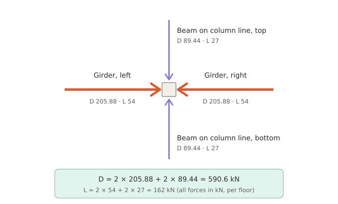

The arrows show where each vertical load comes from in plan; they are not horizontal forces.

6. Area check. 81 m²: slab 445.5 + beams 27 m × 3.375 = 91.1 + girder 9 × 6 = 54, total 590.6 kN; live 81 × 2 = 162 kN. Both routes agree.

**Practice.** Put the secondary beams at 2.25 m instead of 3 m. Find the column dead load.

*Answer:* wD = 5.5 × 2.25 + 3.375 = 15.75 kN/m, R = 70.875 kN; girder R = (3 × 141.75 + 54) / 2 = 239.63 kN; column 2 × 239.63 + 2 × 70.875 = 621.0 kN. Area check: 445.5 + 36 m × 3.375 + 54 = 621.0 kN. More beams, more self-weight.

**Trap to test.** Forgetting the self-weight of the beam webs and girders below the slab, or counting the slab twice (once as area load and once inside a "beam self-weight" taken over the full depth).

**Agent check.** Column load against tributary: the model's axial load per floor should be about 1.0 to 1.25 times the tributary estimate for an interior column; flag anything outside with no explanation.

### 1.3 Interior, edge and corner columns

**Idea.** Edge and corner columns take less area but often carry extra line loads (parapets, cladding). The tributary method still works if every line load is added.

**Worked example.** Same floor, with a 3 kN/m parapet along both building edges. The edge column sits on the girder edge.

- Edge girder: beams from one side only, P = 89.44 kN at 3 m and 6 m; distributed 6 + 3 = 9 kN/m. R = (2 × 89.44 + 9 × 9) / 2 = 129.94 kN.
- Edge column: two edge girders and one column-line beam from inside: D = 2 × 129.94 + 89.44 = 349.3 kN; L = 81 kN. Area check: 40.5 m² × 5.5 + 13.5 m × 3.375 + 9 × 6 + 9 × 3 = 349.3 kN.
- Corner column: one edge girder (129.94 kN) and one edge beam with slab on one side: w = 5.5 × 1.5 + 3.375 + 3 = 14.625 kN/m, R = 65.81 kN. D = 195.75 kN; L = 40.5 kN.

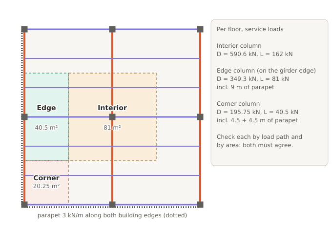

**Practice.** Remove the parapet. What is the corner column dead load?

*Answer:* 195.75 − 4.5 × 3 − 4.5 × 3 = 168.75 kN.

**Trap to test.** Giving an edge beam the full 3 m tributary width, or leaving out the parapet or cladding line load.

**Agent check.** Edge and corner columns: the model load should match the tributary area plus every line load along the edge.

### 1.4 Continuity changes the reactions

**Idea.** The tributary method assumes simple spans. In a continuous beam the interior supports take more and the end supports less; the total is unchanged.

**Worked example.** The secondary beam made continuous over two 9 m spans, wD = 19.875 kN/m.

| Support | Continuous | Simple spans |
|---|---|---|
| End | 0.375wL = 67.08 kN | 89.44 kN |
| Middle | 1.25wL = 223.59 kN | 178.88 kN |
| End | 67.08 kN | 89.44 kN |
| Total | 357.75 kN | 357.75 kN |

Why 1.25: remove the middle support and restore zero deflection there. R(2L)³/48EI = 5w(2L)⁴/384EI, so R = 1.25wL.

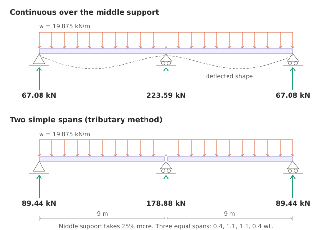

**Practice.** Three equal spans of 6 m with 10 kN/m. Find the reactions.

*Answer:* 0.4wL = 24 kN at the ends and 1.1wL = 66 kN at the two interior supports. Total 180 kN.

**Trap to test.** Using tributary reactions for the column under an interior support of a continuous beam: 9 to 20% low (the continuous reaction is 10 to 25% higher).

**Agent check.** Interior column loads up to about 1.25 × tributary are normal for continuous framing; a lower ratio there needs a reason.

### 1.5 Is all the load in the model?

**Idea.** Before checking any member, compare the model's total base reaction with a hand estimate for each load case.

**Worked example.** Four-storey garage: hand estimate of total dead load 11,500 kN; sum of base reactions in the model 9,200 kN. The ratio is 0.80, so the completeness check fails.

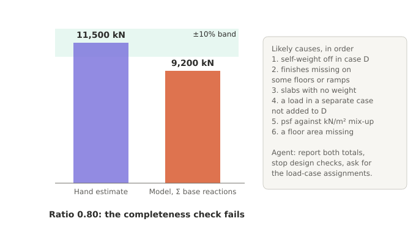

Likely causes, in order: self-weight switched off in the dead case; finishes missing on some floors or ramps; slabs modelled with no weight; a load placed in a separate case that is not added to D; a psf against kN/m² mix-up; a floor area missing. The agent should report both totals and the gap, stop the design checks, ask for the load-case assignments and hand the case to the engineer.

**Practice.** The model gives 10,900 kN. Pass or fail?

*Answer:* Ratio 0.948, a 5.2% gap. With a ±10% band it passes with a note; with a ±5% band it is just outside and gets flagged. Either way, find the missing 600 kN before signing (column self-weight or finishes on the ramps are likely).

**Trap to test.** Checking member results in detail while the global total is 20% short.

**Agent check.** Load completeness: model total D and L against the hand estimate, flag outside ±5 to 10%. Global equilibrium: sum of reactions against sum of applied loads per case, flag above 1%.

---

## Part C. Slab systems

### 1.6 Two-way slabs

**Idea.** A slab supported on four sides sends load to all four. With similar edge conditions, 45° lines from the corners split the panel: the short beams take triangles and the long beams take trapezoids. Different edge conditions shift the angles.

**Worked example.** Panel lx = 6 m by ly = 9 m, w = 7 kN/m².

- Peak line load on every edge beam: q = w × lx / 2 = 7 × 3 = 21 kN/m.
- Short beam (6 m), triangle: total 21 × 6 / 2 = 63 kN, R = 31.5 kN, M = qL²/12 = 63 kN·m.
- Long beam (9 m), trapezoid with 3 m ramps: total 21 × (9 − 3) = 126 kN, R = 63 kN, M = qL²/8 − qa²/6 = 212.6 − 31.5 = 181.1 kN·m.
- Check: 2 × 63 + 2 × 126 = 378 kN = 7 × 54 kN.
- Equivalent uniform loads for midspan moment only: triangle 2q/3 = 14 kN/m; trapezoid q(1 − (lx/ly)²/3) = 17.89 kN/m. Do not use them for reactions or shear: those come from the totals above.

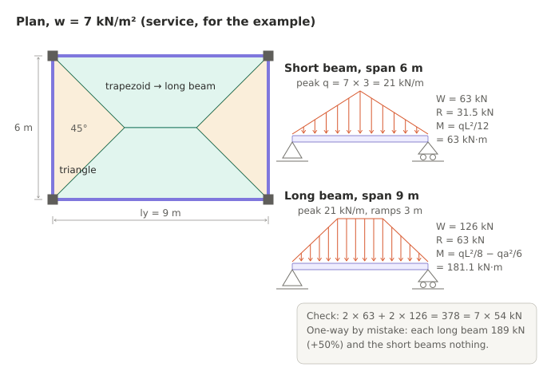

**Practice.** A square 8 × 8 m panel with 6 kN/m². Find the load, reaction and moment of each edge beam.

*Answer:* q = 24 kN/m, total 96 kN, R = 48 kN, M = 24 × 64 / 12 = 128 kN·m.

**Trap to test.** Treating a two-way panel as one-way: each long beam gets 189 kN (+50%) and the short beams nothing.

**Agent check.** Slab action: aspect ratio ly/lx ≤ 2 with supports on four sides means two-way; the beam loads must reflect it.

### 1.7 Flat plates

**Idea.** A flat plate has no beams. Load goes from the slab straight into the column, so the slab–column joint carries everything: punching shear governs, and edge columns also take an unbalanced moment. For design the panel is split into column strips (a quarter of the shorter span each side of the column line) and middle strips.

**Worked example.** 7.5 m grid, 250 mm slab (6.25 kN/m²), superimposed dead 1.5 kN/m², live 2.5 kN/m², 500 mm square columns, d = 210 mm.

- Interior column: D = 56.25 × 7.75 = 435.9 kN; L = 56.25 × 2.5 = 140.6 kN.
- Factored (1.2D + 1.6L, Module 2): qu = 13.3 kN/m².
- Critical section at d/2 from the column face (ACI 318): side 0.5 + 0.21 = 0.71 m, perimeter b0 = 2.84 m. Vu = 13.3 × (56.25 − 0.71²) = 741.4 kN. EN 1992-1-1 uses a basic control perimeter at 2d with rounded corners instead.

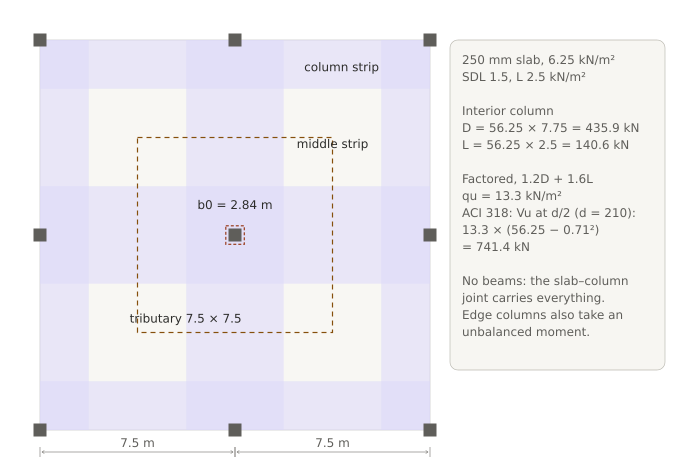

**Practice.** Find D and L for an edge column at the middle of an edge (no cantilever).

*Answer:* Area 7.5 × 3.75 = 28.125 m²: D = 218.0 kN, L = 70.3 kN, plus any cladding line load.

**Trap to test.** Designing a flat plate as if it had beams on the column lines; forgetting the unbalanced moment at edge columns.

**Agent check.** Punching load: Vu at the critical section against the tributary estimate (qu × (A − critical area)).

### 1.8 Joist slabs and composite deck: direction decides

**Idea.** Ribbed (joist) slabs and composite steel decks are one-way: the load goes along the ribs. If the rib direction is wrong in the model, the totals still balance but the wrong members carry the load.

**Worked example.** 9 × 9 m bay, beams at 3 m, deck plus concrete 4.0 kN/m².

- Correct (ribs span 3 m to the beams): beam w = 4.0 × 3 = 12 kN/m, R = 54 kN, M = 121.5 kN·m. The interior girder takes 2 × 108 kN at the third points: 216 kN, M = 108 × 3 = 324 kN·m.
- Wrong (ribs along the beams): the girder takes 4.0 × 9 = 36 kN/m, × 9 m = 324 kN (+50%), M = 364.5 kN·m, and the beams carry nothing.

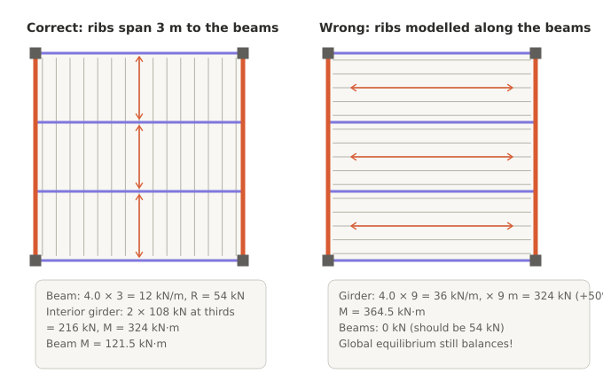

**Practice.** Beams at 2.25 m (four spaces in the 9 m bay). What line load should each beam carry, and what does it carry if the deck direction is wrong?

*Answer:* 4.0 × 2.25 = 9 kN/m; zero if the ribs are modelled parallel to the beams.

**Trap to test.** A model that passes the global equilibrium check while the deck direction is wrong.

**Agent check.** Deck and joist direction: confirm the span direction in the model against the drawings, then compare beam reactions with w × spacing × span / 2.

### 1.9 Openings, headers and tail beams

**Idea.** An opening that cuts a beam turns it into tail beams that land on headers (trimmers); the headers then deliver point loads to the beams or girders they frame into.

**Worked example.** The bay of 1.2 (D only) with a 3 × 3 m opening at x = 3 to 6 m, y = 1.5 to 4.5 m, which cuts the beam at y = 3 m. Headers at x = 3 and 6 m span 6 m from the beam at y = 0 to the beam at y = 6 m. Assumption: the 1.5 m slab strips beside the opening (y = 0 to 1.5 and 4.5 to 6 m) lose their support at y = 3 m and cantilever from the beams at y = 0 and 6 m, which needs top reinforcement over those beams. If they were made to span to the headers instead, the header loads would change.

- Tail beams (3 m): R = 19.875 × 3 / 2 = 29.81 kN at each end.
- Headers: point load 29.81 kN at midspan plus 3.375 kN/m: R = (29.81 + 3.375 × 6) / 2 = 25.03 kN.
- Beams at y = 0 and 6 m: slab tributary unchanged, plus 25.03 kN at x = 3 and 6 m. Midspan moment 201.2 → 201.2 + 25.03 × 3 = 276.3 kN·m (+37%).
- Each girder, at y = 3 m, now receives 29.81 kN instead of 89.44 kN.
- Bay check, loads: −49.5 (slab) − 10.1 (beam) + 40.5 (headers) = −19.1 kN. Reactions: 2 × (29.81 − 89.44) + 4 × 25.03 = −119.25 + 100.1 = −19.1 kN.

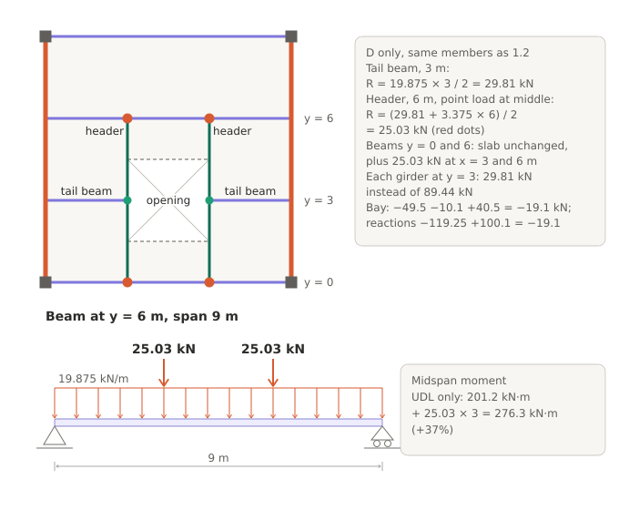

**Practice.** A 3 × 3 m opening between the beams at y = 3 and 6 m (x = 3 to 6 m) cuts no beam. How do the reactions of those two beams change?

*Answer:* Each beam loses 1.5 m of slab over 3 m: 8.25 kN/m × 3 m = 24.75 kN, so each reaction drops by 12.38 kN (the opening is central).

**Trap to test.** Keeping the cut beam as a 9 m span, or forgetting the header point loads on the beams that support them.

**Agent check.** Opening framing: every cut member has a support; header reactions appear as point loads on the receiving members.

---

## Part D. Special loads and irregular geometry

### 1.10 Cantilevers and backspans

**Idea.** A cantilever's load pivots about the support next to it. That support takes more than the total load, and the far support can lift. Check uplift with the least dead load on the backspan and the most load on the cantilever.

**Worked example.** Backspan 4 m with 5 kN/m (dead only), cantilever 2 m with 20 kN/m and 10 kN at the tip.

- ΣMB = 0: RA × 4 = 5 × 4 × 2 − 20 × 2 × 1 − 10 × 2 = −20, so RA = −5 kN (uplift).
- RB = 70 + 5 = 75 kN, more than the total 70 kN.
- MB = −(20 × 2²/2 + 10 × 2) = −60 kN·m, hogging over the whole beam.

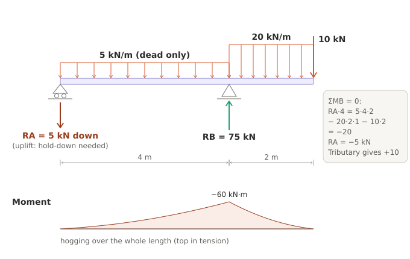

**Practice.** What backspan dead load just prevents uplift at A?

*Answer:* wb × 4 × 2 ≥ 40 + 20, so wb ≥ 7.5 kN/m.

**Trap to test.** Tributary thinking gives RA = +10 kN, an upward reaction (support in compression), and misses the hold-down.

**Agent check.** Reaction sign: every support reaction in compression unless a hold-down or tension connection is shown; flag any tension reaction without one.

### 1.11 Wall line loads and point loads

**Idea.** A partition across a one-way slab acts on each 1 m strip as a point load; along the span it concentrates on a narrow strip, so it needs a beam under it or an effective width from the governing code. Equipment loads are point loads on the members below.

**Worked example.** 1 m strip of slab, span 3 m, 5.5 kN/m², with a wall of 6 kN/m across the span at midspan: M = 5.5 × 9 / 8 + 6 × 3 / 4 = 6.19 + 4.50 = 10.69 kN·m per m (+73%). A 30 kN unit 2 m from the end of a 9 m beam: R = 23.33 and 6.67 kN, M under the load = 30 × 2 × 7 / 9 = 46.67 kN·m.

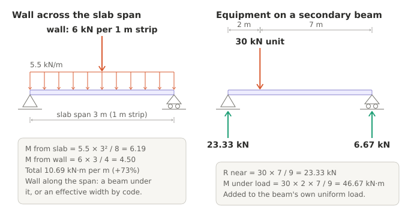

**Practice.** Move the wall to 1 m from a support. Find the wall's moment at the wall.

*Answer:* 6 × 1 × 2 / 3 = 4.0 kN·m per m.

**Trap to test.** Spreading a wall line load as a uniform area load over the whole bay.

**Agent check.** Concentrated loads: every wall, equipment pad and hanger on the drawings appears in the model at its location.

### 1.12 Indirect supports and torsion

**Idea.** A beam framing into another beam (indirect support) hangs its reaction low in the supporting beam; hanger reinforcement lifts it to the top. A load applied off the beam's centreline twists it. Two kinds of torsion matter. Equilibrium torsion is needed to hold a load up: a canopy hung off the beam falls without it, so it must be designed. Compatibility torsion comes from a slab's edge (restraint) moment twisting the beam; if the beam cracks, the twist relaxes and the slab carries more moment at midspan, so codes let it be reduced.

**Worked example.** Edge beam 300 mm wide, span 9 m, fixed against twist at both ends.

- Slab shear reaction 5.5 × 1.5 = 8.25 kN/m at the beam face, 0.15 m from the centreline: a statical torque t = 1.24 kN·m/m, T at the ends = tL/2 = 5.57 kN·m.
- Canopy 2 m × 3 kN/m² = 6 kN/m at 1.15 m on the other side: t = 6.9 kN·m/m, T = 31.05 kN·m, twisting the opposite way.
- If both always act, the net end torque is 31.05 − 5.57 = 25.48 kN·m; design for the canopy with only the slab load that is always there.
- The secondary beam reaction of 1.2 (89.44 kN) enters the girder as an indirect support.

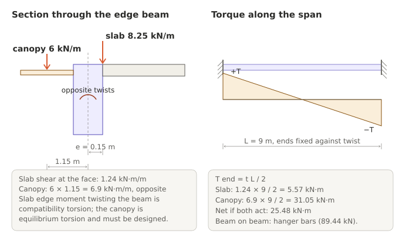

**Practice.** A 1.5 m canopy with 3 kN/m² at a lever of 0.9 m. Find t and T.

*Answer:* t = 4.5 × 0.9 = 4.05 kN·m/m; T = 4.05 × 9 / 2 = 18.2 kN·m.

**Trap to test.** Treating a hung canopy's torsion as compatibility torsion that can be neglected.

**Agent check.** Eccentric loads: for every load hung off a beam, the torque is in the model and its type (equilibrium or compatibility) is stated.

### 1.13 Irregular column grids

**Idea.** On an orthogonal but uneven grid, each column takes the area between the midlines to its neighbours. On a staggered grid, the boundary is the set of perpendicular bisectors to the neighbours (a Voronoi cell).

**Worked example.** Column lines at x = 0, 5, 12 m and y = 0, 6, 10 m. The column at (5, 6) takes (2.5 + 3.5) × (3 + 2) = 30 m²; with 7 kN/m², 210 kN.

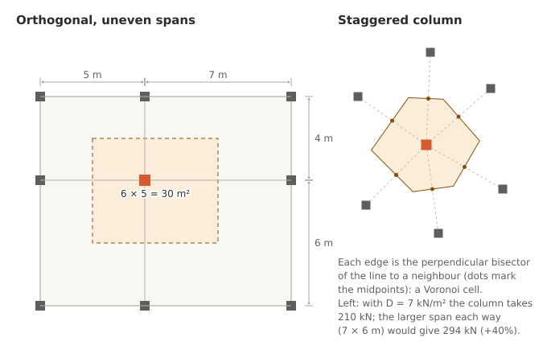

**Practice.** The column at (12, 6), where x = 12 m is the building edge. Find its area and load.

*Answer:* 3.5 × 5 = 17.5 m², 122.5 kN, plus any edge line load.

**Trap to test.** Using the larger span each way (7 × 6 m): 294 kN, 40% high.

**Agent check.** Tributary areas on irregular grids: the areas of all columns add up to the floor area.

---

## Part E. Vertical load path and foundations

### 1.14 Column load takedown

**Idea.** A column load builds up floor by floor, with the column's own weight per storey. Live load reduction (Module 2) depends on how much area the member supports; garages are a special case.

**Worked example.** Interior column of 1.2 through four parking levels, column 0.5 × 0.5 m, 3.2 m storeys (20 kN per storey).

| Column below level | Floors supported | Σ D (kN) | Σ L (kN) | Σ L reduced (kN) |
|---|---|---|---|---|
| 4 | 1 | 610.6 | 162.0 | 162.0 |
| 3 | 2 | 1221.3 | 324.0 | 259.2 |
| 2 | 3 | 1831.9 | 486.0 | 388.8 |
| 1 | 4 | 2442.5 | 648.0 | 518.4 |

In passenger-vehicle garages the general live load reduction does not apply; the IBC allows at most 20% for members supporting two or more floors, and recent ASCE 7 editions have a similar rule. Check the edition in force before using it.

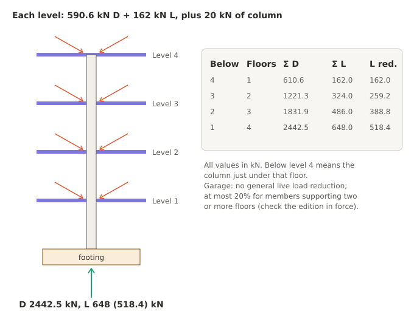

**Practice.** What is the service D + L at the footing, without and with the 20% reduction?

*Answer:* 3090.5 kN and 2960.9 kN.

**Trap to test.** Applying the general live load reduction formula to a garage column.

**Agent check.** Takedown: the column load at each level equals the sum of the floors above plus self-weight; the reduction factor matches the occupancy rules.

### 1.15 Pile caps

**Idea.** A rigid cap on equal piles shares the axial load equally and the moments by the pile coordinates: Pi = P/n ± My·xi/Σx² ± Mx·yi/Σy².

**Worked example.** Four piles at ±0.9 m, P = 3000 kN (cap weight included), My = 450 kN·m, Mx = 270 kN·m.

- P/n = 750 kN; Σx² = Σy² = 4 × 0.81 = 3.24 m².
- My: ±450 × 0.9 / 3.24 = ±125 kN. Mx: ±270 × 0.9 / 3.24 = ±75 kN.
- Piles: 950, 800, 700, 550 kN; sum 3000 kN.
- With P = 1000 kN and M = 1500 kN·m: 250 ± 416.7 kN, one row in tension (−166.7 kN).

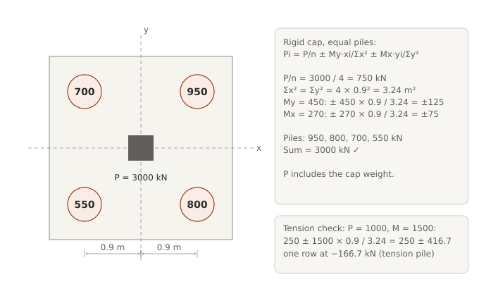

**Practice.** Six piles at x = −1.2, 0, +1.2 m and y = ±0.9 m, P = 4200 kN, My = 720 kN·m.

*Answer:* Σx² = 4 × 1.44 = 5.76 m²; 700 ± 150 kN: 850 kN (x = +1.2), 700 kN (x = 0), 550 kN (x = −1.2).

**Trap to test.** Dividing the moment by n × x instead of using Σx², or leaving out the cap weight.

**Agent check.** Pile loads: the sum equals the column load plus the cap; any tension pile is flagged with its uplift capacity.

### 1.16 Footing pressure under eccentric load

**Idea.** Inside the middle third (e ≤ B/6) the soil pressure is trapezoidal: q = P/B (1 ± 6e/B). Outside it, part of the footing lifts off and the pressure becomes triangular: q max = 2P / (3(B/2 − e)) over 3(B/2 − e). A mat follows the same idea in two directions.

**Worked example.** Strip footing B = 2 m, P = 300 kN/m.

- M = 30 kN·m/m: e = 0.1 m ≤ 0.333 m; q = 150 (1 ± 0.3) = 195 and 105 kPa.
- M = 120 kN·m/m: e = 0.4 m > 0.333 m; contact 3 × (1 − 0.4) = 1.8 m; q max = 600 / 1.8 = 333.3 kPa.

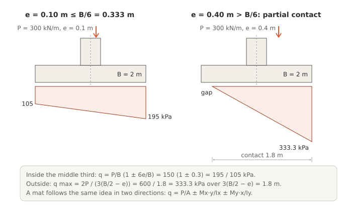

**Practice.** B = 2.4 m, P = 300 kN/m, M = 60 kN·m/m.

*Answer:* e = 0.2 m ≤ 0.4 m; q = 125 (1 ± 0.5) = 187.5 and 62.5 kPa.

**Trap to test.** Using P/B (1 ± 6e/B) when e > B/6, which gives a negative (tension) soil pressure.

**Agent check.** Footing pressure: e against B/6 is checked before the formula is chosen; q max is compared with the allowable bearing pressure from the geotechnical report, not a "typical" value.

---

## Part F. Transfer structures

### 1.17 Transfer girders

**Idea.** When a column stops, its load turns sideways into a transfer girder and then down through the columns at its ends. The girder carries large moments, its deflection lets the floors above shed load, and the construction sequence matters.

**Worked example.** A column carrying 2400 kN from four floors stops on a 12 m transfer girder (0.8 × 1.8 m, 36 kN/m), 4 m from the left support.

- Girder reactions: left 2400 × 8 / 12 + 36 × 6 = 1816 kN; right 800 + 216 = 1016 kN. The columns under the girder ends also carry the columns above them.
- M under the column = 2400 × 4 × 8 / 12 + 36 × 4 × 8 / 2 = 6400 + 576 = 6976 kN·m.

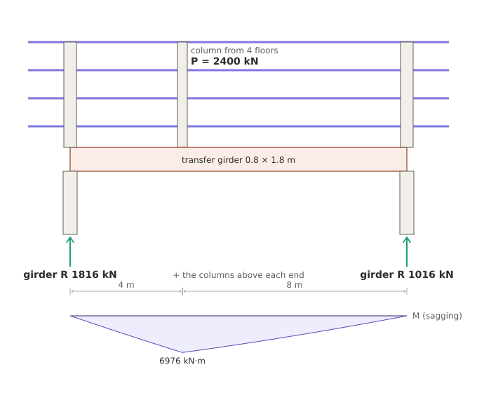

**Practice.** Move the column to midspan.

*Answer:* R = 1200 + 216 = 1416 kN each; M = 2400 × 12 / 4 + 36 × 144 / 8 = 7848 kN·m.

**Trap to test.** Sending the stopped column's load "straight down" to a column that is not there, or giving the columns below only their tributary floor load.

**Agent check.** Discontinuities: every column that stops lands on a member designed for its load; the columns below a transfer carry its reactions.

### 1.18 Transfer slabs

**Idea.** A thick transfer slab spreads a stopped column's load to several columns below. Where the load lands decides the split; a rigid-plate estimate is only a first step before a model with the slab's real stiffness, and punching governs at the landing and at the supports.

**Worked example.** 8 × 8 m bay, 1.2 m slab, 1800 kN.

- At the centre: 450 kN to each column, plus slab weight 1.2 × 25 × 64 / 4 = 480 kN per column from this bay.
- 2 m off centre (rigid plate): 1800 / 4 ± 1800 × 2 × 4 / (4 × 4²) = 450 ± 225: 675 kN near, 225 kN far.

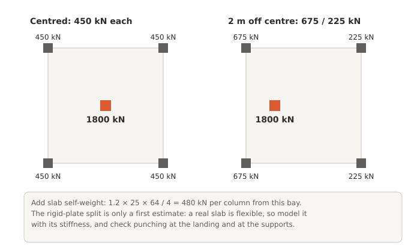

**Practice.** The load lands 2 m from the centre in both directions. Rigid-plate split?

*Answer:* 450 ± 225 ± 225: 900, 450, 450 and 0 kN.

**Trap to test.** Splitting a transfer load equally between all columns whatever its position.

**Agent check.** Transfer slab: column reactions sum to the transferred load plus slab weight; the split follows the load position.

### 1.19 Hanging floors

**Idea.** Floors hung from a roof truss send their load up through hangers in tension, across the truss and down the cores. The path reverses, so the hanger force grows towards the top.

**Worked example.** Three floors of 300 kN each hang from one hanger at the middle of a 16 m, 200 kN roof truss between two cores. Hanger tension: 300, 600 and 900 kN from the bottom up. Each core receives (900 + 200) / 2 = 550 kN.

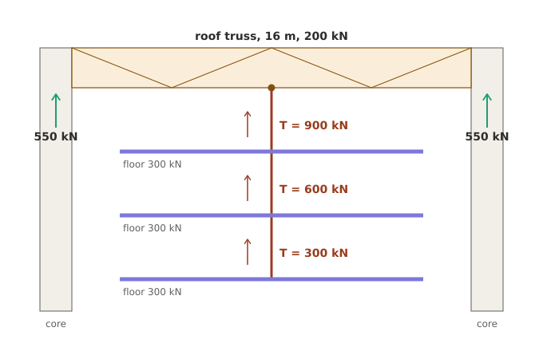

**Practice.** Four floors of 250 kN and a 300 kN truss.

*Answer:* Top hanger 1000 kN; each core (1000 + 300) / 2 = 650 kN.

**Trap to test.** Modelling the hangers as compression columns, or sending the floor loads to a foundation under the hanger that does not exist.

**Agent check.** Member force sign: hangers in tension; no load reaches a support that is not on the drawings.

### 1.20 Discontinued shear walls

**Idea.** A shear wall that stops, or shifts, must pass its shear through the diaphragm and collectors at that level and its overturning moment into the members below. ASCE 7 treats both as irregularities: a shift along the wall's own line is an in-plane discontinuity (Table 12.3-2, Type 4); a shift sideways out of the wall's plane is an out-of-plane offset (Table 12.3-1, Type 4). Either way the members that support the discontinued wall need overstrength forces (12.3.3.3; check the edition used).

**Worked example.** A 6 m wall above level 2 stops on a transfer beam; the wall below is shifted 6 m along the same line, centre to centre (an in-plane offset). Storey shear 600 kN, overturning moment at level 2 = 4800 kN·m, boundary elements 5.4 m apart.

- The level 2 diaphragm and collectors carry the 600 kN to the lower wall.
- C = T = 4800 / 5.4 = 888.9 kN on the transfer beam at the wall ends.

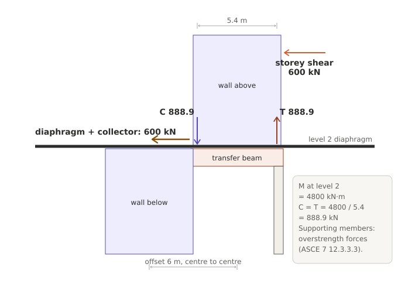

**Practice.** Boundary elements 5.0 m apart.

*Answer:* C = T = 4800 / 5.0 = 960 kN.

**Trap to test.** Treating the upper wall as if it continued to the foundation.

**Agent check.** Lateral system continuity: every wall and frame line continues to the foundation, or its transfer path (diaphragm, transfer beam, columns) is identified and designed.

---

## Part G. Lateral load path

### 1.21 Wind: facade to diaphragm to walls

**Idea.** Wind pressure acts on the cladding, which spans to the floor edges; each floor diaphragm collects its strip and delivers it to the shear walls or frames, which take it to the foundation.

**Worked example.** Storey 3.5 m, windward pressure 0.75 kPa and leeward suction 0.45 kPa (assumed), together 1.2 kPa, facade 30 m wide.

- A windward panel spanning floor to floor sees only the windward pressure: 0.75 × 3.5 / 2 = 1.31 kN/m to each floor edge (a leeward panel: 0.45 × 3.5 / 2 = 0.79 kN/m).
- Per floor, both faces together: 1.2 × 3.5 = 4.2 kN/m, × 30 m = 126 kN. Roof: half a storey, 63 kN.

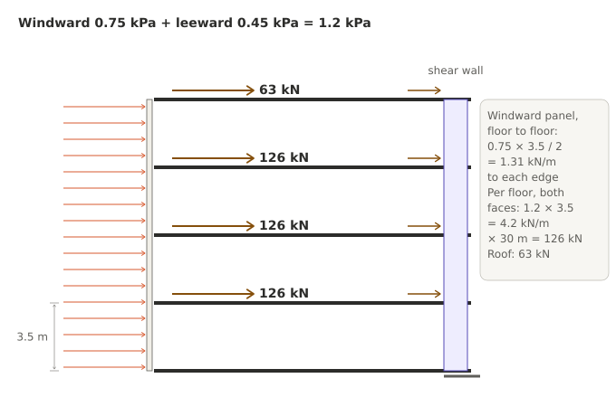

**Practice.** Storey 4.0 m, 1.0 kPa, 24 m wide.

*Answer:* 4.0 kN/m per floor (both faces), 96 kN per floor.

**Trap to test.** Applying the full storey strip at the roof; forgetting the leeward suction in the floor force; or designing a single cladding panel for the combined windward plus leeward pressure.

**Agent check.** Wind force per floor: p × storey height × width, compared with the model's floor forces.

### 1.22 Seismic: base shear up the height

**Idea.** The equivalent lateral force method spreads the base shear V over the floors: Fx = Cvx V, with Cvx = wx hx^k / Σ wi hi^k, where k = 1 for periods up to 0.5 s, k = 2 for periods of 2.5 s and more, and linear between (ASCE 7 12.8.3).

**Worked example.** Four storeys, w = 3000, 3000, 3000 and 2500 kN at h = 3.5, 7, 10.5 and 14 m, V = 900 kN, k = 1.

- Σ wh = 10,500 + 21,000 + 31,500 + 35,000 = 98,000.
- F = 96.4, 192.9, 289.3 and 321.4 kN.
- Storey shears: 321.4, 610.7, 803.6 and 900 kN.

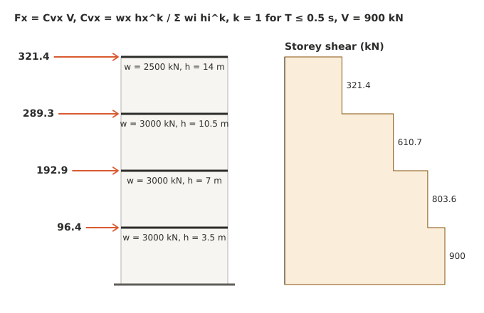

**Practice.** All four storeys weigh 3000 kN.

*Answer:* Σ wh = 105,000; F = 90, 180, 270 and 360 kN.

**Trap to test.** Spreading the base shear equally between floors, or by weight alone without height.

**Agent check.** Storey forces sum to V; the force per unit weight, Fx / wx, grows with height (the force itself can drop at a light roof).

### 1.23 Flexible against rigid diaphragms

**Idea.** A flexible diaphragm (for example timber or untopped deck) shares the floor force by tributary length. A rigid diaphragm (concrete slab) shares it by the stiffness of the walls, and if the centre of mass and the centre of rigidity do not coincide it also twists. For seismic design ASCE 7 adds an accidental eccentricity of 5% of the building dimension perpendicular to the force (12.8.4.2); recent editions use it in member design only for buildings with a torsional irregularity (Type 1a or 1b), but it is still used to check for that irregularity. For wind, ASCE 7 uses its torsional wind load cases instead. Check the edition in force.

**Worked example.** Plan 24 × 12 m, walls A, B and C at x = 0, 12 and 24 m, wall C twice as stiff (k = 1, 1, 2). Floor force 600 kN, uniform (25 kN/m).

- Flexible: A 150, B 300, C 150 kN.
- Rigid: centre of rigidity x = (0 + 12 + 48) / 4 = 15 m; centre of mass 12 m; e = 3 m; T = 600 × 3 = 1800 kN·m. J = Σk·d² = 225 + 9 + 162 = 396.
- Direct shear 150, 150, 300 kN; torsional shear 1800·k·d/J = +68.2, +13.6, −81.8 kN.
- Rigid result: A 218.2, B 163.6, C 218.2 kN (sum 600).
- Seismic, with ±5% of 24 m = ±1.2 m accidental eccentricity: envelope A 245.5, B 169.1, C 250.9 kN.

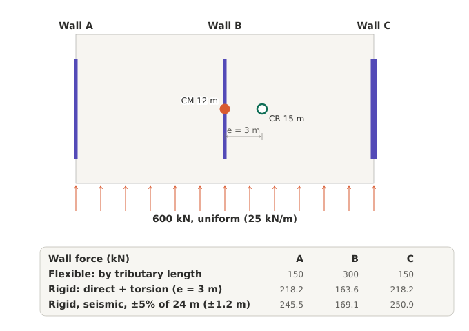

**Practice.** Make wall C as stiff as the others. Rigid split?

*Answer:* The centre of rigidity moves to 12 m, no inherent torsion: 200 kN to each wall (before accidental torsion).

**Trap to test.** Choosing flexible or rigid without checking; ignoring torsion; leaving out the accidental eccentricity.

**Agent check.** Diaphragm assumption: stated and consistent with the floor system; the wall forces add up to the floor force; torsion is included for rigid diaphragms.

### 1.24 Chords and collectors

**Idea.** A diaphragm works like a deep beam lying flat. Its edges perpendicular to the load are the chords (force = M/d): the loaded edge is in compression and the far edge in tension, and both reverse when the load does. Where a wall is shorter than the diaphragm edge, a collector (drag strut) gathers the diaphragm shear along the rest of the edge and delivers it into the wall.

**Worked example.** Diaphragm 24 m long, 12 m deep, between end walls, w = 25 kN/m.

- M = 25 × 24² / 8 = 1800 kN·m; chord force 1800 / 12 = 150 kN.
- End shear 300 kN; unit shear 300 / 12 = 25 kN/m along the end edge.
- The left wall is only 6 m long: the collector along the other 6 m carries up to 25 × 6 = 150 kN into it, and the wall takes 300 / 6 = 50 kN/m.

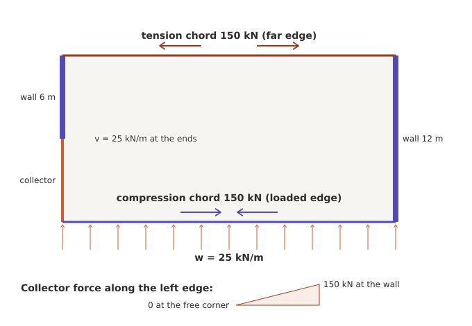

**Practice.** The 6 m wall sits in the middle of the 12 m edge. Collector force?

*Answer:* Two collectors of 3 m each, 25 × 3 = 75 kN at each end of the wall.

**Trap to test.** A wall shorter than the diaphragm edge with no collector: the load "jumps" into the wall. In ASCE 7 seismic design, collectors in higher seismic design categories need overstrength forces (12.10.2.1; check the edition).

**Agent check.** Every diaphragm edge has a continuous chord and every short wall has a collector, with forces computed.

### 1.25 Overturning, uplift and sliding

**Idea.** A shear wall takes its storey forces down to the base, where they become a base shear (sliding) and an overturning moment (a couple at the wall ends). Uplift is checked with the least dead load of the governing combination (Module 2). For wind that is 0.9D + 1.0W; for seismic forces in ASCE 7 it is (0.9 − 0.2SDS)D + ρQE, so the dead load drops further (EN 1998 uses 1.0G with the seismic action).

**Worked example.** Wall 6 m long, 14 m tall, taking half of the strength-level seismic storey forces of 1.22: 48.2, 96.4, 144.6 and 160.7 kN at 3.5, 7, 10.5 and 14 m. Dead load on the wall 1200 kN, SDS = 1.0 and ρ = 1.0 (assumed), boundary elements 5.4 m apart.

- V = 450 kN; M = Σ F·h = 4612.5 kN·m.
- Dead load factor 0.9 − 0.2 × 1.0 = 0.7: N = 840 kN.
- T = M / 5.4 − 840 / 2 = 854.2 − 420 = 434.2 kN: a hold-down is needed.
- Sliding: friction 0.5 × 840 = 420 kN < 450 kN (μ = 0.5 assumed, before any resistance or safety factor), so the base needs a shear key, dowels or passive resistance.

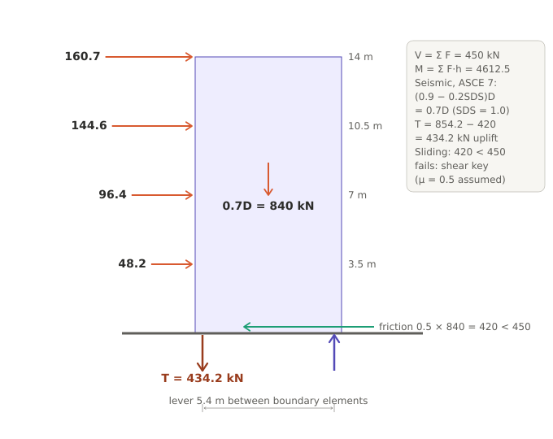

**Practice.** Dead load 1600 kN.

*Answer:* N = 0.7 × 1600 = 1120 kN; T = 854.2 − 560 = 294.2 kN, still uplift.

**Trap to test.** Using the full dead load, 1.2D, or the wind combination's 0.9D against seismic uplift; forgetting the 0.2SDS·D term.

**Agent check.** Overturning: tension at the wall ends computed with the minimum-dead combination of the load type, and a hold-down or anchorage shown for it; sliding compared with a factored resistance.

### 1.26 Diaphragm openings and re-entrant corners

**Idea.** An opening interrupts the diaphragm web; the strips above and below it act like small beams with their own (secondary) chords around the opening. At a re-entrant corner of an L or T plan the stiffness changes suddenly and the edge chord stops, so a drag strut continues it into the other wing.

**Worked example.** Diaphragm of 1.24 with a 6 × 4 m opening at mid-depth from x = 6 to 12 m.

- Shear at the centre of the opening (x = 9 m): V = 300 − 25 × 9 = 75 kN; each 4 m strip carries 37.5 kN.
- The opening-edge chords carry 37.5 × (6/2) / 4 = 28.1 kN. They run past the opening corners far enough for the diaphragm to take the force back: 28.1 / (75 / 12) = 28.1 / 6.25 = 4.5 m.
- Global chord at x = 9 m: M = 300 × 9 − 25 × 81 / 2 = 1687.5 kN·m, 1687.5 / 12 = 140.6 kN; near the opening the outer chords carry 140.6 ± 28.1 kN.

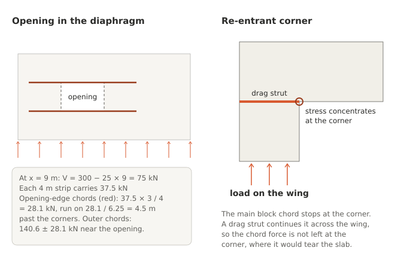

**Practice.** The opening is centred at midspan (x = 9 to 15 m). What happens to the secondary chord force from shear?

*Answer:* The shear at midspan is zero, so the shear-induced secondary chords are small; the global chord force is at its largest, 150 kN.

**Trap to test.** Leaving out the secondary chords around a stair or shaft opening near a support, where the shear is high.

**Agent check.** Openings and corners: chords and drag struts are continuous around every opening and across every re-entrant corner.

---

## Part H. Alternate load paths and construction

### 1.27 Losing a column

**Idea.** Robustness asks what happens if one member is lost. The floor above must bridge the gap through flexure, ties or catenary action, under the accidental combination of the governing standard (for example UFC 4-023-03 or EN 1991-1-7).

**Worked example.** Two 9 m spans with 20 kN/m (accidental combination, assumed).

- Before: support moment −202.5 kN·m, span moment +113.9 kN·m, end reactions 67.5 kN.
- After the middle column is lost: one 18 m span, M = 20 × 18² / 8 = 810 kN·m, end reactions 180 kN (×2.7).
- At the lost column the moment reverses, from −202.5 kN·m (hogging, top steel) to +810 kN·m (sagging), where there is little bottom steel. That is why codes ask for continuous bottom bars and ties through the columns.
- A linear static alternate-path analysis (UFC 4-023-03) also applies load-increase (dynamic) factors over the bays above the removed column; check the factors in the edition used.

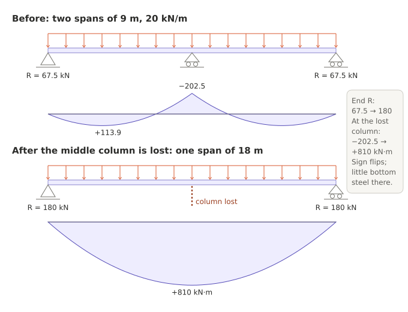

**Practice.** Two spans of 7.5 m instead.

*Answer:* After removal, M = 20 × 15² / 8 = 562.5 kN·m.

**Trap to test.** Calling a structure robust because every member passes its normal design checks.

**Agent check.** Alternate path: the removal scenarios required by the governing standard are listed and either analysed or flagged for the engineer.

### 1.28 Ties

**Idea.** Horizontal ties along every grid line, round the perimeter and into each column hold the floor together after local damage. EN 1991-1-7 Annex A gives, for framed structures, internal ties Ti = 0.8 (gk + ψqk) s L ≥ 75 kN and peripheral ties Tp = 0.4 (gk + ψqk) s L ≥ 75 kN, where ψ is ψ1 or ψ2 from the accidental combination (check the National Annex).

Annex A applies these ties from consequence class 2a up; class 2b adds vertical ties or an alternate-path check.

**Worked example.** The parking floor of 1.2: gk = 590.6 / 81 = 7.29 kN/m² (slab, beams and girders), qk = 2.0 kN/m², ψ = ψ2 = 0.6 for parking (category F; 0.7 if the National Annex uses ψ1), s = L = 9 m: gk + ψqk = 8.49 kN/m²; Ti = 0.8 × 8.49 × 81 = 550.3 kN; Tp = 0.4 × 8.49 × 81 = 275.1 kN.

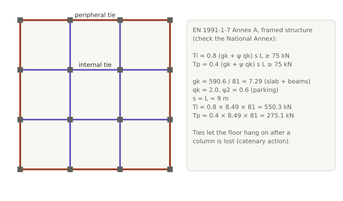

**Practice.** s = 7.5 m, L = 9 m.

*Answer:* Ti = 0.8 × 8.49 × 67.5 = 458.6 kN.

**Trap to test.** Using the 75 kN minimum as the tie force for a large bay, or taking gk as the slab alone.

**Agent check.** Ties: tie forces computed for each grid line and the reinforcement or connections that carry them identified.

### 1.29 Construction stage: shores and reshores

**Idea.** A newly cast slab is carried by shores and reshores to the slabs below, which may be young and not at full strength. In the simplified method the shores are stiff and the connected slabs share the new load equally.

**Worked example.** New slab 5.0 kN/m², formwork 0.5 kN/m², construction live 1.5 kN/m² (assumed): 7.0 kN/m², shared by two slabs below: 3.5 kN/m² each. Each supporting slab carries 5.0 + 3.5 = 8.5 kN/m², 1.7 times its self-weight and above its 7.5 kN/m² service design load. This is a single stage: following the cycles of casting, stripping and reshoring floor after floor, the classic analysis (Grundy and Kabaila, 1963) finds peaks of about twice the slab self-weight.

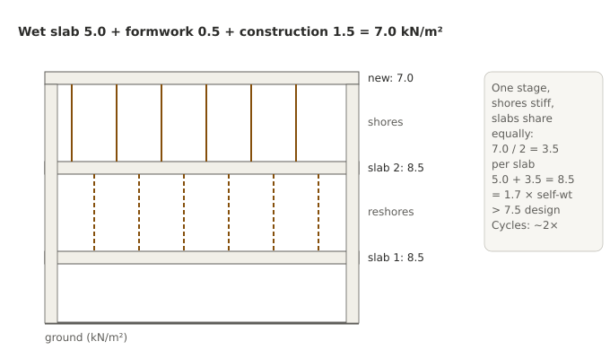

**Practice.** Three slabs share the load.

*Answer:* 7.0 / 3 = 2.33 kN/m² each; 7.33 kN/m² in total, 1.47 times the self-weight.

**Trap to test.** Assuming a slab only ever carries its design service load.

**Agent check.** Construction loads: the shoring scheme and the concrete strength at the time of loading are stated; slab loads during construction are compared with their capacity at that age.

---

## Part I. Bridges

### 1.30 Deck to girders: the lever rule

**Idea.** On a girder bridge the deck sends wheel loads to the girders. For the exterior girder the lever rule treats the deck as simply supported between the exterior and the first interior girder, with the first wheel 0.6 m (2 ft) from the barrier face and 1.8 m (6 ft) between wheels; a multiple presence factor of 1.2 applies to one loaded lane (AASHTO LRFD; check the edition).

**Worked example.** Girders at 2.5 m; barrier face 0.7 m outside the exterior girder, so the wheels are at −0.1 m and 1.7 m from it.

- Share of G1: [(2.5 + 0.1) + (2.5 − 1.7)] / 2.5 / 2 = (1.04 + 0.32) / 2 = 0.68 lane.
- With m = 1.2: 0.816 lane for strength and service.

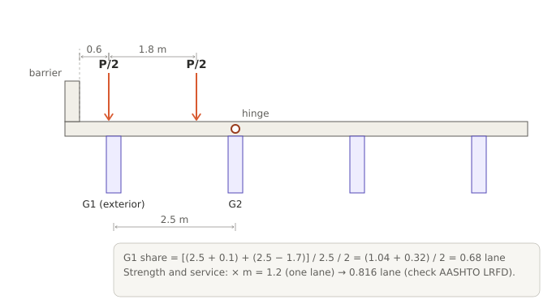

**Practice.** Girders at 3.0 m, same barrier.

*Answer:* (3.1 + 1.3) / 3 / 2 = 0.733 lane; × 1.2 = 0.88 lane.

**Trap to test.** Applying the multiple presence factor to the fatigue truck, or putting the first wheel at the barrier face.

**Agent check.** Distribution factors: the exterior girder's lever-rule value is computed and compared with the code formula; the larger governs where the code says so.

### 1.31 Bearings, piers and longitudinal forces

**Idea.** Longitudinal forces (braking, temperature, creep) go only where the bearings are fixed. Expansion bearings pass only a small force: friction for sliding bearings, the shear stiffness of the pad for elastomeric ones. A fixed bearing is usually a pin: it passes the force but no moment, so the height of the force above the bearing becomes a vertical couple on the supports, not a moment in the pier.

**Worked example.** Two spans of 30 m, expansion bearings at both abutments, a fixed (pinned) bearing on the pier. AASHTO LRFD 3.6.4 takes the greatest of 25% of the design truck (or tandem) axle weights and 5% of the truck (or tandem) plus lane load, per lane in the same direction, with the multiple presence factor, acting 1.8 m above the deck (check the edition).

- 25% case: 0.25 × 325 = 81.25 kN; 5% case: 0.05 × (325 + 9.3 × 60) = 44 kN. The 25% case governs.
- One lane, m = 1.2: BR = 97.5 kN, all to the pier bearing.
- Pier 8 m tall: M at the pier base = 97.5 × 8 = 780 kN·m. The 3.8 m from the bearing to the line of action becomes a vertical couple on the supports.

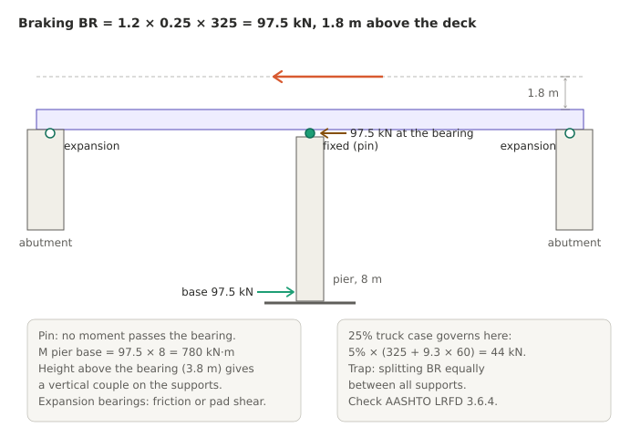

**Practice.** Pier 6 m tall.

*Answer:* M = 97.5 × 6 = 585 kN·m.

**Trap to test.** Splitting the braking force equally between all supports, or adding the force's height above a pinned bearing to the pier moment.

**Agent check.** Bearing fixity: every longitudinal force is traced to the fixed bearings shown on the drawings, with the bearing type (pin or fixed) used for the moment.

---

## Agent checks from this module

Each check is computed by a Python tool the agent calls, not recalled from memory. The flags are starting values, to be calibrated on real tasks.

| Check | Compares | Proposed flag |
|---|---|---|
| Global equilibrium | Sum of reactions against sum of applied loads, per case | Difference above 1% |
| Load completeness | Model totals against a hand estimate from areas and unit weights | Outside ±5 to 10% |
| Support stability | Model solves; reactions not all parallel or concurrent | Mechanism or singularity warning |
| Column load against tributary | Axial load per floor against the tributary estimate | Interior outside 1.0 to 1.25 with no reason |
| Load path continuity | Every member's reaction lands on a member that carries it | A member with no support |
| Slab action and direction | Two-way or one-way, deck and joist direction | Model differs from drawings |
| Reaction sign | Tension reactions | Tension with no hold-down |
| Concentrated loads | Walls, equipment, hangers, openings | A drawn load missing from the model |
| Transfers and discontinuities | Stopped columns and walls | No designed transfer path |
| Diaphragm | Rigid or flexible, torsion, chords, collectors | Assumption missing or forces missing |
| Overturning and sliding | End tension and base shear with minimum dead | Uplift with no anchorage |
| Foundation pressure | e against B/6, q against allowable | Formula outside its range; allowable assumed |

## Traps to test (not yet measured)

| Section | Trap | Status |
|---|---|---|
| 1.1 | Determinacy by counting only | Not yet tested |
| 1.4 | Tributary reactions for a continuous beam | Not yet tested |
| 1.6 | Two-way slab treated as one-way | Not yet tested |
| 1.8 | Wrong deck direction with balanced totals | Not yet tested |
| 1.10 | Uplift at the backspan support missed | Not yet tested |
| 1.14 | General live load reduction used in a garage | Not yet tested |
| 1.15 | Pile moment term divided by n × x | Not yet tested |
| 1.16 | Trapezoid formula used beyond B/6 | Not yet tested |
| 1.17 | Stopped column load sent straight down | Not yet tested |
| 1.23 | Flexible or rigid chosen without checking; torsion left out | Not yet tested |
| 1.24 | No collector into a short wall | Not yet tested |
| 1.25 | Wind 0.9D or full dead load used against seismic uplift | Not yet tested |
| 1.31 | Braking split equally between supports | Not yet tested |

## Answer keys and rubrics

Eight of these examples are written as tasks in the harness, each with a prompt, numerical checks with tolerances, a rubric item and the expert's notes: [`tasks/str-lp-*`](../../tasks/). They will be run on Claude Haiku, Sonnet and Opus and on Gemini models, and the results added to the table above.

## References to check in the edition in force

ASCE 7 (live load reduction 4.7, load combinations 2.3 and seismic combinations 2.3.6, seismic distribution 12.8.3, accidental torsion 12.8.4.2, irregularities Tables 12.3-1 and 12.3-2, supports of discontinuous walls 12.3.3.3, collectors 12.10.2.1); IBC chapter 16; ACI 318 (two-way shear critical section); EN 1992-1-1 (punching control perimeter); EN 1990 (ψ factors); EN 1991-1-7 Annex A (ties); EN 1998-1 (seismic combination); UFC 4-023-03 (progressive collapse); AASHTO LRFD Bridge Design Specifications (4.6.2.2 distribution, 3.6.1.1.2 multiple presence, 3.6.4 braking). Clause numbers only; no code text is reproduced.
