# Module 2: Loads and load combinations

*A Review Notebook for Civil Engineers to Evaluate Frontier Models*, by Saba Azadegan

Module 1 followed where load goes. This module asks how big each load is and how loads are combined: dead, live, roof, snow, rain, wind, seismic, soil, temperature and crane loads, then the strength and serviceability combinations, and finally how a load model is checked. Each section has the idea, a worked example with a figure, a practice problem with its answer, a trap to test on AI models, and the check an AI review agent should run.

**Two codes side by side.** The US side follows ASCE/SEI 7-22 (strength-level wind and seismic, LRFD combinations). The European side follows the Eurocodes (EN 1990 and EN 1991, EN 1998-1) with their recommended values; every Eurocode number here must be checked against the National Annex of the country, which can change it. Code clauses are pointers to check in the edition in force; no code text is reproduced.

**How to read the numbers.** Units are kN and m (kPa = kN/m²) unless a section says otherwise; the snow drift in 2.10 is computed in feet and pounds, as the ASCE 7-22 equation is written, and converted. Every number was computed in a script ([module-02-calc.py](module-02-calc.py)) and checked again by an independent reviewer. Values marked "assumed" are example inputs, not code values.

**The running example.** A four-storey office building, 36 × 27 m in plan on a 9 m grid (20 columns), storeys of 3.75 m, roof at 15 m, a special reinforced concrete moment frame. Its floor is the Module 1 framing (200 mm slab, beams every 3 m, girders on the grid). Section 2.25 returns to the Module 1 parking floor.

**Status of the model tests.** The traps listed here are hypotheses: errors to test on Claude and Gemini models with the [expert eval harness](https://github.com/sabaazdn73/expert-eval-harness). Results will be added with the model version and date. Until then, nothing here claims how often a model fails.

## Contents

- Part A. Dead loads: 2.1 to 2.3
- Part B. Live loads: 2.4 to 2.7
- Part C. Roof loads: roof live, snow, rain: 2.8 to 2.11
- Part D. Wind: 2.12 to 2.14
- Part E. Seismic: 2.15 to 2.18
- Part F. Other loads: 2.19 to 2.21
- Part G. Load combinations: 2.22 to 2.26
- Part H. Software and checking: 2.27 and 2.28
- Agent checks, traps to test, answer keys

---

## Part A. Dead loads

### 2.1 Dead load from the floor build-up

**Idea.** Dead load is everything permanently attached: the structure's self-weight plus the superimposed dead load (SDL) of screed, finishes, ceilings and services. Build it layer by layer from thickness × unit weight, and keep self-weight and SDL apart so that neither is counted twice or lost.

**Worked example.** Office floor of the running example: girders on the column lines in one direction, beams every 3 m in the other (on the grid lines and between them).

| Layer | Calculation | kN/m² |
|---|---|---|
| RC slab 200 mm | 0.20 × 25 | 5.00 |
| Screed 60 mm | 0.06 × 22 (assumed unit weight) | 1.32 |
| Tiles and adhesive | assumed | 0.25 |
| Ceiling and services | assumed | 0.50 |
| Slab level | 5.00 + 2.07 (SDL) | 7.07 |

- Beam webs below the slab: 0.3 × 0.45 × 25 = 3.375 kN/m every 3 m → 1.125 kN/m².
- Girder webs: 0.4 × 0.6 × 25 = 6.0 kN/m every 9 m → 0.667 kN/m².
- Average over the bay: 7.07 + 1.125 + 0.667 = 8.86 kN/m². Columns 0.5 × 0.5 m: 23.4 kN per storey.

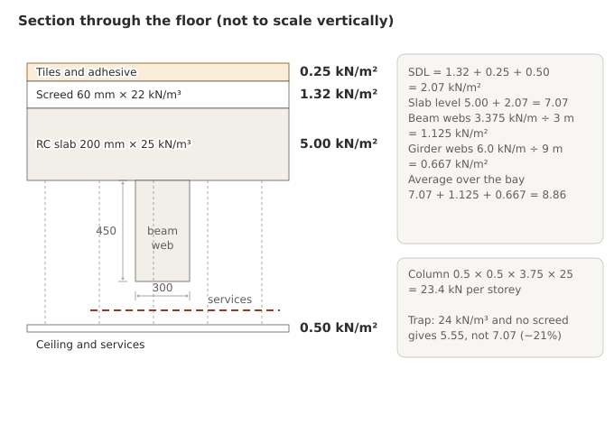

**Practice.** A 250 mm slab with 75 mm screed, the same finishes and ceiling. Slab-level dead load?

*Answer:* 6.25 + 1.65 + 0.25 + 0.50 = 8.65 kN/m².

**Trap to test.** Using 24 kN/m³ (plain concrete) and forgetting the screed: 4.80 + 0.25 + 0.50 = 5.55 kN/m², 21% low.

**Agent check.** Dead load build-up: every layer on the drawings and specification has a line in the load table, with thickness, unit weight and source; slab self-weight appears once (in the model material or in the load table, not both).

### 2.2 Partitions

**Idea.** Light movable partitions are spread as a uniform load; heavy walls are modelled where they stand. EN 1991-1-1 (6.3.1.2) turns partitions of up to 1, 2 and 3 kN/m into 0.5, 0.8 and 1.2 kN/m² of imposed load; heavier walls are taken individually. ASCE 7-22 (4.3.2) asks for at least 0.72 kN/m² of partition live load in offices, not reduced, unless the floor live load is 3.83 kN/m² or more.

**Worked example.** Office bay with light partitions of 1.6 kN/m and one masonry wall, 150 mm thick, 3.5 m high, at 18 kN/m³.

- Light partitions: 1.6 kN/m is in the ≤ 2.0 kN/m class → 0.8 kN/m² (EN). Office imposed load becomes 3.0 + 0.8 = 3.8 kN/m² (3.0 assumed office value; check the National Annex). ASCE: 2.40 kN/m² office live load (reducible) + 0.72 kN/m² partitions (never reduced).
- Masonry wall: 3.5 × 0.15 × 18 = 9.45 kN/m, above 3 kN/m → a line load in the model, as dead load.

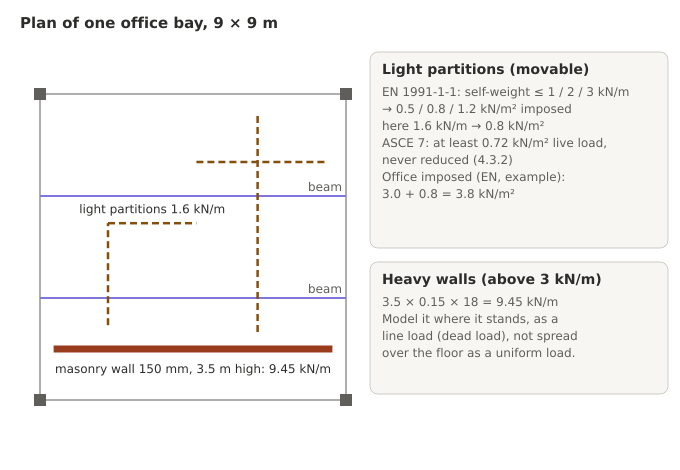

**Practice.** A blockwork partition 2.8 m high, 100 mm thick, 14 kN/m³. Uniform load or line load?

*Answer:* 2.8 × 0.10 × 14 = 3.92 kN/m, above 3 kN/m: a line load where it stands.

**Trap to test.** Spreading a heavy wall over the floor as a uniform load (the beam under it is then far under-designed), or reducing the ASCE partition load together with the live load.

**Agent check.** Partitions: the partition allowance is present on every office floor, kept outside the live load reduction, and every wall above the light-partition limit is a line load in the model.

### 2.3 Equipment, tanks and green roofs

**Idea.** Some dead loads change. A green roof is heavy when saturated and light when dry; a tank is heavy when full and light when empty. Use the heavy state where the load adds to the effect and the light state where it resists. ASCE 7-22 (3.1.4) asks for both the saturated and the dry state of vegetative roofs.

**Worked example.** A light steel-deck roof (1.0 kN/m² with insulation) with a 250 mm green roof: substrate 18 kN/m³ saturated and 11 kN/m³ dry (supplier values, assumed), drainage layer 0.3 or 0.1 kN/m². Net strength-level wind uplift on the corner zone: 3.8 kN/m².

- Saturated: D = 1.0 + 4.5 + 0.3 = 5.80 kN/m². 0.9D − W = 5.22 − 3.8 = +1.42: holds down.
- Dry: D = 1.0 + 2.75 + 0.1 = 3.85 kN/m². 0.9D − W = 3.47 − 3.8 = −0.33: the deck lifts.

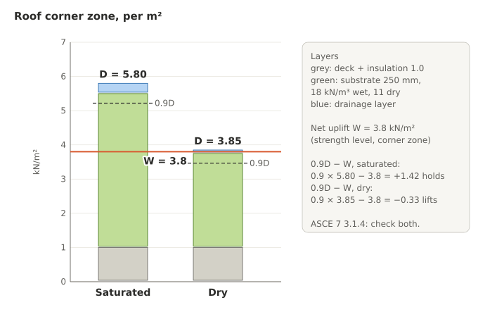

**Practice.** A 10 m³ water tank weighing 8 kN empty. What goes into the gravity check and what into the overturning check of its supports?

*Answer:* Full, 10 × 9.81 + 8 = 106.1 kN, for gravity; empty, 8.0 kN, for uplift and overturning. ASCE 7 treats the fluid (F) with the dead load factor.

**Trap to test.** Checking uplift with the saturated weight, which hides the dry case that actually governs.

**Agent check.** Variable dead loads: for each green roof, tank or ballast the model has a heavy case for gravity and a light case for uplift, sliding and overturning.

---

## Part B. Live loads

### 2.4 Occupancy loads and where they change

**Idea.** Live load depends on the use of each area, and the use changes inside a floor. ASCE 7-22 Table 4.3-1 gives 2.40 kN/m² for offices, 3.83 kN/m² for corridors above the first floor and 4.79 kN/m² for lobbies and first-floor corridors. A member that supports two uses takes each over its own tributary strip.

**Worked example.** Beam B2 has a tributary width of 3 m: 1.5 m of corridor on one side, 1.5 m of office on the other.

- All office: 3 × 2.40 = 7.20 kN/m.
- Actual: 1.5 × 2.40 + 1.5 × 3.83 = 9.35 kN/m, 30% more.

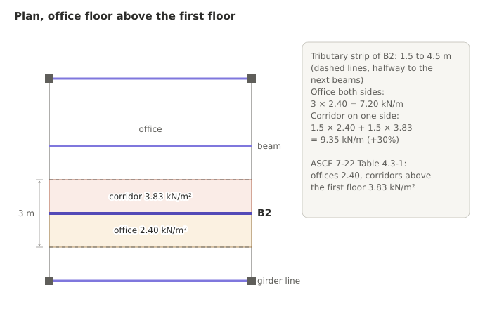

**Practice.** The corridor strip is 1.0 m and the office strip 2.0 m.

*Answer:* 2.0 × 2.40 + 1.0 × 3.83 = 8.63 kN/m.

**Trap to test.** Applying the office load to the whole floor, corridors and lobbies included.

**Agent check.** Occupancy map: the live load in the model is mapped zone by zone to the architectural plan, and each zone's value is traced to the code table or the brief.

### 2.5 Live load reduction

**Idea.** A member with a large tributary area is unlikely to see the full live load everywhere at once. ASCE 7-22 (4.7.2): L = Lo (0.25 + 4.57/√(KLL AT)) for KLL AT ≥ 37.16 m², not less than 0.50 Lo for one floor or 0.40 Lo for two or more; KLL = 4 for interior columns and 2 for interior beams. EN 1991-1-1 (6.3.1.2) uses αA = 5/7 ψ0 + A0/A (A0 = 10 m²) for floors and αn = [2 + (n − 2) ψ0]/n for columns over n storeys.

**Worked example.** Interior column, office floors, 81 m² per floor.

- Supporting one floor: KLL AT = 4 × 81 = 324 m²; 0.25 + 4.57/18 = 0.504 ≥ 0.50 → L = 0.504 × 2.40 × 81 = 98.0 kN (unreduced 194.4).
- Ground storey, supporting three office floors: KLL AT = 972 m²; 0.25 + 4.57/31.2 = 0.397 → floor 0.40 governs → L = 0.40 × 2.40 × 243 = 233.3 kN (unreduced 583.2).
- Partitions 0.72 × 243 = 175.0 kN, not reduced. Total live load on the column: 408.2 kN.
- EN, same column: αn = (2 + 1 × 0.7)/3 = 0.90 → Qk = 3.8 × 243 × 0.90 = 831.1 kN (with the 0.8 kN/m² partitions). For a floor member with A = 81 m²: αA = 0.5 + 0.12 = 0.62.

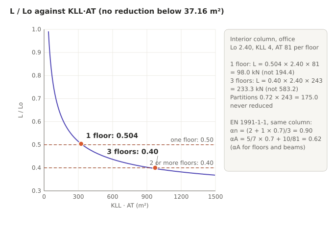

**Practice.** An edge column without a cantilever slab (KLL = 4), 40.5 m² per floor, three floors.

*Answer:* KLL AT = 486 m²; 0.25 + 4.57/22.05 = 0.457 (above 0.40) → L = 0.457 × 2.40 × 121.5 = 133.3 kN.

**Trap to test.** Reducing below the 0.40 floor; reducing the partition allowance; using KLL = 1 or forgetting it, which wrongly gives no reduction for small AT.

**Agent check.** Live load reduction: for every column and beam the agent recomputes KLL AT, the factor and the floor (0.50 or 0.40) and confirms that partitions, garages, assembly areas and loads above 4.79 kN/m² are treated by their own rules.

### 2.6 Garages and heavy loads: no reduction

**Idea.** Passenger vehicle garages (1.92 kN/m², ASCE 7-22 Table 4.3-1) may not use the reduction formula. Members supporting two or more garage floors may be reduced by 20% at most, and not below the formula value (4.7.4). Loads above 4.79 kN/m² follow the same 20% rule (4.7.3). Garages also carry a 13.35 kN wheel load on 114 × 114 mm (4.10.1) and vehicle barriers a 26.70 kN horizontal load at 460 to 686 mm above the deck (4.5.3).

**Worked example.** Interior column under three parking floors, 81 m² each.

- Allowed: 0.8 × 1.92 × 243 = 373.2 kN (unreduced 466.6 kN).
- Office formula, wrong here: 0.25 + 4.57/31.2 = 0.397 → 0.40 → 186.6 kN, half the correct value.
- Barrier: M = 26.70 × 0.686 = 18.3 kN·m at the base of the barrier; Mu = 1.6 × 18.3 = 29.3 kN·m.

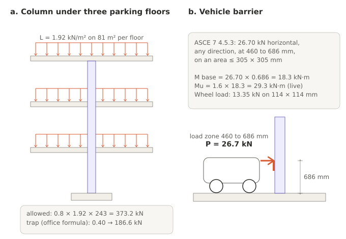

**Practice.** Interior column under two parking floors (162 m²).

*Answer:* 20% cap: 0.8 × 1.92 × 162 = 248.8 kN. The formula alone (0.43) would give 133.6 kN; the 20% limit governs.

**Trap to test.** Applying the office reduction formula to a garage column, or reducing a one-floor garage member at all.

**Agent check.** Occupancy rules: garage, assembly and heavy-storage members are flagged and checked against the 20% limit; barrier loads are present at every vehicle edge.

### 2.7 Pattern live loading

**Idea.** Live load can be on some spans and not others. In continuous members, the largest span moment comes from loading that span and every second span; the largest support moment from loading the two spans next to the support (ASCE 7-22 4.3.3, partial loading).

**Worked example.** The office secondary beam of 2.1 and 2.4 made continuous over three 9 m spans: factored dead 1.2 × 24.585 = 29.50 kN/m everywhere, factored live 1.6 × 7.2 = 11.52 kN/m where placed.

| Effect | All spans loaded | Worst pattern | Increase |
|---|---|---|---|
| End span sagging | 265.8 kN·m | 284.8 (spans 1 and 3) | +7% |
| Support B hogging | −332.3 kN·m | −347.8 (spans 1 and 2) | +5% |
| Middle span sagging | 83.1 kN·m | 129.7 (span 2 only) | +56% |

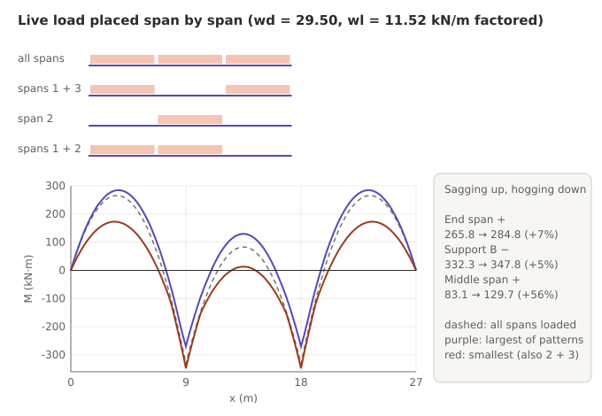

**Practice.** The same beam with a service live load of 18 kN/m (storage). End-span sagging moment, all spans against spans 1 and 3?

*Answer:* 377.8 kN·m against 425.9 kN·m, +13%. The heavier the live load relative to the dead load, the more patterns matter.

**Trap to test.** Designing the middle span of a continuous beam from the all-spans-loaded case, 36% short of the pattern value here.

**Agent check.** Pattern loading: for continuous members with live load the model contains the alternate-span and adjacent-span patterns, and the design uses their envelope.

---

## Part C. Roof loads: roof live, snow, rain

### 2.8 Roof live load

**Idea.** Ordinary roofs carry a maintenance live load of 0.96 kN/m², reduced for large areas and steep slopes: Lr = 0.96 R1 R2, between 0.58 and 0.96 kN/m² (ASCE 7-22 4.8.2). R1 = 1.2 − 0.011 AT between 18.58 and 55.74 m²; R2 = 1 for a flat roof. In EN 1990 a category H roof has ψ0 = 0: its imposed load never acts as an accompanying load.

**Worked example.** Flat roof of the running example.

- Roof beam, AT = 27 m²: R1 = 1.2 − 0.297 = 0.903 → Lr = 0.867 kN/m².
- Girder or column, AT = 81 m²: R1 = 0.6 → 0.576 → floor 0.58 kN/m².

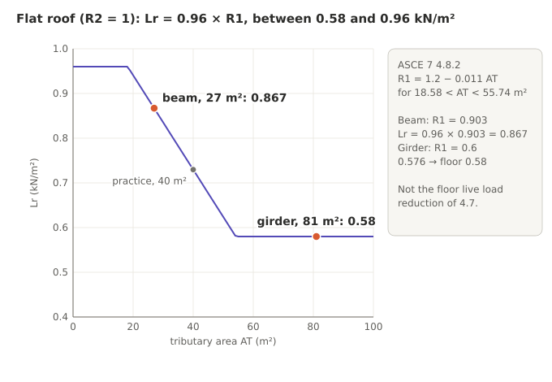

**Practice.** A member with AT = 40 m².

*Answer:* R1 = 1.2 − 0.44 = 0.76 → Lr = 0.73 kN/m².

**Trap to test.** Using the floor live load reduction of 4.7 on a roof, or going below 0.58 kN/m².

**Agent check.** Roof live load: Lr per member from its own AT and slope, within the 0.58 to 0.96 range.

### 2.9 Flat roof snow and the low-slope minimum

**Idea.** ASCE 7-22 (7.3): pf = 0.7 Ce Ct pg. For low-slope roofs there is also a minimum, pm = pg up to pm,max (1.44 kN/m² in Risk Category II), applied as a separate uniform case and not combined with drift, sliding or unbalanced loads (7.3.3). In ASCE 7-22 the ground snow load already depends on the Risk Category, so there is no separate importance factor. EN 1991-1-3: s = μ1 Ce Ct sk with μ1 = 0.8 for a flat roof.

**Worked example.** Flat roof, pg = 1.20 kN/m², Ce = Ct = 1.0, Risk Category II.

- pf = 0.7 × 1.0 × 1.0 × 1.20 = 0.84 kN/m².
- pm = pg = 1.20 kN/m² (pg ≤ 1.44): the minimum governs the uniform snow case.

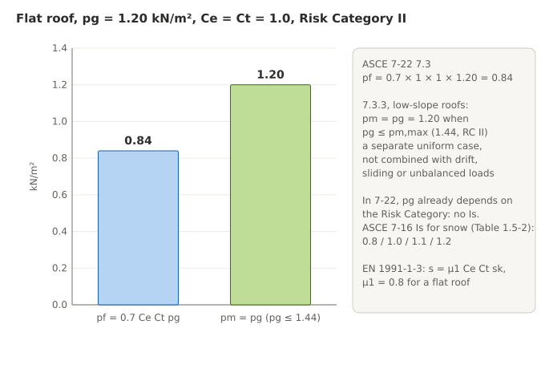

**Practice.** pg = 2.00 kN/m², Risk Category II.

*Answer:* pf = 1.40 kN/m²; pg > 1.44, so pm = pm,max = 1.44 kN/m², which still governs the uniform case by a little.

**Trap to test.** Multiplying the ASCE 7-22 snow load, whose ground snow already depends on the Risk Category, by the ASCE 7-16 snow importance factor (Table 1.5-2: 0.8, 1.0, 1.1, 1.2 for Risk Categories I to IV): on a Risk Category IV roof with pf = 0.84 kN/m², 0.84 × 1.2 = 1.01 kN/m² counts the risk twice. Or forgetting the minimum altogether.

**Agent check.** Roof snow: pf, pm and the edition are stated; pm is a separate uniform case; the ground snow value is traced to the site and Risk Category.

### 2.10 Snow drift at a roof step

**Idea.** Wind blows snow off a higher roof onto a lower one and piles it against the step. ASCE 7-22 (7.6.1 and 7.7.1) gives the drift height from the ground snow load, the upwind roof length and the site's winter wind parameter W2: hd = 1.5 √(pg^0.74 lu^0.70 W2^1.7 / γ), in feet and psf, with γ = 0.13 pg + 14 ≤ 30 pcf. The drift is a triangle on top of the balanced snow.

**Worked example.** pg = 30 psf (1.44 kN/m²), upper roof 100 ft (30.5 m) long, lower roof 60 ft (18.3 m), step 8 ft (2.44 m), W2 = 0.45 (assumed; in practice the site value from the ASCE hazard tool).

1. γ = 0.13 × 30 + 14 = 17.9 pcf (2.81 kN/m³).
2. Leeward drift: hd = 1.5 √(30^0.74 × 100^0.70 × 0.45^1.7 / 17.9) = 3.17 ft, below the cap of 0.6 × 60 = 36 ft. Windward drift (lower roof length, × 0.75): 1.99 ft. Leeward governs: hd = 3.17 ft = 0.97 m.
3. Balanced snow on the lower roof: pf = 0.7 × 30 = 21 psf (1.01 kN/m²), hb = 21/17.9 = 1.17 ft. Clear height hc = 8 − 1.17 = 6.83 ft > hd, so w = 4 hd = 12.7 ft = 3.87 m.
4. Surcharge at the wall: pd = hd γ = 56.8 psf = 2.72 kN/m². Peak at the step: 21 + 56.8 = 77.8 psf = 3.72 kN/m².

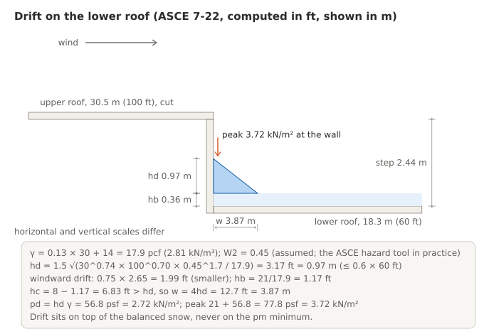

**Practice.** The same roofs at a windier site, W2 = 0.55.

*Answer:* hd = 3.76 ft (1.15 m), still below hc; w = 15.0 ft; pd = 67.4 psf = 3.22 kN/m².

**Trap to test.** Using the ASCE 7-16 drift equation (no W2) with ASCE 7-22 inputs, putting the drift on top of the pm minimum, or entering SI values into an equation written in feet and psf.

**Agent check.** Drifts: every roof step, parapet and rooftop unit is listed with lu, hc, hd, w and pd; the unit system of each equation is stated.

### 2.11 Rain and ponding

**Idea.** If the primary drains block, water rises to the overflow, flows over it and gathers where the roof deflects. ASCE 7-22 (8.2): R = 0.0098 (ds + dh + dp) kN/m², depths in mm: static head to the secondary inlet, hydraulic head over it, and ponding head from the roof deflection.

**Worked example.** Secondary inlet 75 mm above the roof (ds), hydraulic head 25 mm from the overflow calculation (dh), ponding head 15 mm from the deflection analysis (dp).

- R = 0.0098 × (75 + 25 + 15) = 1.13 kN/m². The static head alone gives 0.74 kN/m².

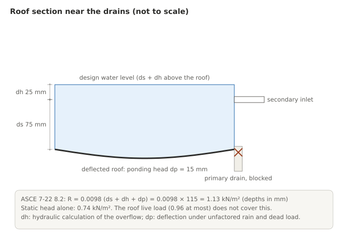

**Practice.** ds = 100 mm, dh = 30 mm, dp = 20 mm.

*Answer:* 0.0098 × 150 = 1.47 kN/m².

**Trap to test.** Designing a flat roof for the roof live load only (at most 0.96 kN/m²) when the rain load is higher, or leaving out dh and dp.

**Agent check.** Rain: the drain layout, overflow height and the three heads are stated, and the rain load is compared with roof live and snow loads.

---

## Part D. Wind

### 2.12 Velocity pressure

**Idea.** Both codes turn a wind speed into a pressure that grows with height. ASCE 7-22 (26.10): qz = 0.613 Kz Kzt Ke V² (N/m², V in m/s), with Kz = 2.41 (z/zg)^(2/α) (Exposure C: α = 9.8, zg = 750 m) and Kd moved into the pressure equation. The mapped V is strength level, so the load factor on W is 1.0. EN 1991-1-4: qp(z) = [1 + 7 Iv(z)] × ½ ρ vm(z)², with vm = cr(z) vb, cr = kr ln(z/z0), Iv = 1/ln(z/z0); qp is characteristic, so the load factor is 1.5.

**Worked example.** z = 15 m.

- ASCE, V = 46 m/s (assumed), Exposure C, Kzt = Ke = 1: Kz = 2.41 (15/750)^(2/9.8) = 1.085; qz = 0.613 × 1.085 × 46² = 1.41 kPa; with Kd = 0.85, 1.20 kPa.
- EN, vb = 27 m/s (assumed), terrain category III (z0 = 0.3 m): kr = 0.19 (0.3/0.05)^0.07 = 0.215; cr = 0.215 ln 50 = 0.843; vm = 22.75 m/s; Iv = 0.256; qp = (1 + 7 × 0.256) × 0.5 × 1.25 × 22.75² = 0.90 kPa; × 1.5 = 1.35 kPa at ultimate.

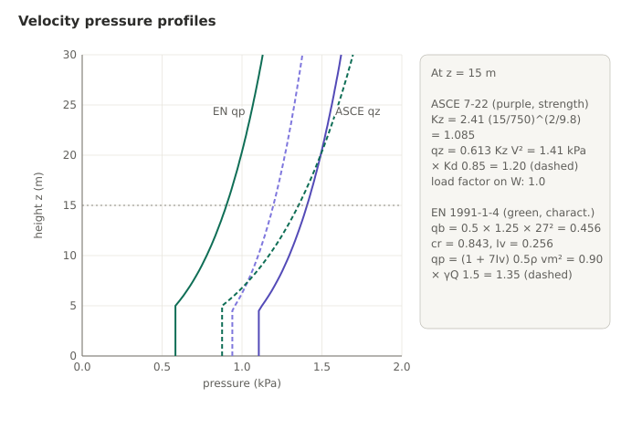

**Practice.** z = 30 m.

*Answer:* ASCE: Kz = 1.249, qz = 1.62 kPa. EN: qp = 1.13 kPa.

**Trap to test.** Multiplying ASCE 7-22 wind by 1.6 as if it were a service-level load, or using a Eurocode characteristic pressure with a factor of 1.0.

**Agent check.** Wind basis: the edition, the basic wind speed and its basis (strength or characteristic), exposure or terrain category and the load factor applied are stated together.

### 2.13 Pressures on the main system

**Idea.** For the main wind force resisting system of an enclosed building, ASCE 7-22 (27.3.1) gives p = q Kd G Cp − qi Kd (GCpi): windward Cp = 0.8 with qz, leeward Cp from L/B (−0.5 up to L/B = 1) with qh, G = 0.85 for a rigid building (26.11.1). Internal pressure acts on all inside faces and cancels in the overall force. Below 4.6 m, Kz is taken at 4.6 m (Table 26.10-1).

**Worked example.** Wind on the 36 m face (B = 36 m, L = 27 m, L/B = 0.75), h = 15 m, V = 46 m/s, Exposure C.

| Level (m) | Windward (kPa) | Leeward (kPa) | Storey height (m) | Force (kN) |
|---|---|---|---|---|
| 3.75 | 0.64 | 0.51 | 3.75 | 154.9 |
| 7.5 | 0.71 | 0.51 | 3.75 | 163.9 |
| 11.25 | 0.77 | 0.51 | 3.75 | 172.1 |
| 15 | 0.81 | 0.51 | 1.875 | 89.2 |
| Ground-storey shear | | | | 580.1 |

Each level takes the strip half a storey above and below it, with the windward pressure at the level height; leeward = 1.41 × 0.85 × 0.85 × 0.5 = 0.51 kPa. The bottom half storey (77.4 kN) goes straight into the foundation, so the total on the building is 657.5 kN.

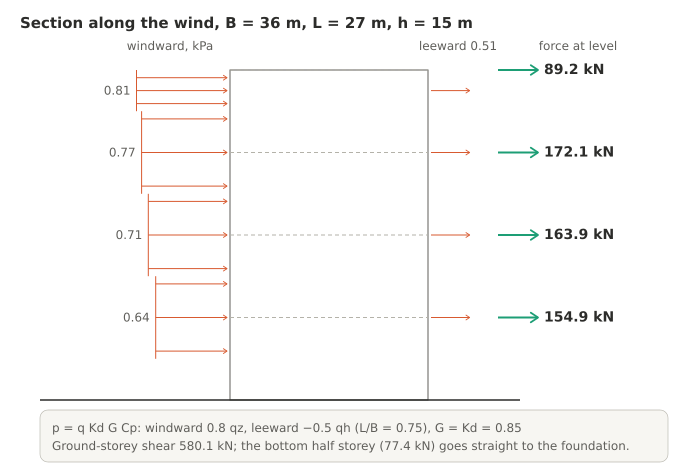

**Practice.** Wind on the 27 m face (B = 27 m, L/B = 1.33).

*Answer:* Leeward Cp = −0.5 + 0.33 × 0.2 = −0.433 (interpolated between L/B = 1 and 2) → 0.44 kPa; base shear 411.1 kN.

**Trap to test.** Using qz instead of qh on the leeward wall, or taking leeward Cp = −0.5 for every L/B.

**Agent check.** Wind on the main system: both directions computed, Cp from the right L/B for each, and the base shear compared with the seismic base shear (Section 2.17).

### 2.14 Internal pressure and enclosure

**Idea.** Internal pressure does not change the overall wind force, but it changes the net pressure on each wall and roof panel. An enclosed building has GCpi = ±0.18; a partially enclosed one, with large openings on one face, ±0.55 (ASCE 7-22 Table 26.13-1). For each surface, take the sign that makes the net larger.

**Worked example.** Leeward wall of the running example, qh = 1.41 kPa, Kd = G = 0.85.

- Enclosed: p = 1.41 × 0.85 × (0.85 × −0.5 − 0.18) = −0.72 kPa (external only: −0.51 kPa).
- Partially enclosed, a large door open on the windward wall: 1.41 × 0.85 × (−0.425 − 0.55) = −1.17 kPa, 61% more.

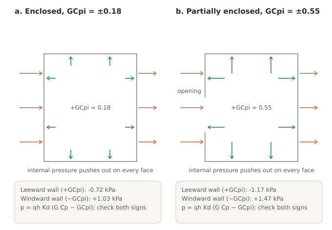

**Practice.** Windward wall at 15 m, partially enclosed.

*Answer:* 1.41 × 0.85 × (0.68 + 0.55) = 1.47 kPa with −GCpi (enclosed: 1.03 kPa). With the door open on this same wall the internal pressure is positive and the net is only 0.16 kPa, but the opening can face any wind direction, so both signs are checked and 1.47 kPa is the design value.

**Trap to test.** Classifying a building with large doors (loading docks, hangars, car parks with shutters) as enclosed.

**Agent check.** Enclosure: opening areas per wall are compared with the enclosure criteria, and the GCpi used is stated with that classification.

---

## Part E. Seismic

### 2.15 Design response spectrum

**Idea.** The design spectrum gives the acceleration a structure feels against its period. ASCE 7-22 two-period spectrum (11.4.5.2): rising to SDS at T0 = 0.2 SD1/SDS, flat to TS = SD1/SDS, then SD1/T, and SD1 TL/T² beyond TL. EN 1998-1: the elastic spectrum has a plateau of 2.5 ag S between TB and TC; the design spectrum divides it by the behaviour factor q.

**Worked example.** ASCE: SDS = 0.80 g, SD1 = 0.40 g (site values, assumed), TL = 8 s. EN: Type 1, ground type B (S = 1.2, TB = 0.15 s, TC = 0.5 s, TD = 2.0 s), ag = 0.20 g, q = 3.9 (assumed).

- ASCE: T0 = 0.10 s, TS = 0.50 s, plateau 0.80 g; at T = 0.533 s, Sa = 0.40/0.533 = 0.75 g.
- EN: elastic plateau 2.5 × 0.20 × 1.2 = 0.60 g; design plateau 0.60/3.9 = 0.154 g.

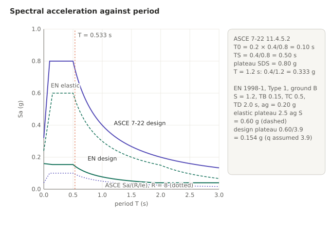

**Practice.** T = 1.2 s.

*Answer:* ASCE: 0.40/1.2 = 0.333 g. EN design: 0.154 × 0.5/1.2 = 0.064 g.

**Trap to test.** Reading SDS off the plateau for a period beyond TS, or comparing the EN design spectrum (already divided by q) with the ASCE design spectrum (still to be divided by R/Ie, the dotted curve in the figure).

**Agent check.** Spectrum: site parameters, site class or ground type, and the period used are stated, and the spectral value is recomputed from them.

### 2.16 Seismic weight

**Idea.** The seismic weight W is what the ground has to shake: the dead load plus some other loads. ASCE 7-22 (12.7.2): 25% of storage live load, partitions (actual or at least 0.48 kN/m²), operating equipment, 15% of the snow where pf > 2.16 kN/m², landscaping and stored fluids. Ordinary office live load is not included, and garage live load need not be. EN 1998-1 uses G + ψE Q, with ψE = φ ψ2.

**Worked example.** Running example, 972 m² per floor.

| Item, one floor level | kN |
|---|---|
| Slab and beams, 972 × 8.862 | 8,613.5 |
| Partitions, 0.48 × 972 | 466.6 |
| Columns, 20 × 23.44 | 468.8 |
| Facade, 126 m × 3.75 m × 0.8 kN/m² (assumed) | 378.0 |
| Floor level total | 9,926.8 |

Roof: 972 × 8.292 (roof build-up 6.5 kN/m² plus beams) + 234.4 (half storey of columns) + 189.0 (half facade) + 150 (equipment, assumed) = 8,632.9 kN. Snow: pf = 0.84 < 2.16, none. W = 3 × 9,926.8 + 8,632.9 = 38,413 kN.

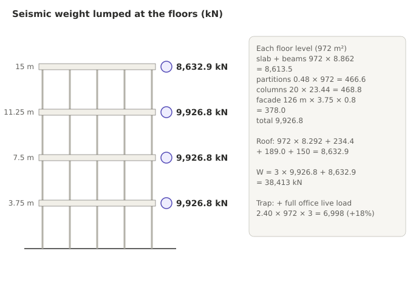

**Practice.** Level 2 has a 200 m² storage room with 6.0 kN/m². Does it go into W?

*Answer:* 25% × 6.0 × 200 = 300 kN, 3.0% of that level's 9,926.8 kN. Exception (a) of 12.7.2 lets it out when such items add no more than 5% at that level.

**Trap to test.** Adding the full office live load (+6,998 kN, +18%), or leaving out partitions and facade.

**Agent check.** Seismic mass: the mass source in the software is listed (which cases, which factors) and its total is compared with a hand estimate of W.

### 2.17 Base shear by the equivalent lateral force method

**Idea.** V = Cs W. ASCE 7-22 (12.8.1.1, Method 2): Cs = SDS/(R/Ie), not more than SD1/(T R/Ie) and not less than 0.044 SDS Ie ≥ 0.01 (more where S1 ≥ 0.6). The period is Ta = Ct hn^x (12.8.2.1); a computed period may be used up to Cu Ta. Forces go up the height in proportion to wx hx^k (12.8.3), k from 1 to 2 with the period.

**Worked example.** Special RC moment frame, R = 8 (Table 12.2-1; confirm in the edition used), Ie = 1.0, hn = 15 m.

1. Ta = 0.0466 × 15^0.9 = 0.533 s (concrete moment frame).
2. Cs = 0.80/8 = 0.100; cap 0.40/(0.533 × 8) = 0.0938; floor 0.044 × 0.80 = 0.035 → Cs = 0.0938.
3. V = 0.0938 × 38,413 = 3,602 kN, 6.2 times the wind base shear of 2.13.
4. k = 1 + (0.533 − 0.5)/2 = 1.017. Forces: 373.8, 756.2, 1,141.9 and 1,330.4 kN at 3.75, 7.5, 11.25 and 15 m.

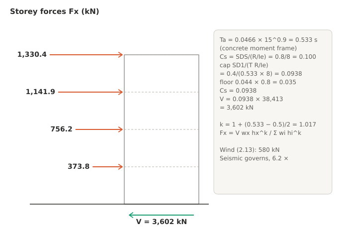

**Practice.** A modal analysis gives T = 0.9 s. What Cs?

*Answer:* T is capped at Cu Ta = 1.4 × 0.533 = 0.746 s (SD1 = 0.40) → Cs = 0.40/(0.746 × 8) = 0.0670, V = 2,573 kN.

**Trap to test.** Using a computed period above Cu Ta, or stopping at SDS/(R/Ie) without the SD1/T cap.

**Agent check.** Base shear: Ta, the period actually used, each Cs bound and W are listed, and V is recomputed; the model base shear is compared with it.

### 2.18 Vertical seismic effect and overstrength

**Idea.** ASCE 7-22 adds a vertical effect Ev = 0.2 SDS D (12.4.2.2): it increases dead load in combination 6 and reduces it in combination 7. Elements that must stay elastic, such as collectors and columns under discontinuous walls, use the overstrength factor Ω0 on the horizontal effect (12.4.3).

**Worked example.** Ground-storey interior column: D = 2,918.8 kN, L = 408.2 kN (233.3 reduced office + 175.0 partitions), companion S = 0.84 × 81 = 68.0 kN, QE = ±250 kN from the frame analysis (assumed), SDS = 0.8, ρ = 1.0 (assumed, 12.3.4).

- Ev = 0.2 × 0.8 × 2,918.8 = 467.0 kN.
- Combination 6: 1.36 × 2,918.8 + 250 + 0.5 × 408.2 + 0.15 × 68.0 = 4,433.8 kN (0.5L allowed: office).
- Combination 7: 0.74 × 2,918.8 − 250 = 1,909.9 kN, still compression.
- With Ω0 = 3, for illustration only (this column carries no discontinuous element): 4,933.8 kN and 1,409.9 kN.

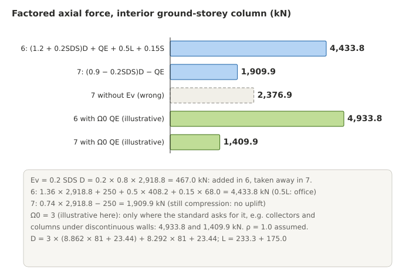

**Practice.** SDS = 1.2 g.

*Answer:* Combination 6: 1.44 × 2,918.8 + 250 + 204.1 + 10.2 = 4,667.3 kN; combination 7: 0.66 × 2,918.8 − 250 = 1,676.4 kN.

**Trap to test.** Leaving Ev out of combination 7 (2,376.9 kN here, 467 kN too high, unconservative for uplift and tension), or applying Ω0 to members that do not need it.

**Agent check.** Seismic combinations: Ev is in both 6 and 7 with the right sign, and Ω0 is applied exactly where the standard requires it.

---

## Part F. Other loads

### 2.19 Soil and water pressure on basement walls

**Idea.** ASCE 7-22 (3.2.1) asks for at-rest pressure on walls restrained at the top, buoyant soil weight plus full hydrostatic pressure below the water table, and the lateral soil loads of a geotechnical report approved by the authority, or the minimum values of Table 3.2-1 where there is none. For normally consolidated soil K0 ≈ 1 − sin φ′; compacted or overconsolidated backfill can exceed it. The strength combinations add H with 1.6 where it adds to the effect (2.3.1).

**Worked example.** Wall 3.5 m high, propped by the ground floor slab. From the geotechnical report (assumed values): soil 18 kN/m³ (20 kN/m³ saturated), φ′ = 30°, design water table 2.0 m below the top, surcharge 10 kPa. (K0 γ = 9.0 kN/m² per m; without a report, Table 3.2-1 sets at least 9.43 for the best soils.)

1. K0 = 1 − sin 30° = 0.5.
2. At the water table: 0.5 × 18 × 2.0 = 18.0 kPa (23.0 with the surcharge). At the base: 18.0 + 0.5 × (20 − 9.81) × 1.5 = 25.6 kPa.
3. Water at the base: 9.81 × 1.5 = 14.7 kPa. Surcharge: 0.5 × 10 = 5.0 kPa over the full height. Total at the base: 45.4 kPa.
4. Force per metre: soil 50.7 + water 11.0 + surcharge 17.5 = 79.3 kN (factored 1.6: 126.8 kN).
5. Basement slab: factored uplift 1.6 × 14.7 = 23.5 kPa against 0.9 × 0.3 × 25 = 6.75 kPa of slab. The slab is designed to span the net 16.8 kPa upward to the foundations, and the whole building is checked against buoyancy with 0.9D; anchors or pressure relief are alternatives.

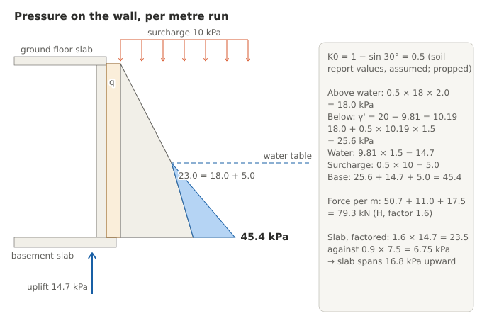

**Practice.** The water table rises to the top of the wall.

*Answer:* Base pressure 0.5 × 10.19 × 3.5 + 9.81 × 3.5 + 5.0 = 57.2 kPa; force 108.8 kN per metre.

**Trap to test.** Using active pressure (Ka = 0.33) for a propped wall, or leaving out the water pressure: with the moist unit weight over the full height the base pressure is 36.5 kPa, with the saturated weight below the water table 38.0 kPa, both well below 45.4.

**Agent check.** Retaining pressures: wall restraint (active or at rest), design water level and surcharge are stated, and the buoyancy check uses the lowest dead load.

### 2.20 Temperature and shrinkage restraint

**Idea.** A long concrete frame shortens as it cools and shrinks. If the end columns hold it, they take shear and bending. ASCE 7-22 (2.3.4) leaves the factor on T to the engineer, not less than 1.0; expansion joints limit the length that moves.

**Worked example.** Frame 60 m long, cooling ΔT = 25 °C (assumed), α = 10 × 10⁻⁶ /°C; end columns 500 × 500 mm, 3.75 m high, fixed at both ends, E = 30,000 MPa.

- Free shortening 15 mm, so each end moves 7.5 mm toward the middle.
- Column stiffness 12EI/h³ = 35.6 kN/mm uncracked; about half when cracked, 17.8 kN/mm (assumed).
- V = 17.8 × 7.5 = 133 kN; M = V h/2 = 250 kN·m in each end column. This is an upper bound: fixed at both ends against a rigid floor, with no creep. Creep relaxes the restraint over time (effective stiffness well below half), while shrinkage, often of the same order as ΔT, adds to the shortening.

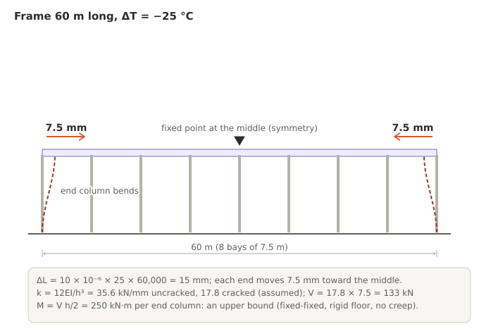

**Practice.** An expansion joint at the middle.

*Answer:* Each 30 m part moves 3.75 mm at its ends: V = 66.7 kN.

**Trap to test.** Ignoring restraint in a long frame, or computing it with uncracked stiffness and a single temperature drop, without shrinkage and creep, which can mislead in either direction.

**Agent check.** Long structures: the length between joints is compared with the project's limit, and if there is no joint, restraint forces in the end bays are computed and stated.

### 2.21 Cranes and impact

**Idea.** Crane wheel loads are increased for vertical impact, and the runway also takes lateral and longitudinal forces. ASCE 7-22: vertical impact 25% for powered monorails and bridge cranes of service class D, E or F, 10% for class A, B or C, 0% for hand-geared cranes (4.9.3); lateral force 20% of the rated capacity plus trolley and hoist (4.9.4); longitudinal force 10% of the maximum wheel loads (4.9.5).

**Worked example.** Bridge crane, rated 100 kN, trolley and hoist 20 kN, maximum wheel load 90 kN, two wheels per runway.

- Vertical: class B, 90 × 1.10 = 99 kN; class D, 90 × 1.25 = 112.5 kN per wheel.
- Lateral: 0.20 × 120 = 24 kN; 12 kN per runway (equal stiffness assumed), 6 kN per wheel.
- Longitudinal: 0.10 × 90 = 9 kN per wheel.

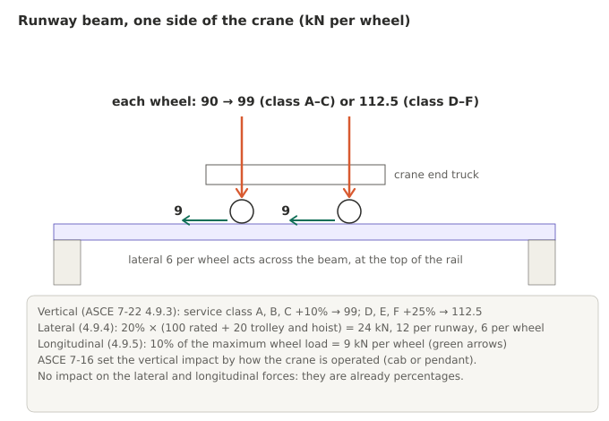

**Practice.** Rated 200 kN, trolley and hoist 30 kN, four wheels in total.

*Answer:* Lateral 0.20 × 230 = 46 kN, 11.5 kN per wheel.

**Trap to test.** Using the ASCE 7-16 rule (impact by operation: cab or pendant) with an ASCE 7-22 design, or adding impact to the lateral and longitudinal forces.

**Agent check.** Crane loads: service class, rated capacity, trolley weight and wheel loads come from the crane supplier's data, with each percentage traced to its clause.

---

## Part G. Load combinations

### 2.22 ASCE 7-22 strength combinations

**Idea.** ASCE 7-22 (2.3.1): 1a 1.4D; 2a 1.2D + 1.6L + (0.5Lr or 0.3S or 0.5R); 3a 1.2D + (1.6Lr or 1.0S or 1.6R) + (L or 0.5W); 4a 1.2D + 1.0W + L + (0.5Lr or 0.3S or 0.5R); 5a 0.9D + 1.0W. L may be 0.5L in 3a and 4a where Lo ≤ 4.78 kN/m², except garages and public assembly (Exception 1). As a companion in 2a and 4a, S is the balanced pf or ps (Exception 2). ASCE 7-16 used 1.6S and 0.5S here.

**Worked example.** Ground-storey interior column: D = 2,918.8, L = 408.2, Lr = 0.58 × 81 = 47.0, S as principal = pm × 81 = 97.2, S as companion = pf × 81 = 68.0, W = ±150 kN (frame analysis, assumed). Rain is left out here; if this roof had the drainage of 2.11 (R = 1.13 kN/m²), 0.5R = 45.6 kN and 1.6R = 146.1 kN would govern the brackets: 2a 4,201.3, 3a 3,852.7, 4a 3,902.3 kN.

| Combination | kN |
|---|---|
| 1a 1.4D | 4,086.3 |
| 2a 1.2D + 1.6L + 0.5Lr | 4,179.2 (governs) |
| 3a 1.2D + 1.0S + 0.5L | 3,803.8 |
| 4a 1.2D + 1.0W + 0.5L + 0.5Lr | 3,880.1 |
| 5a 0.9D − 1.0W | 2,476.9 (least compression) |

ASD (2.4.1), for foundations sized by allowable soil pressure: D + L = 3,327.0 kN; 0.6D − 0.6W = 1,661.3 kN.

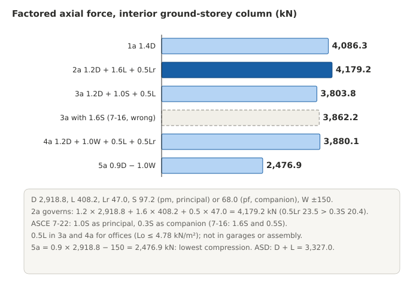

**Practice.** Roof beam on a heavy-snow site, pg = 2.4 kN/m²: D = 6.5 × 3 + 3.375 = 22.875 kN/m, Lr = 0.867 × 3 = 2.60 kN/m. Combination 3a?

*Answer:* pf = 1.68 > pm = 1.44, so S = 1.68 × 3 = 5.04 kN/m; 1.6Lr = 4.16 < 5.04; 3a = 1.2 × 22.875 + 5.04 = 32.49 kN/m. With the old 1.6S it would be 35.51 kN/m, 9% more.

**Trap to test.** Using ASCE 7-16 snow factors (1.6S, 0.5S) with ASCE 7-22 snow loads (3a becomes 3,862.2 kN here), or 0.5L in a garage.

**Agent check.** Combinations: the edition is stated, every combination is listed with its factors, and the governing result for each effect (maximum and minimum) is identified.

### 2.23 Eurocode: expression 6.10 against 6.10a and 6.10b

**Idea.** EN 1990 (6.4.3.2, Table A1.2(B)) allows either 6.10: 1.35 Gk + 1.5 Qk,1 + 1.5 Σ ψ0,i Qk,i, or the less favourable of 6.10a: 1.35 Gk + 1.5 ψ0,1 Qk,1 + 1.5 Σ ψ0,i Qk,i and 6.10b: ξ 1.35 Gk + 1.5 Qk,1 + 1.5 Σ ψ0,i Qk,i with ξ = 0.85. The National Annex chooses. Recommended ψ0: office 0.7, snow 0.5 (most sites; the Annex may differ, for example at altitude), wind 0.6. EN 1991-1-1 does not allow the storey reduction αn and ψ0 on the same imposed load; this module applies that wherever ψ0 multiplies the imposed load (check 3.3.1(2) and 6.2.2(2) in the edition used).

**Worked example.** The same column: Gk = 2,918.8 kN; imposed load 3.8 × 243 = 923.4 kN, or 831.1 kN with αn = 0.90; snow 0.8 × 1.0 × 81 = 64.8 kN (sk = 1.0 kN/m², assumed); wind 100 kN (characteristic, assumed). Imposed load leading:

- 6.10: 3,940.3 + 1.5 × 831.1 (1,246.6) + 48.6 + 90 = 5,325.5 kN.
- 6.10a: 3,940.3 + 1.5 × 0.7 × 923.4 (969.6, ψ0 without αn) + 48.6 + 90 = 5,048.5 kN.
- 6.10b: 3,349.3 + 1,246.6 + 48.6 + 90 = 4,734.5 kN.
- Governing of a and b: 5,048.5 kN, 5% below 6.10. Applying αn and ψ0 together would give 4,951.5 kN.

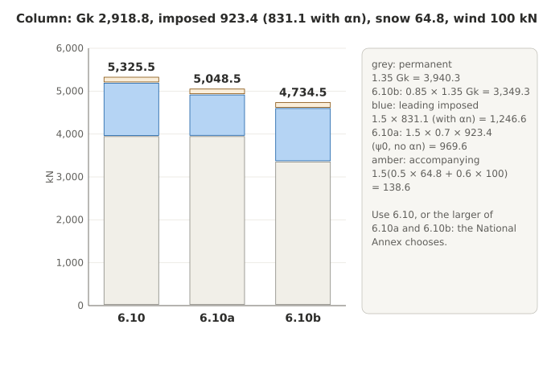

**Practice.** Wind as the leading action instead.

*Answer:* 6.10a does not change (5,048.5 kN; every variable action already carries ψ0). 6.10b: 3,349.3 + 150 + 969.6 + 48.6 = 4,517.4 kN (the imposed load is now accompanying, so ψ0 without αn). 6.10a still governs.

**Trap to test.** Applying ψ0 to the leading action in 6.10, using 6.10b alone without 6.10a, or applying αn and ψ0 to the same imposed load.

**Agent check.** Eurocode combinations: the National Annex choice (6.10 or 6.10a/b) is stated, each variable action takes the leading role in turn, and ψ values are traced to the Annex.

### 2.24 Dead load that helps: uplift

**Idea.** Where dead load resists the effect, it takes its lowest factor: 0.9 in ASCE 7-22 LRFD (5a), 0.6 in ASD (7a), γG,inf = 1.0 for EN STR and 0.9 for EN EQU (static equilibrium, Table A1.2(A)). Use the lightest dead load that can exist at the time.

**Worked example.** Roof column base: D = 300 kN. ASCE strength-level wind W = −350 kN; Eurocode characteristic wind Qk,w = −220 kN.

- ASCE 5a: 0.9 × 300 − 350 = −80 kN: net uplift, design the hold-down for 80 kN.
- ASCE ASD 7a: 0.6 × 300 − 0.6 × 350 = −30 kN.
- EN STR: 1.0 × 300 − 1.5 × 220 = −30 kN; EN EQU: 0.9 × 300 − 1.5 × 220 = −60 kN.

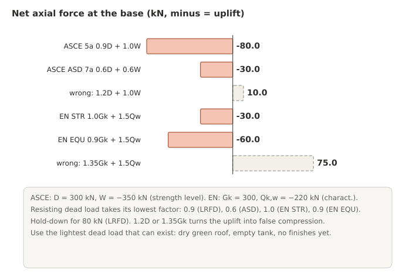

**Practice.** D = 400 kN, same wind.

*Answer:* 0.9 × 400 − 350 = +10 kN, compression; ASD 240 − 210 = +30 kN.

**Trap to test.** Factoring the resisting dead load up (1.2D gives +10 kN, 1.35 Gk gives +75 kN of false compression), or taking it with the green roof saturated (2.3).

**Agent check.** Uplift and overturning: for each hold-down, anchor and footing the minimum-dead-load combination is run, with the dead load used stated.

### 2.25 Seismic combinations and the garage 0.5L trap

**Idea.** ASCE 7-22 2.3.6: combination 6, 1.2D + Ev + Eh + L + 0.15S; combination 7, 0.9D − Ev + Eh. The 0.5L exception again excludes garages and public assembly. In EN 1990 the seismic design situation is G + ψ2 Q + AEd (6.4.3.4).

**Worked example.** The Module 1 parking edge column: D = 349.3 kN, L = 81 kN (Module 1 used 2.0 kN/m²), QE = ±60 kN (assumed), SDS = 0.8.

- 1a: 1.4 × 349.3 = 489.0 kN; 2a: 1.2 × 349.3 + 1.6 × 81 = 548.8 kN.
- 6: (1.2 + 0.16) × 349.3 + 60 + 1.0 × 81 = 616.0 kN, which governs, 12% above 2a.
- 6 with 0.5L (not allowed in a garage): 575.5 kN, 6.6% low.
- 7: 0.74 × 349.3 − 60 = 198.5 kN.

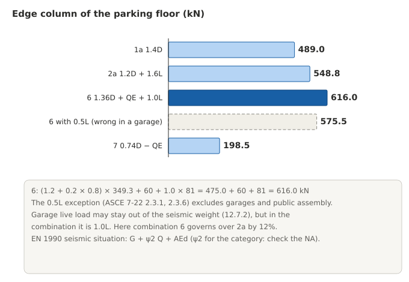

**Practice.** QE = ±120 kN.

*Answer:* 6: 475.0 + 120 + 81 = 676.0 kN; 7: 258.5 − 120 = 138.5 kN.

**Trap to test.** Using 0.5L in a garage because the live load is light; garage live load may stay out of the seismic weight (12.7.2), but in the combination it is 1.0L.

**Agent check.** Occupancy exceptions: every member whose combinations use 0.5L is checked against the occupancy map; garage and assembly members use 1.0L.

### 2.26 Serviceability combinations

**Idea.** Serviceability uses unfactored loads in different mixes. EN 1990: characteristic (6.14b, Gk + Qk,1 + Σ ψ0 Qk,i) for irreversible effects, frequent (6.15b) for reversible ones, quasi-permanent (6.16b, Gk + Σ ψ2 Qk,i) for long-term effects such as creep and long-term deflection. ASCE 7 leaves serviceability to the designer and gives guidance in its Appendix C and commentary.

**Worked example.** Office beam, 3 m tributary width: gk = 7.07 × 3 + 3.375 = 24.585 kN/m, qk = (3.0 + 0.8) × 3 = 11.4 kN/m, ψ2 = 0.3.

- Characteristic: 36.0 kN/m. Quasi-permanent: 24.585 + 0.3 × 11.4 = 28.0 kN/m (78% of characteristic). ULS 6.10: 50.3 kN/m.
- Formally the partition allowance is imposed load with ψ2 = 0.3, but partitions are there all the time, and many designers take them as permanent for deflection: 24.585 + 2.4 + 0.3 × 9.0 = 29.7 kN/m.

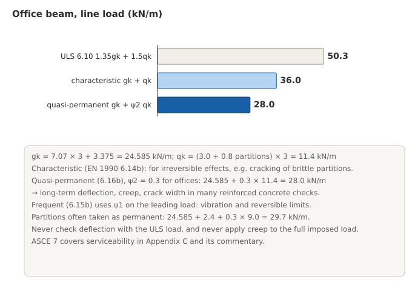

**Practice.** Heavier partitions, in the ≤ 3 kN/m class (1.2 kN/m²).

*Answer:* qk = 4.2 × 3 = 12.6 kN/m; quasi-permanent 24.585 + 3.78 = 28.4 kN/m, or 30.9 kN/m with the partitions taken as permanent.

**Trap to test.** Checking deflection with the ULS load, or applying creep to the full imposed load.

**Agent check.** Serviceability: each limit (deflection, cracking, vibration) is paired with the right combination, and the load used is stated.

---

## Part H. Software and checking

### 2.27 Envelopes against concurrent forces

**Idea.** Programs report envelopes: the maximum and minimum of each force over all combinations. A member check needs forces that occur together. The envelope corner (Pmax with Mmax) is not a real combination; it can be safe where it should not be, and miss the combination that governs.

**Worked example.** Column base on a 3 × 3 m footing: q = P/9 ± 6M/27.

| Combination | P (kN) | M (kN·m) | e (m) | qmin (kPa) | qmax (kPa) |
|---|---|---|---|---|---|
| 1.2D + 1.6L | 3,000 | 40 | 0.013 | 324.4 | 342.2 |
| 1.2D + L + W | 2,300 | 220 | 0.096 | 206.7 | 304.4 |
| 0.9D + W | 1,300 | 230 | 0.177 | 93.3 | 195.6 |
| 0.9D − Ev + E | 1,050 | 270 | 0.257 | 56.7 | 176.7 |
| Envelope corner | 3,000 | 270 | 0.090 | 273.3 | 393.3 |

The error is reading the "max P" and "max M" columns together: the corner says qmin = 273 kPa, far from lift-off, while the real 0.9D − Ev + E gives 56.7 kPa. A careful user who pairs Pmin with Mmax would find (1,050, 270) here, but only because one combination happens to hold both. For bearing the corner overstates qmax (393 against 342 kPa). Corners can also be unconservative: for a column below the balance point, where axial load raises the moment capacity, Pmax with Mmax overstates the capacity; for sliding, μ Pmax with the largest shear overstates the friction. (These are LRFD forces, used for illustration; soil pressures are usually checked with ASD or the method of the geotechnical report.)

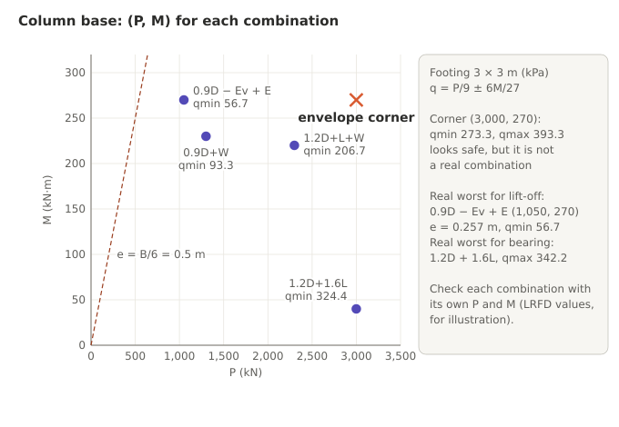

**Practice.** Add a combination with P = 900 kN and M = 300 kN·m.

*Answer:* e = 0.333 m (< B/6 = 0.5 m); qmin = 100 − 66.7 = 33.3 kPa, qmax = 166.7 kPa. It now governs lift-off.

**Trap to test.** Designing a column or footing from envelope values taken from different combinations.

**Agent check.** Concurrency: every design check reads the forces of one combination at a time; envelopes are used only to find candidate combinations.

### 2.28 Checking the load model

**Idea.** Before any member check, compare the model's load-case totals with a hand estimate (Module 1, 1.5). Many load errors are bookkeeping: a load in a case that no combination uses, a unit mix-up, a load counted twice.

**Worked example.** The running example.

| Case | Hand (kN) | Model (kN) | Ratio | Finding |
|---|---|---|---|---|
| Dead (D) | 37,437 | 31,401 | 0.839 | SDL (3 × 972 × 2.07 = 6,036 kN) is in a case "SD" that no combination uses |
| Office live (L) | 6,998 | 145,800 | 20.8 | 50 / 2.40 = 20.8: the 50 psf office load was typed into a kN/m² field |

Hand D, as the model's base reaction: 3 × 972 × 8.862 + 972 × 8.292 + 4 storeys × (468.8 + 378.0) + 150 = 37,437 kN.

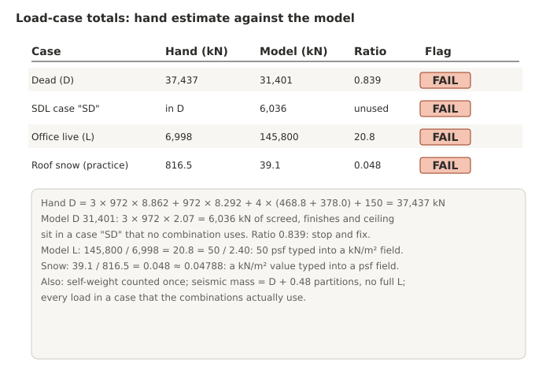

**Practice.** The roof snow case totals 39.1 kN for a 972 m² roof with pf = 0.84 kN/m². What happened?

*Answer:* Hand: 0.84 × 972 = 816.5 kN. Ratio 0.048 ≈ 0.04788 (psf to kPa): 0.84 was typed into a psf field.

**Trap to test.** Checking members in detail while a load-case total is wrong by a round factor (20.9 or 0.048 for units, 0.8 or 1.2 for a missing or doubled SDL).

**Agent check.** Load model audit: each case total against the hand estimate (flag outside ±5 to 10%), ratios close to 20.9 or 0.048 flagged as unit errors, every case used in at least one combination, the seismic mass source listed.

---

## Agent checks from this module

Each check is to be computed by a Python tool the agent calls, not recalled from memory. The flags are starting values, to be calibrated on real tasks.

| Check | Compares | Proposed flag |
|---|---|---|
| Dead load build-up | Every layer on the drawings against the load table | A layer missing; self-weight counted twice |
| Partitions | Allowance on office floors; walls above 3 kN/m | Missing allowance; heavy wall spread as a uniform load |
| Variable dead loads | Heavy and light states of green roofs, tanks, ballast | Uplift checked with the heavy state only |
| Occupancy map | Live load per zone against the architectural plan | A zone with the wrong load |
| Live load reduction | KLL AT, factor and floor per member | Below 0.40 or 0.50; garage, assembly or partitions reduced |
| Pattern loading | Patterns present for continuous members | Only the all-spans case |
| Roof loads | Lr, pf, pm, drift, rain per roof area | pm missing; drift on pm; rain above Lr ignored |
| Wind basis | Edition, speed basis, exposure, load factor | 1.6 on ASCE 7-22 wind; 1.0 on Eurocode wind |
| Enclosure | Openings against the enclosure criteria | Large openings with GCpi = ±0.18 |
| Spectrum | Site parameters, site class or ground type, period, Sa | Sa off the plateau beyond TS; design spectra compared on different bases |
| Seismic | W, Ta, period used, Cs bounds, V, Ev, Ω0 | Period above Cu Ta; Ev missing in 7; full live load in W |
| Soil and water | Wall restraint, water level, surcharge, buoyancy | Active pressure on a propped wall; water left out |
| Temperature | Length between joints; restraint forces | Long frame with no joint and no restraint check |
| Cranes | Service class, capacity, wheel loads, percentages | ASCE 7-16 impact rule; impact on lateral or longitudinal forces |
| Combinations | Edition, all combinations, max and min per effect | 1.6S with ASCE 7-22; 0.5L in a garage; resisting D factored up |
| Eurocode combinations | 6.10 or 6.10a/b per the Annex, each leading action, ψ values | ψ0 on the leading action in 6.10; αn with ψ0 |
| Serviceability | Each limit with its combination | ULS load for deflection; creep on the full imposed load |
| Concurrency | Forces read per combination | Envelope corner used as a design point |
| Load model audit | Case totals against hand estimates | Outside ±5 to 10%; ratios near 20.9 or 0.048; unused cases |

## Traps to test (not yet measured)

| Section | Trap | Status |
|---|---|---|
| 2.1 | Plain concrete unit weight and no screed | Not yet tested |
| 2.2 | Heavy wall spread as a uniform load; partitions reduced | Not yet tested |
| 2.3 | Uplift checked with the saturated green roof | Not yet tested |
| 2.4 | Office load used in corridors and lobbies | Not yet tested |
| 2.5 | Partitions reduced with the live load; below the 0.40 floor | Not yet tested |
| 2.6 | Office reduction formula used for a garage column | Not yet tested |
| 2.7 | Middle span designed from the all-spans case | Not yet tested |
| 2.8 | Floor live load reduction used on a roof | Not yet tested |
| 2.9 | ASCE 7-16 importance factor on ASCE 7-22 snow; pm missed | Not yet tested |
| 2.10 | ASCE 7-16 drift equation or SI inputs in the ft-psf equation | Not yet tested |
| 2.11 | Roof designed for roof live load when rain is higher | Not yet tested |
| 2.12 | Load factor 1.6 on ASCE 7-22 wind | Not yet tested |
| 2.13 | qz used on the leeward wall | Not yet tested |
| 2.14 | Building with large openings treated as enclosed | Not yet tested |
| 2.15 | EN design spectrum compared with the ASCE design spectrum before R | Not yet tested |
| 2.16 | Full office live load in the seismic weight | Not yet tested |
| 2.17 | Computed period above Cu Ta | Not yet tested |
| 2.18 | Ev left out of combination 7 | Not yet tested |
| 2.19 | Active pressure on a propped wall; water left out | Not yet tested |
| 2.20 | Restraint ignored in a long frame | Not yet tested |
| 2.21 | ASCE 7-16 crane impact rule | Not yet tested |
| 2.22 | 1.6S and 0.5S with ASCE 7-22 | Not yet tested |
| 2.23 | ψ0 on the leading action in 6.10; αn with ψ0 | Not yet tested |
| 2.24 | Resisting dead load factored up | Not yet tested |
| 2.25 | 0.5L in a garage | Not yet tested |
| 2.26 | ULS load used for deflection | Not yet tested |
| 2.27 | Envelope corner used as a design point | Not yet tested |
| 2.28 | Member checks on a model whose totals are wrong | Not yet tested |

## Answer keys and rubrics

Eight of these examples are written as tasks in the harness, each with a prompt, numerical checks with tolerances, a rubric item and the expert's notes, in the [expert eval harness](https://github.com/sabaazdn73/expert-eval-harness): `str-ld-llr-column` (2.5), `str-ld-garage-column` (2.6), `str-ld-pattern-3span` (2.7), `str-ld-snow-drift` (2.10), `str-ld-elf-base-shear` (2.16, 2.17), `str-ld-asce-combos` (2.22), `str-ld-en-610` (2.23) and `str-ld-garage-seismic` (2.25). They will be run on Claude Haiku, Sonnet and Opus and on Gemini models, and the results added to the table above.

## References to check in the edition in force

ASCE/SEI 7-22: combinations 2.3.1, 2.3.4, 2.3.6 and 2.4.1; vegetative roofs 3.1.4; lateral soil loads Table 3.2-1; live loads Table 4.3-1, partitions 4.3.2, partial loading 4.3.3, vehicle barriers 4.5.3, reduction 4.7, roof live load 4.8.2, cranes 4.9, garages 4.10.1; snow 7.3, 7.3.3, Table 7.3-4, drifts 7.6.1 and 7.7.1; rain 8.2; seismic spectrum 11.4.5.2, Ev 12.4.2.2, overstrength 12.4.3, seismic weight 12.7.2, base shear 12.8.1.1, period 12.8.2 and Tables 12.8-1 and 12.8-2, vertical distribution 12.8.3, system factors Table 12.2-1, redundancy 12.3.4; wind velocity pressure 26.10 and Table 26.10-1, Kd Table 26.6-1, gust factor 26.11.1, exposure constants Table 26.11-1, internal pressure Table 26.13-1, MWFRS pressures 27.3.1 and Figure 27.3-1. ASCE 7-16 Table 1.5-2 and 4.9.3 for the earlier snow and crane rules. EN 1990 (6.4.3.2, 6.4.3.4, 6.5.3, Tables A1.1, A1.2(A), A1.2(B)); EN 1991-1-1 (3.3.1, 3.3.2, 6.2.2, 6.3.1.2); EN 1991-1-3 (5.2, 5.3); EN 1991-1-4 (4.2 to 4.5); EN 1998-1 (3.2.2, 4.2.4). Clause numbers only; no code text is reproduced.
