# Module 3: Structural analysis

*A Review Notebook for Civil Engineers to Evaluate Frontier Models*, by Saba Azadegan

Module 1 followed where load goes and Module 2 sized the loads. This module turns loads into the forces inside members: how a model is built (supports, stiffness, joints, flanges), how continuous beams, frames and slabs are analysed by hand, and how the output of an analysis program is checked. Each section has the idea, a worked example with a figure, a practice problem with its answer, a trap to test on AI models, and the check an AI review agent should run.

**Two codes side by side.** The US side follows ACI 318-19 (with the 2014 direct design method it still permits); the European side follows EN 1992-1-1 and EN 1998-1 with their recommended values, to be checked against the National Annex. Code clauses are pointers to check in the edition in force; no code text is reproduced.

**How to read the numbers.** Units are kN and m. Every number was computed in a script ([module-03-calc.py](module-03-calc.py)) and checked again by an independent reviewer; wherever a model can be built, the hand method was also checked against a small frame solver written for this module ([frame2d.py](frame2d.py), direct stiffness method). The frame models include the axial deformation of the beams, with no rigid diaphragm; a rigid diaphragm changes the frame results by a few per cent (for example 3.50 mm instead of 3.71 mm in 3.14). Values marked "assumed" are example inputs, not code values.

**The running example.** The office building of Modules 1 and 2: 9 m grid, storeys of 3.75 m, 200 mm slab, beams 300 × 450 mm every 3 m, girders 400 × 600 mm on the column lines, columns 500 × 500 mm. Concrete f′c = 30 MPa, Ec = 4700√f′c = 25,740 MPa (ACI 318-19 19.2.2.1, SI form). Where a girder load is needed, wu = 41.0 kN/m (the factored office load of Module 2, 2.7, assumed uniform for illustration). Stiffness for strength-level analysis: columns 0.70 Ig, beams 0.35 Ig (ACI 318-19 Table 6.6.3.1.1(a)) unless a section says otherwise.

**Status of the model tests.** The traps listed here are hypotheses: errors to test on Claude and Gemini models with the [expert eval harness](https://github.com/sabaazdn73/expert-eval-harness). Results will be added with the model version and date. Until then, nothing here claims how often a model fails.

## Contents

- Part A. Building the model: 3.1 to 3.5
- Part B. Continuous beams: 3.6 to 3.10
- Part C. Frames under lateral load: 3.11 to 3.14
- Part D. Slabs: 3.15 to 3.17
- Part E. Checking software output: 3.18 to 3.23
- Agent checks, traps to test, answer keys

---

## Part A. Building the model

### 3.1 Supports: pinned, fixed and the real joint

**Idea.** A beam framing into columns is neither pinned nor fixed: the joint rotates, and the end moment is shared between the beam and the columns in proportion to their stiffness. ACI 318-19 (6.3.1.2) allows a gravity model of one level with the columns above and below, their far ends taken as fixed.

**Worked example.** A 9 m girder with wu = 41.0 kN/m between two columns, with columns above and below each end (h = 3.75 m, cracked stiffness).

- Pinned ends: midspan wL²/8 = 415.3 kN·m.
- Fixed ends: wL²/12 = 276.9 kN·m at the ends, 138.4 kN·m at midspan.
- Real joint, by hand. The loading is symmetric, so both ends rotate equally and the beam's stiffness at each end is 2EIb/L = 0.560 × 10⁻³E. The two columns give Σ4EIc/h = 2 × 4 × 0.003646/3.75 = 7.778 × 10⁻³E. End moment = 276.9 × 7.778/(7.778 + 0.560) = 258.3 kN·m (93% of fixed); midspan 157.0 kN·m.
- Frame model: 258.3 and 157.0 kN·m.

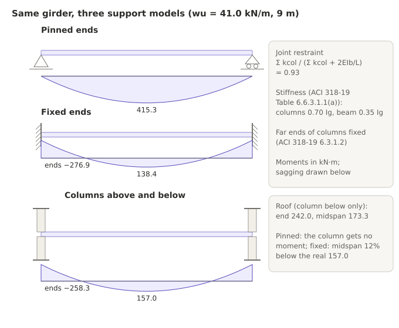

**Practice.** The same girder at the roof, with a column below only.

*Answer:* 276.9 × 3.889/(3.889 + 0.560) = 242.0 kN·m at the ends, 173.3 kN·m at midspan (model 241.7).

**Trap to test.** Taking beam ends at columns as pinned, so the columns get no moment from the beam (here 258 kN·m is missed), or as fully fixed, so the midspan moment comes out 12% low.

**Agent check.** Joint restraint: the support model of every beam end (pin, spring or column) is stated, and the end moments are compared with the fixed-end moment: a ratio near 0 or exactly 1 needs a reason.

### 3.2 Cracked stiffness for analysis

**Idea.** Concrete members crack, and the stiffness used in the analysis decides the drift and, to a lesser degree, how moment is shared. ACI 318-19 Table 6.6.3.1.1(a) gives, for factored-load analysis, 0.70 Ig for columns and uncracked walls, 0.35 Ig for beams and cracked walls and 0.25 Ig for flat plates; for lateral deflection under service loads, 6.6.3.2.2 allows 1.4 times these, not more than Ig. EN 1998-1 (4.3.1(7)) allows one-half of the uncracked stiffness.

**Worked example.** One-bay portal, 9 m by 3.75 m, fixed bases, 400 × 600 girder, 500 × 500 columns, 100 kN at beam level.

| Stiffness | Columns | Beam | Drift (mm) | Against gross |
|---|---|---|---|---|
| Gross sections | 1.00 Ig | 1.00 Ig | 2.78 | 1.00 |
| ACI service (1.4 ×) | 0.98 Ig | 0.49 Ig | 3.55 | 1.28 |
| ACI factored | 0.70 Ig | 0.35 Ig | 4.95 | 1.78 |
| EN 1998-1 (seismic analysis) | 0.50 Ig | 0.50 Ig | 5.52 | 1.99 |

The moments change less: left column base and top 116.1 and 73.1 kN·m with gross sections, 129.0 and 59.5 kN·m with the ACI factors. The beam is softened more than the columns, so it restrains the column tops less and more moment goes to the bases. A hand bound with a rigid beam, Δ = Ph³/(24EIc), gives 1.64 mm (gross): the beam's flexibility is most of the difference.

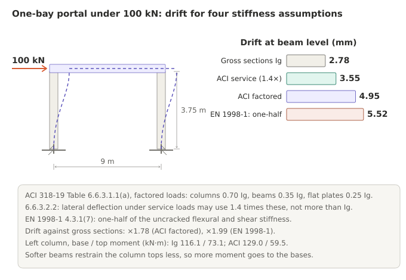

**Practice.** What is the ratio of the ACI service drift to the factored-level drift, and why?

*Answer:* 3.55/4.95 = 0.717, close to 1/1.4 = 0.714: every flexural stiffness is multiplied by 1.4 (only the axial stiffness is not).

**Trap to test.** Checking drift with gross sections: 1.78 times too stiff against the factored-level set, 1.28 times against the service set. (Using the factored-level set for a service check is allowed and conservative by 1.4.)

**Agent check.** Stiffness modifiers: for each analysis (strength, service drift, seismic) the factor on each member type is listed with its clause, and the drift check states which set it used.

### 3.3 Moments at the face and rigid joint zones

**Idea.** A frame model works on centrelines, but the beam meets the support at its face. ACI 318-19 permits Mu at the face of a support for beams built integrally with it (9.4.2.1) and permits the joint regions to be modelled as rigid (6.6.2.3(b)). EN 1992-1-1 (5.3.2.2) takes the moment at the face for monolithic supports, not less than 0.65 of the fixed-end moment (3), and allows a support without rotational restraint to be reduced by ΔM = FEd,sup·t/8 (4).

**Worked example.** Two 9 m spans with wu = 41.0 kN/m, continuous over a 500 mm column at B (column stiffness ignored, so the spans are knife-edge supported for clarity).

1. Centreline: MB = wL²/8 = 415.3 kN·m; V at B = 0.625wL = 230.7 kN.
2. Face, from the centreline model: 415.3 − 230.7 × 0.25 + 41.0 × 0.25²/2 = 358.9 kN·m (−13.6%).
3. EN 1992-1-1 (4), for a support without rotational restraint: ΔM = 461.5 × 0.5/8 = 28.8; M = 386.5 kN·m.
4. With rigid zones over the column width the face moment is 392.6 kN·m: by symmetry B does not rotate, so the flexible beam is 8.75 m long and fixed in rotation at the face, and M = w × 8.75²/8. The modelling choice moves the face moment by 9%.
5. EN 1992-1-1 (3) floor: 0.65 × 276.9 = 180.0 kN·m, met.

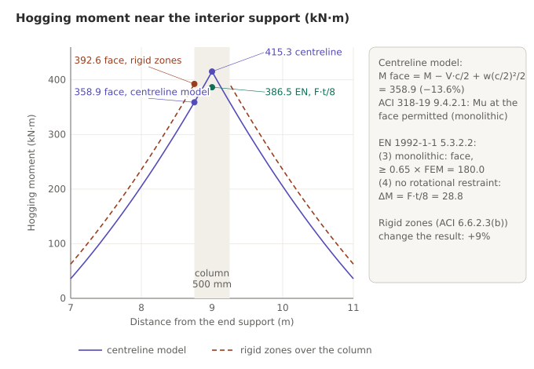

**Practice.** The column is 800 mm wide.

*Answer:* Face moment 415.3 − 230.7 × 0.40 + 41.0 × 0.40²/2 = 326.3 kN·m; the EN reduction for a non-restraining support would be 46.2 kN·m.

**Trap to test.** Reducing to the face where the support is not monolithic (a beam on a bearing or a masonry wall), or reducing twice: a model with rigid zones already reports the face, and subtracting V·c/2 again under-designs the support.

**Agent check.** Support moments: the location used (centreline or face), the rigid-zone setting in the model and the reduction applied are stated, and the reduction is applied once.

### 3.4 Effective flange width

**Idea.** A slab cast with its beams acts as a flange. The width that works with the beam is limited. ACI 318-19 Table 6.3.2.1: each side of the web, the least of 8h, sw/2 and ln/8 (one side: 6h, sw/2, ln/12). EN 1992-1-1 (5.3.2.1): beff,i = 0.2bi + 0.1l0, not more than 0.2l0 or bi, where l0 is the distance between points of zero moment (0.85l1 in an end span, 0.7l2 in an interior span, 0.15(l1 + l2) over a support).

**Worked example.** Beam 300 × 450 mm with a 200 mm slab, beams at 3 m (clear distance sw = 2.7 m), span 9 m between 400 mm girders (ln = 8.6 m).

- ACI: least of 1.60, 1.35 and 1.075 m → bf = 0.3 + 2 × 1.075 = 2.45 m.
- EN, interior span: l0 = 6.3 m, bi = 1.35 m, beff,i = 0.27 + 0.63 = 0.90 m → beff = 2.10 m. End span 2.37 m. Over a support, l0 = 2.7 m: beff = 1.38 m.
- Stiffness: web alone I = 2,278 × 10⁻⁶ m⁴; T-beam with bf = 2.45 m: 5,317 × 10⁻⁶ m⁴ (2.33 times), neutral axis 0.320 m above the soffit; with 2.10 m: 5,012 (2.20 times). ACI R6.6.3.1.1 notes that taking 2Ig of the web is generally accurate enough.

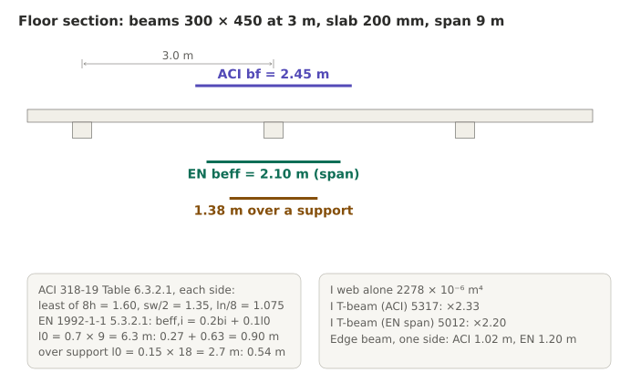

**Practice.** An edge beam with the slab on one side only.

*Answer:* ACI: least of 6h = 1.20, sw/2 = 1.35 and ln/12 = 0.717 m → bf = 1.02 m. EN (interior span): 0.3 + 0.90 = 1.20 m.

**Trap to test.** Taking the full beam spacing (3.0 m) as the flange, or using the span flange width over a support, where the flange is in tension and the compression is in the web.

**Agent check.** T-beam geometry: the flange width used for stiffness and for strength is stated for span and support regions and traced to the clause.

### 3.5 Interior column moment from live load on one side

**Idea.** With live load on one side of an interior column only, the unbalanced end moments must go somewhere: into the columns above and below, in proportion to their stiffness (ACI 318-19 6.5.5, 6.6.2.1 and 6.6.2.2). Live load may be taken on the level under consideration only (6.4.1).

**Worked example.** Interior joint of the subframe: girders of 9 m both sides (far ends fixed), columns above and below. Factored dead load 29.50 kN/m on both spans, factored live load 11.52 kN/m on the left span only.

- Unbalanced fixed-end moment: 11.52 × 9²/12 = 77.8 kN·m.
- Stiffness: column 4E(0.70Ic)/h = 3.889 × 10⁻³E; beam 4E(0.35Ib)/L = 1.120 × 10⁻³E.
- Each column: 77.8 × 3.889/(2 × 3.889 + 2 × 1.120) = 30.2 kN·m; each beam takes 8.7 kN·m of the unbalanced moment. Model: 30.2 kN·m (final beam end moments at the joint 267.7 and 207.4 kN·m).

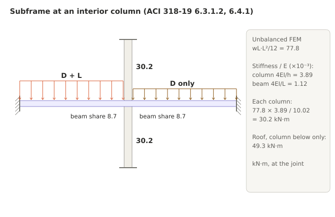

**Practice.** The same joint at the roof (column below only).

*Answer:* 77.8 × 3.889/(3.889 + 2 × 1.120) = 49.3 kN·m (model 49.1).

**Trap to test.** Designing interior columns for axial load only because "the spans balance": the balance holds only when both spans carry the same load.

**Agent check.** Column moments from pattern live load are included in gravity design of interior columns, not only edge columns.

## Part B. Continuous beams

### 3.6 Moment distribution

**Idea.** Moment distribution (Hardy Cross) solves a continuous beam by hand: lock the joints, apply the fixed-end moments, release one joint at a time, share the unbalanced moment by distribution factors, carry half to the far end, and repeat. For a pinned far end, use the modified stiffness 3EI/L and the propped fixed-end moment; for a symmetric span under symmetric load, 2EI/L.

**Worked example.** Spans of 8, 10 and 8 m on pinned supports, 40 kN/m (assumed), constant EI.

- Fixed-end moments: end spans, far end pinned: wL²/8 = 320.0 kN·m; middle span wL²/12 = 333.3 kN·m.
- Distribution factors at B: (3/8)/(3/8 + 4/10) = 0.484 to BA and 0.516 to BC.

| Step | BA | BC | CB |
|---|---|---|---|
| Fixed-end moments | 320.00 | −333.33 | 333.33 |
| After cycle 1 | 326.45 | −330.78 | 328.12 |
| After cycle 2 | 328.55 | −328.83 | 328.66 |
| After cycle 3 | 328.69 | −328.70 | 328.69 |

- With symmetry: DF = (3/8)/(3/8 + 2/10) = 0.652, so MB = 320.0 + 0.652 × 13.33 = 328.7 kN·m in one step. Model: 328.7 kN·m.
- End spans: RA = 160 − 328.7/8 = 118.9 kN, maximum 118.9²/(2 × 40) = 176.8 kN·m at 2.97 m. Middle span: 500.0 − 328.7 = 171.3 kN·m.

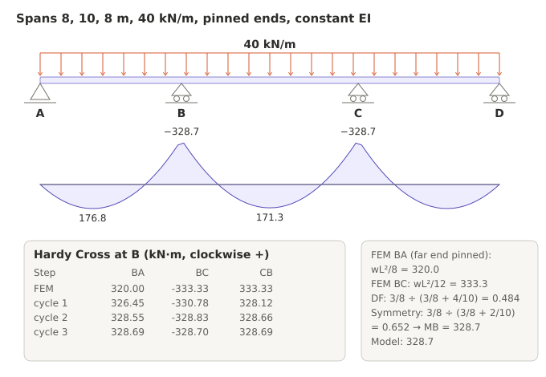

**Practice.** The middle span is 12 m.

*Answer:* FEM BC = 480.0; DF = (3/8)/(3/8 + 2/12) = 0.692; MB = 320.0 + 0.692 × 160 = 430.8 kN·m (model 430.8); middle span 720.0 − 430.8 = 289.2 kN·m.

**Trap to test.** Treating the end supports as fixed, which invents a hogging moment of 170.5 kN·m at A, gives MB = 299.0 (9% low) and halves the end-span moment to 88.5 kN·m.

**Agent check.** Continuous beams: the support conditions at the ends are stated, and the hand result for one critical support matches the model to rounding.

### 3.7 ACI approximate moments

**Idea.** ACI 318-19 (6.5) gives moment coefficients for continuous beams and one-way slabs that meet five conditions (6.5.1): prismatic members, uniform load, L ≤ 3D, at least two spans, and adjacent spans within 20%. Table 6.5.2 uses the clear span (the average of the adjacent clear spans for negative moments): wuln²/14 or /11 for end-span positive (integral or unrestrained end), /16 for interior spans, /24 or /16 at the exterior support (spandrel beam or column), /9 or /10 at the first interior support (two spans, more than two), /11 at other supports, /12 where (a) or (b) of the table applies. These moments are not redistributed (6.5.3).

**Worked example.** Four 9 m spans, girder 400 × 600 on 500 mm columns above and below; wu = 41.0 kN/m (L/D = 0.29), ln = 8.5 m, wuln² = 2,963.8 kN·m. The analysis is the subframe with every live load pattern of 6.4.2, moments at the column faces.

| Location | Coefficient | ACI (kN·m) | Analysis (kN·m) | ACI ÷ analysis |
|---|---|---|---|---|
| Exterior support (column) | 1/16 | 185.2 | 203.2 | 0.91 |
| End span positive | 1/14 | 211.7 | 150.3 | 1.41 |
| First interior support | 1/10 | 296.4 | 246.4 | 1.20 |
| Interior span positive | 1/16 | 185.2 | 142.9 | 1.30 |
| Other supports | 1/11 | 269.4 | 235.3 | 1.14 |

Shears (Table 6.5.4): 1.15wuln/2 = 200.5 kN at the first interior support, wuln/2 = 174.3 kN elsewhere. Here the coefficients are conservative except at the exterior support: with columns at 0.70 Ig and the beam at 0.35 Ig, the columns at a joint are 6.9 times as stiff as the beam and hold its end more than the coefficient assumes. With gross sections for every member the exterior envelope is 180.7 kN·m, and /16 is then conservative.

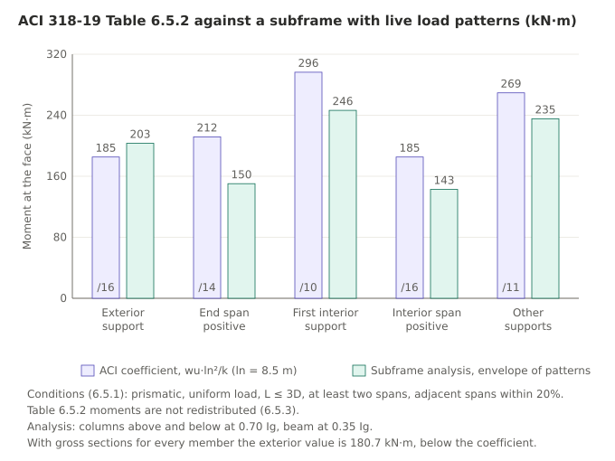

**Practice.** The same girder with only two spans. Moment at the first interior support?

*Answer:* wuln²/9 = 329.3 kN·m; the subframe analysis gives 247.7 kN·m.

**Trap to test.** Using the coefficients outside their limits (spans differing by more than 20%, point loads, L > 3D), redistributing them, or relying on /16 at an exterior column that is much stiffer than the beam.

**Agent check.** Approximate methods: each condition of 6.5.1 is checked and listed; column moments are evaluated separately (R6.5.2).

### 3.8 Moment redistribution

**Idea.** A ductile section can yield and pass moment to the rest of the span. ACI 318-19 (6.6.5) allows the elastic moment at a section to be reduced by up to the lesser of 1000εt percent and 20%, where εt ≥ 0.0075 at that section, keeping equilibrium for each load case; not for moments from Table 6.5.2. EN 1992-1-1 (5.5(4)) limits the ratio δ of redistributed to elastic moment: δ ≥ k1 + k2·xu/d (0.44 + 1.25xu/d for fck ≤ 50 MPa) and δ ≥ 0.7 for class B or C reinforcement (0.8 for class A), with adjacent spans within 0.5 to 2.

**Worked example.** The beam of 3.6 (MB = 328.7 kN·m elastic), section at B 400 × 600 mm, d = 540 mm, f′c = 30 MPa, fy = 420 MPa, four 25 mm bars (As = 1,963 mm²).

1. a = 1,963 × 420/(0.85 × 30 × 400) = 80.8 mm; β1 = 0.832 (Table 22.2.2.4.3 with f′c = 30 MPa = 4,351 psi); c = 97.1 mm; εt = 0.003 × (540 − 97.1)/97.1 = 0.0137.
2. ACI limit: least of 13.7% and 20% → 13.7%. MB = 328.7 × 0.863 = 283.7 kN·m.
3. Equilibrium: end spans RA = 160 − 283.7/8 = 124.5 kN, maximum 193.9 kN·m (from 176.8); middle span 500.0 − 283.7 = 216.3 kN·m (from 171.3).
4. EN, with xu/d = 0.18 (assumed, close to c/d above): δ ≥ 0.44 + 1.25 × 0.18 = 0.665 and δ ≥ 0.7 → up to 30%.

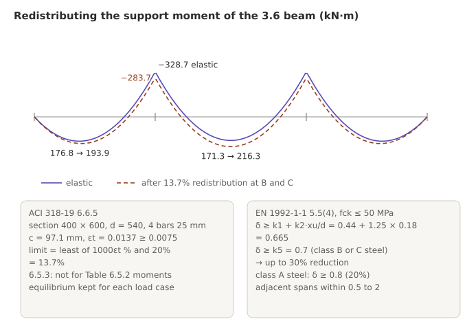

**Practice.** Six 25 mm bars at B (As = 2,945 mm²).

*Answer:* c = 145.7 mm, εt = 0.0081 ≥ 0.0075 → ACI 8.1%. EN with xu/d = 0.27: δ ≥ 0.778 → 22.3%.

**Trap to test.** Redistributing moments from Table 6.5.2 or at a section with εt below 0.0075, or reducing the support moment without raising the span moments to keep equilibrium.

**Agent check.** Redistribution: the percentage, εt (or xu/d and steel class) at the reduced section, and the equilibrium of the redistributed diagram are shown for each load case.

### 3.9 Influence lines and moving loads

**Idea.** An influence line shows how one effect (a reaction or a moment at a fixed point) changes as a unit load moves across the structure. By the Müller-Breslau principle it has the shape of the deflected structure when that effect is released and given a unit displacement. The worst position of a group of wheel loads is read from it.

**Worked example.** A crane runway girder continuous over two 9 m spans, two wheels of 112.5 kN (with impact, Module 2, 2.21) at 3.6 m (assumed).

- Reaction at B: largest, 212.4 kN, with the wheels at 7.2 and 10.8 m, either side of B. Treating each span as simple gives 180.0 kN (15% low).
- Moment over B: the influence line is lowest, −0.866 m per unit load, at L/√3 = 5.20 m; with both wheels in one span, the hogging moment is 160.9 kN·m.
- Span moment at 0.4L: 260.8 kN·m with the wheels at 3.6 and 7.2 m.

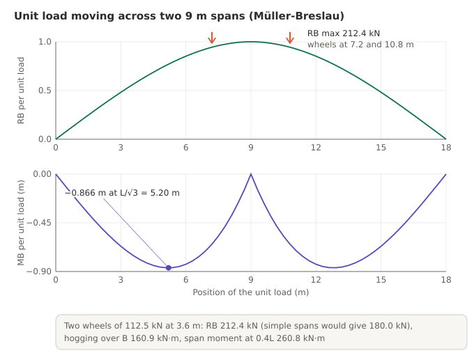

**Practice.** The wheels are 4.5 m apart.

*Answer:* RB = 205.7 kN. Hogging over B 166.1 kN·m, now with one wheel in each span (at 6.75 and 11.25 m); both wheels in one span give only 142.7 kN·m, so the governing position changes with the spacing.

**Trap to test.** Treating a continuous runway as simple spans for the support reaction, or checking one wheel position (both wheels at midspan) instead of searching for the worst.

**Agent check.** Moving loads: the governing positions come from influence lines or a stepped search, and the position used for each effect is reported.

### 3.10 Support settlement

**Idea.** In a continuous beam, a support that settles changes the moments; the effect is proportional to EI. ACI 318-19 (5.3.6) treats differential settlement as a load effect where it can be adverse, with a load factor of at least 1.0. A settling interior support relieves its own hogging and loads the spans; a settling end support adds hogging at the first interior support.

**Worked example.** Two 9 m spans of the 400 × 600 girder; the geotechnical report gives 15 mm differential settlement at the middle support (assumed).

- MB = 3EIΔ/L²: cracked (0.35Ig) 36.0 kN·m sagging; gross 103.0 kN·m. The reaction at B falls by 6EIΔ/L³: 8.0 kN (cracked).
- With gravity (415.3 kN·m hogging over B, 233.6 kN·m in the spans): 379.3 over B and 247.3 kN·m in the spans (cracked).

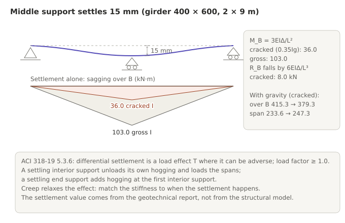

**Practice.** The settlement is 25 mm (cracked stiffness).

*Answer:* 3 × 25,740,000 × 0.00252 × 0.025/81 = 60.1 kN·m.

**Trap to test.** Ignoring a settlement the geotechnical report gives, computing it with gross stiffness (2.9 times larger here) when the settlement happens slowly, or getting the sign wrong (a settling interior support does not add hogging there).

**Agent check.** Settlement: the value and its source are stated, it enters as its own load case, and the stiffness used matches when the settlement occurs.

## Part C. Frames under lateral load

### 3.11 Portal method

**Idea.** The portal method splits each storey shear among the columns, giving interior columns twice the share of exterior ones, and puts inflection points at mid-height of columns and midspan of beams. It satisfies equilibrium, but the split and the inflection points are assumptions.

**Worked example.** Three bays of 9 m, two storeys of 3.75 m, fixed bases, 100 kN at the roof and 60 kN at level 1 (assumed).

- Bottom storey shear 160 kN: exterior columns 160/6 = 26.7 kN, interior 53.3 kN. Base moments V·h/2: 50.0 and 100.0 kN·m.
- Top storey: 16.7 and 33.3 kN; level-1 exterior beam moment 31.25 + 50.0 = 81.25 kN·m.

| Bottom storey | Portal | Model | Model ÷ portal |
|---|---|---|---|
| Exterior shear (kN) | 26.7 | 37.0 | 1.39 |
| Interior shear (kN) | 53.3 | 44.0 | 0.82 |
| Exterior base moment (kN·m) | 50.0 | 104.1 | 2.08 |
| Interior base moment (kN·m) | 100.0 | 112.1 | 1.12 |
| Level-1 exterior beam moment (kN·m) | 81.25 | 57.1 | 0.70 |

The model's bottom-storey inflection points sit 2.82 m (exterior) and 2.55 m (interior) above the base, 0.68 to 0.75 of the height: fixed bases and cracked beams that are flexible against the columns push them up. With very stiff beams all four columns take about 40 kN (39 to 42 kN). The 1 : 2 split is not a law.

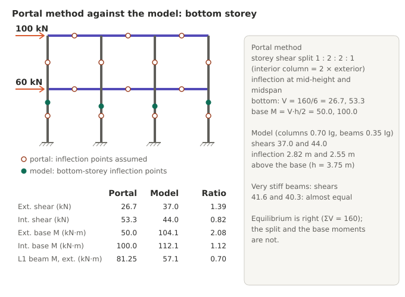

**Practice.** 120 kN at the roof and 80 kN at level 1 (portal method).

*Answer:* Interior base moment 200/3 × 1.875 = 125.0 kN·m; level-1 exterior beam moment (20.0 + 33.3) × 1.875 = 100.0 kN·m.

**Trap to test.** Using portal moments to design or "verify" the bottom storey of a fixed-base frame: the exterior base moment here is half the model's.

**Agent check.** Hand methods for lateral load: storey shears must sum exactly; the distribution among columns and the base moments are compared with the model only within a stated tolerance, with the reason for any difference.

### 3.12 Cantilever method

**Idea.** The cantilever method treats the frame as a vertical cantilever: column axial forces at each level are proportional to their distance from the centroid of the column areas, and they resist the overturning moment above that level. It suits tall, slender frames; the portal method suits low, wide ones.

**Worked example.** The frame of 3.11, equal columns at −13.5, −4.5, +4.5 and +13.5 m from the centroid; Σd² = 405 m².

- Overturning at the inflection level of the bottom storey: 100 × 5.625 + 60 × 1.875 = 675 kN·m. N = M·d/Σd² = 22.5 kN (exterior) and 7.5 kN (interior), tension on the windward side.
- Top storey: 187.5 kN·m → 6.25 and 2.08 kN. Beam shear at an exterior joint = the change in column axial force: 22.5 − 6.25 = 16.25 kN at level 1.
- Model: 21.1 kN tension in the windward exterior column, but only 2.1 kN in the windward interior column, and in compression, not tension: with flexible beams the interior columns carry almost none of the overturning. Portal: 25.0 and 0 kN.

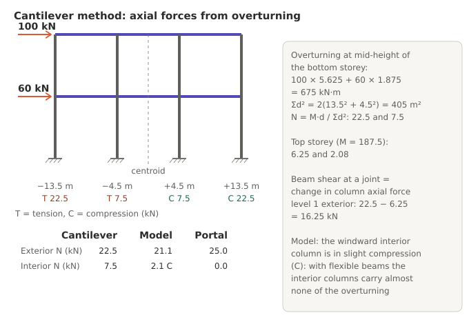

**Practice.** 120 kN at the roof and 80 kN at level 1.

*Answer:* 120 × 5.625 + 80 × 1.875 = 825 kN·m; 27.5 kN exterior and 9.17 kN interior.

**Trap to test.** Forgetting that the overturning moment at a level includes every force above it, or taking the axial force at a level from that level's force alone.

**Agent check.** Column axial forces from lateral load are compared with an overturning estimate; their sum is zero under lateral load alone.

### 3.13 Deflection by virtual work

**Idea.** The displacement at a point is Σ∫Mm/EI dx, with M from the real load and m from a unit load at that point in that direction. Every member that bends contributes, including the supports' own members.

**Worked example.** A canopy: 500 × 500 column 4 m high fixed at the base, 400 × 600 cantilever beam 3 m long, 50 kN at the tip; gross sections for illustration.

- Beam: M = −Px, m = −x over 3 m → Pa³/3EIb = 2.43 mm.
- Column: M = Pa, m = a over 4 m → Pa²h/EIc = 13.43 mm.
- Tip deflection 15.85 mm, 85% of it from the column. Model: 15.88 mm (it adds the column's shortening). The column top also sways 8.95 mm.

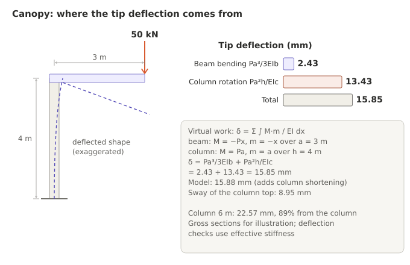

**Practice.** The column is 6 m high.

*Answer:* 2.43 + 20.14 = 22.57 mm; 89% from the column.

**Trap to test.** Taking the tip deflection of a cantilever as Pa³/3EI of the beam alone when the beam is supported by a flexible column or wall: 2.43 against 15.85 mm here.

**Agent check.** Deflections of cantilevers and canopies include the rotation of their supports; the stiffness used (gross or effective) is stated.

### 3.14 Storey stiffness and drift

**Idea.** The shear-building assumption (rigid beams, each column 12EI/h³) gives a quick storey stiffness. It is a lower bound on drift and is close only when the beams are much stiffer than the columns.

**Worked example.** The bottom storey of the frame alone: four 500 × 500 columns (0.70 Ig), fixed bases, 400 × 600 beams (0.35 Ig), 160 kN.

- Shear building: k = 4 × 12E(0.70Ic)/h³ = 85,428 kN/m → 1.87 mm.
- Model with the real beams: 43,149 kN/m → 3.71 mm, 1.98 times as much (drift ratio 0.099%).

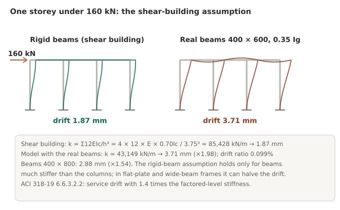

**Practice.** The beams are 400 × 800 mm.

*Answer:* 2.88 mm, 1.54 times the shear-building value.

**Trap to test.** Estimating drift or period with rigid beams in a frame with flexible beams, flat plates or wide shallow beams: the drift can be underestimated by half.

**Agent check.** Drift: taken from the model with the stated effective stiffness; a rigid-beam hand estimate is reported as a lower bound only.

## Part D. Slabs

### 3.15 Direct design method

**Idea.** For regular two-way slabs, the direct design method takes the total static moment of a panel, Mo = qu·l2·ln²/8 with ln the clear span, and distributes it to negative and positive regions and then to column and middle strips by fixed fractions. It was in ACI 318 until 2014 (8.10). ACI 318-19 removed it from the Code but still permits the 2014 method (6.2.4.1 and its commentary).

**Worked example.** Flat plate on a 7.5 m grid, 500 mm columns, qu = 13.3 kN/m² (Module 1, 1.7), no edge beams.

- Limits: at least three spans each way, adjacent spans within one-third, panel ratio ≤ 2, columns offset ≤ 10%, uniform load, L/D = 2.5/7.75 = 0.32 ≤ 2: met.
- ln = 7.0 m; Mo = 13.3 × 7.5 × 7.0²/8 = 611.0 kN·m.
- End span: exterior negative 0.26Mo = 158.9, positive 0.52Mo = 317.7, interior negative 0.70Mo = 427.7 kN·m. Interior span: negative 0.65Mo = 397.1, positive 0.35Mo = 213.8 kN·m.
- Column strip (3.75 m wide): exterior negative 100% = 158.9; interior-span negative 75% = 297.8 (79.4 kN·m/m); interior-span positive 60% = 128.3 kN·m.

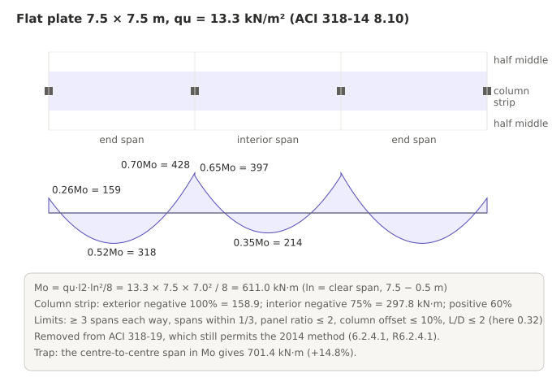

**Practice.** A panel 9 m in the direction considered and 7.5 m across, same slab.

*Answer:* Mo = 13.3 × 7.5 × 8.5²/8 = 900.9 kN·m; interior span column strip negative 0.65 × 0.75 × 900.9 = 439.2 kN·m, positive 0.35 × 0.60 × 900.9 = 189.2 kN·m.

**Trap to test.** Citing ACI 318-19 clauses for the method's coefficients (they are not there), or using the centre-to-centre span in Mo: 701.4 kN·m, 14.8% high.

**Agent check.** Slab analysis: the method and the edition it comes from are stated, its limits are checked, and the clear span is used in Mo.

### 3.16 Live load arrangement in two-way slabs

**Idea.** ACI 318-19 (6.4.3): two-way slabs must take at least the moments with factored live load on all panels. If L ≤ 0.75D, or all panels are loaded together by nature, that is enough (6.4.3.2). Otherwise, 75% of the factored live load is placed on the panel and alternate panels for positive moment and on adjacent panels for negative moment (6.4.3.3), and the design takes the larger of the two.

**Worked example.** The flat plate of 3.15 used for storage: D = 7.75 kN/m², L = 7.2 kN/m² (assumed), L/D = 0.93 > 0.75. Factored: all panels 1.2D + 1.6L = 20.82 kN/m²; pattern 9.30 + 0.75 × 11.52 = 17.94 kN/m² on loaded panels, 9.30 on the others. On a 7.5 m strip of three spans (knife-edge supports, for illustration):

| Moment (kN·m) | All panels | Pattern |
|---|---|---|
| Interior span positive | 219.6 | 371.5 |
| End span positive | 702.7 | 680.6 |
| Interior support negative | 878.3 | 817.6 |

The pattern governs the interior span (+69%); all panels loaded governs the rest.

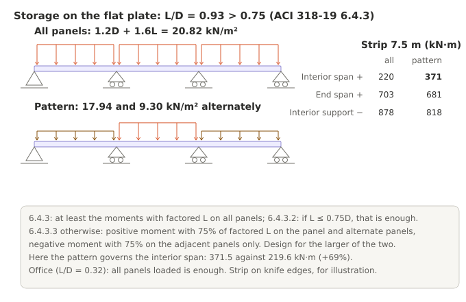

**Practice.** The live load is 5.0 kN/m².

*Answer:* L/D = 0.65 ≤ 0.75: all panels loaded is enough, with 1.2 × 7.75 + 1.6 × 5.0 = 17.3 kN/m².

**Trap to test.** Loading all panels only when L > 0.75D: the interior span positive moment is then 41% low.

**Agent check.** Two-way slabs: L/D is computed and the arrangement of 6.4.3 that follows from it is applied.

### 3.17 Reading plate results: peak against strip average

**Idea.** Finite element plate results give moments per metre that vary across the slab. Design reinforcement for a strip uses the moment integrated over the strip width; designing the whole width for the peak is wasteful, and peaks over point supports grow as the mesh is refined.

**Worked example.** A simply supported square plate 7.5 m, 13.3 kN/m², Poisson's ratio 0.2 (Navier series), moment mx across the width at midspan.

- Peak at the centre: 0.0442qa² = 33.07 kN·m/m (0.0479qa² for ν = 0.3).
- Integrated across the 7.5 m width: 162.8 kN·m, an average of 21.70 kN·m/m; over the middle half, 30.14 kN·m/m.
- Peak × full width = 248.0 kN·m, 52% more than the integral. A one-way slab would need wL²/8 = 93.5 kN·m/m, 701.4 kN·m across the width; the plate integral is only 23% of that, because the load near each edge goes straight to that edge and the twisting moments with the corner forces carry a large part.

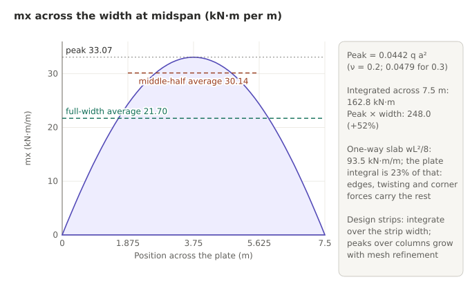

**Practice.** What share of the full-width integral is in the middle half?

*Answer:* 113.0/162.8 = 69%.

**Trap to test.** Reading the moment at one node over a column as the design value for a whole strip, or averaging over a strip wider than the code strip, which dilutes the column-strip moment.

**Agent check.** Plate results: the strip widths, the integration and the mesh size are stated; a peak at a point support is not used as a strip value.

## Part E. Checking software output

### 3.18 Reactions under lateral load: the equilibrium check

**Idea.** Before any member is checked, the reactions must balance the loads: horizontal reactions equal the lateral load, vertical reactions the gravity load, and the moments about a base point balance the overturning. Overturning is carried by the axial couple of the columns and by the base moments together.

**Worked example.** Base reactions of the 3 × 2 frame of 3.11 (kN, kN·m):

| Column | Shear | Axial | Base moment |
|---|---|---|---|
| 1 (windward) | 37.0 | 21.1 tension | 104.1 |
| 2 | 44.0 | 2.1 compression | 112.1 |
| 3 | 43.4 | 1.8 tension | 110.9 |
| 4 | 35.6 | 20.8 compression | 100.7 |
| Sum | 160.0 | 0 | 427.8 |

Overturning about the base: 100 × 7.5 + 60 × 3.75 = 975 kN·m = axial couple 547.2 + base moments 427.8. The axial couple takes 56%.

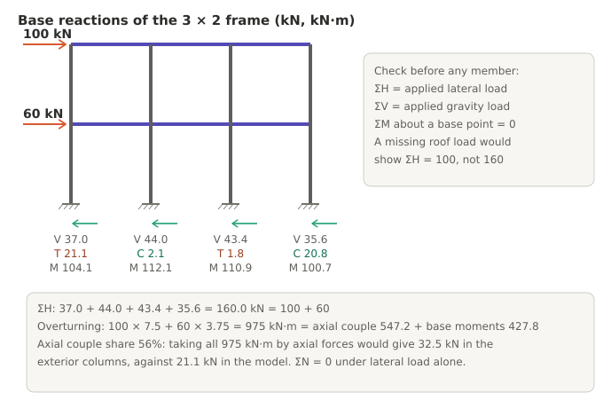

**Practice.** 120 kN at the roof and 80 kN at level 1. Overturning moment at the base?

*Answer:* 120 × 7.5 + 80 × 3.75 = 1,200 kN·m.

**Trap to test.** Accepting a model whose horizontal reactions add to 100 kN when 160 kN was applied (a load on a node not connected to the frame), or taking all of the overturning as column axial force: 32.5 kN in the exterior columns against 21.1 kN.

**Agent check.** Reaction sums for every load case against the applied loads (force and moment), before any member result is used.

### 3.19 Local axes: a column turned 90 degrees

**Idea.** Each program defines member local axes its own way. A rectangular column assigned with b and h swapped, or rotated when drawn, bends about its weak axis in the frame. The model solves without warning, with the wrong stiffness.

**Worked example.** One-bay portal of 3.2 with 300 × 700 columns, 100 kN.

- I about the strong axis 8,575 × 10⁻⁶ m⁴, about the weak axis 1,575 × 10⁻⁶ m⁴: (0.7/0.3)² = 5.44 times.
- Drift: 3.54 mm (strong axis in plane) against 11.24 mm (turned): 3.17 times.
- Column base moment 140.8 → 108.0 kN·m; top 48.2 → 79.9 kN·m: the beam now restrains the weaker column more.

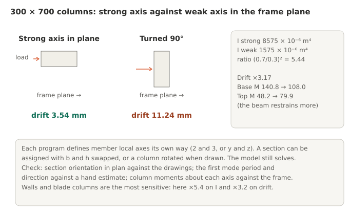

**Practice.** Columns 400 × 600 turned 90 degrees.

*Answer:* I ratio (0.6/0.4)² = 2.25; drift 1.72 times.

**Trap to test.** Section orientation that differs from the drawings, especially for walls and blade columns, which no error message reports.

**Agent check.** Section orientation in plan against the drawings, the first mode period and direction against a hand estimate, and column moments about each axis against the frame direction.

### 3.20 Stiffness modifiers applied twice

**Idea.** Cracked-section factors can be applied in more than one place: a cracked-section option in the program, a property modifier on the member, a reduced E for "cracked concrete". Applied twice, the beams lose most of their stiffness: they restrain the column tops less, and moment moves from the beams and column tops to the column bases.

**Worked example.** The 3 × 2 frame of 3.11.

| Modifiers | Roof drift (mm) | Level-1 beam end | Exterior column top, level 1 | Exterior column base | Interior column base |
|---|---|---|---|---|---|
| Once: columns 0.70, beams 0.35 | 9.66 | 57.1 | 34.5 | 104.1 | 112.1 |
| Beams twice: 0.35 × 0.35 = 0.1225 | 16.76 | 37.9 | 8.0 | 135.7 | 140.2 |
| Both twice: columns 0.49, beams 0.1225 | 19.83 | 44.1 | | | 129.1 |

Moments in kN·m. Beams twice: drift 1.74 times too large; beams and column tops under-designed, column bases over-designed.

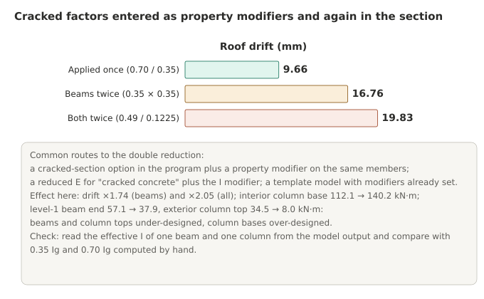

**Practice.** The 0.35 modifier is applied to E of the beams instead of to I. What changes?

*Answer:* EI is the same, but EA also falls to 35%. In a moment frame the effect is small; in braces, chords and collectors, where axial stiffness matters, it is not.

**Trap to test.** A template or imported model with modifiers already set, plus the program's cracked-section option.

**Agent check.** The effective I of one beam and one column is read from the model output and compared with 0.35Ig and 0.70Ig computed by hand.

### 3.21 End releases and mechanisms

**Idea.** A moment release turns a rigid joint into a hinge. Releases change the load path, and too many make a mechanism: the stiffness matrix becomes singular and programs report instability, an ill-conditioned matrix or huge displacements. Some still print results.

**Worked example.**

- The girder of 3.1 with both ends released: midspan 415.3 kN·m against 157.0 kN·m with the real joints, and no moment in the columns.
- One-bay portal with pinned bases and the beam released at both ends: nothing resists sway. The solver's condition number is about 10¹⁷: singular in practice.
- Pinned bases without releases: drift 25.7 mm against 4.95 mm with fixed bases under 100 kN.

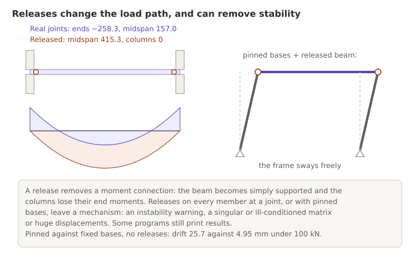

**Practice.** Fixed bases, beam released at both ends, 100 kN. Drift?

*Answer:* Two cantilever columns, each 3E(0.70Ic)/h³: 9.37 mm by hand; model 9.40 mm.

**Trap to test.** Beam-end releases in a moment frame (copied from a steel model with simple connections), or a release that leaves a mechanism and a result that is read anyway.

**Agent check.** Releases are listed with their reason; the analysis log is read for instability or conditioning warnings.

### 3.22 Load direction and projection on a sloping member

**Idea.** Snow, roof live load and rain are given per area on plan; self-weight and cladding per length along the member; wind normal to the surface. Programs offer global, projected and local load directions, and the same number means a different total in each.

**Worked example.** A rafter spanning 10 m on plan at 30°, frames at 6 m.

- Sloping length 11.55 m.
- Snow 0.84 kN/m² on plan × 6 m = 5.04 kN/m per metre on plan: 50.4 kN. Entered as 5.04 kN/m along the member: 58.2 kN (+15.5%).
- Self-weight 3 kN/m along the member: 34.6 kN. Entered per metre on plan: 30.0 kN (−13.4%).

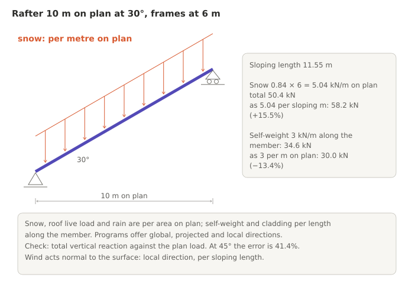

**Practice.** A roof at 45°. Error from applying a plan load along the member?

*Answer:* 1/cos 45° − 1 = 41.4%.

**Trap to test.** A plan load entered per length of a sloping member, or self-weight entered as a projected load.

**Agent check.** The total vertical reaction of a sloping member under each roof load case against the plan area × load.

### 3.23 Hand checks against the model

**Idea.** A hand check is worth only as much as its expected accuracy. Exact methods (moment distribution, joint stiffness) should match the model to rounding; code coefficients are meant to lie above an analysis; approximate methods only bound the order of magnitude. A difference outside the expected band is a reason to find the cause, in the hand check or in the model, not to adjust one to match the other.

**Worked example.** The comparisons of this module:

| Check | Hand | Model | Difference |
|---|---|---|---|
| Moment distribution, MB (3.6) | 328.7 | 328.7 | 0.0% |
| Joint restraint, end moment (3.1) | 258.3 | 258.3 | 0.0% |
| Column share of unbalanced moment (3.5) | 30.2 | 30.2 | 0.0% |
| Cantilever method, exterior N (3.12) | 22.5 | 21.075 | +6.8% |
| Portal, interior base moment (3.11) | 100.0 | 112.1 | −10.8% |
| ACI /10, first interior support (3.7) | 296.4 | 246.4 | +20.3% |
| Portal, level-1 beam moment (3.11) | 81.25 | 57.1 | +42.3% |
| Rigid-beam drift, mm (3.14) | 1.873 | 3.708 | −49.5% |
| Portal, exterior base moment (3.11) | 50.0 | 104.1 | −52.0% |

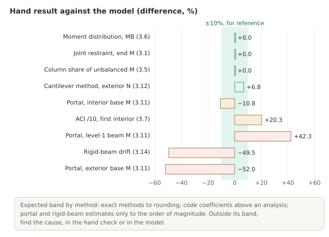

**Practice.** The hand estimate of 3.5 gives 30.2 kN·m for the interior column; the model shows 3.0 kN·m. What to check?

*Answer:* A difference of ten times is not a method difference: look for a release at the joint, the column's local axes and section, and whether the live load in the model is really on one span only.

**Trap to test.** Trusting the model because "software does not make arithmetic errors", or changing the hand check until it agrees.

**Agent check.** A comparison table like the one above, with the expected band for each method (exact methods to rounding; the ACI coefficients above an analysis; the portal method and rigid-beam drift only as order of magnitude) and the cause of every difference outside it.

---

## Agent checks from this module

Each check is to be computed by a Python tool the agent calls, not recalled from memory. The flags are starting values, to be calibrated on real tasks.

| Check | Compares | Proposed flag |
|---|---|---|
| Joint restraint | Beam end moments against fixed-end moments | Ratio exactly 0 or 1 without a reason |
| Stiffness modifiers | Factors per member type and per analysis | Gross sections for drift (strength-level factors for service drift are allowed, conservative by 1.4) |
| Support moments | Centreline or face; rigid zones; reductions | Reduction applied twice; face reduction at a non-monolithic support |
| Flange width | bf for stiffness and strength, span and support | Full beam spacing as flange |
| Interior columns | Moments from one-sided live load | Interior columns with axial load only |
| Continuous beams | Hand moment at a critical support against the model | Different end conditions; difference above 2% for exact methods |
| Approximate moments | Conditions of ACI 6.5.1 | Coefficients outside the limits or redistributed |
| Redistribution | Percentage, εt or xu/d, equilibrium | εt < 0.0075; equilibrium not restored |
| Moving loads | Governing positions | One position only; continuous members as simple spans |
| Settlement | Value, source, stiffness, load factor | Settlement in the report but not in the model |
| Lateral hand checks | Storey shears and overturning | Shears not summing; portal moments used for design |
| Deflections | Support rotation included | Cantilever deflection from the beam alone |
| Slabs | Method, edition, limits, clear span, L/D | Centre-to-centre span in Mo; pattern missing when L > 0.75D |
| Plate results | Strip widths and integration | Point value used as a strip value |
| Reactions | Sums for every load case | Any imbalance |
| Local axes | Section orientation against the drawings | Strong and weak axes swapped |
| Releases | List with reasons; instability warnings | Releases in a moment frame; warnings ignored |
| Load projection | Vertical reaction against plan load | Plan load applied along the slope |

## Traps to test (not yet measured)

| Section | Trap | Status |
|---|---|---|
| 3.1 | Beam ends at columns taken as pinned or fully fixed | Not yet tested |
| 3.2 | Drift checked with gross sections | Not yet tested |
| 3.3 | Face reduction at a non-monolithic support, or applied twice | Not yet tested |
| 3.4 | Full beam spacing taken as the flange | Not yet tested |
| 3.5 | Interior columns designed for axial load only | Not yet tested |
| 3.6 | End supports treated as fixed in moment distribution | Not yet tested |
| 3.7 | ACI coefficients used outside their limits | Not yet tested |
| 3.8 | Redistribution with εt < 0.0075 or without equilibrium | Not yet tested |
| 3.9 | Continuous runway treated as simple spans | Not yet tested |
| 3.10 | Settlement ignored or with the wrong sign | Not yet tested |
| 3.11 | Portal moments used for a fixed-base bottom storey | Not yet tested |
| 3.12 | Overturning at a level without the forces above | Not yet tested |
| 3.13 | Cantilever deflection without support rotation | Not yet tested |
| 3.14 | Shear-building drift in a flexible-beam frame | Not yet tested |
| 3.15 | DDM cited to ACI 318-19; centre-to-centre span in Mo | Not yet tested |
| 3.16 | All panels loaded only when L > 0.75D | Not yet tested |
| 3.17 | Point moment used for a whole strip | Not yet tested |
| 3.18 | Reactions not checked against the loads | Not yet tested |
| 3.19 | Column local axes swapped | Not yet tested |
| 3.20 | Stiffness modifiers applied twice | Not yet tested |
| 3.21 | Releases in a moment frame; a mechanism read as a result | Not yet tested |
| 3.22 | Plan load applied along a sloping member | Not yet tested |
| 3.23 | Model trusted over a hand check without finding the cause | Not yet tested |

## Answer keys and rubrics

Eight of these examples are written as tasks in the harness, each with a prompt, numerical checks with tolerances, a rubric item and the expert's notes, in the [expert eval harness](https://github.com/sabaazdn73/expert-eval-harness): `str-an-joint-restraint` (3.1), `str-an-cracked-drift` (3.2), `str-an-face-moment` (3.3), `str-an-moment-distribution` (3.6), `str-an-aci-coefficients` (3.7), `str-an-redistribution` (3.8), `str-an-portal-check` (3.11, 3.18) and `str-an-ddm` (3.15). They will be run on Claude Haiku, Sonnet and Opus and on Gemini models, and the results added to the table above.

## References to check in the edition in force

ACI 318-19: load effects of settlement 5.3.6; analysis methods 6.2.4.1 and R6.2.4.1; modelling 6.3.1.2; T-beam flange width Table 6.3.2.1; live load arrangement 6.4.1, 6.4.2 and 6.4.3; simplified method 6.5.1 to 6.5.5 with Tables 6.5.2 and 6.5.4; modelling of members 6.6.2.1 to 6.6.2.3 and R6.5.2; T-beam stiffness R6.6.3.1.1; section properties Table 6.6.3.1.1(a) and 6.6.3.2.2; redistribution 6.6.5; beam moments at the face 9.4.2.1; modulus of elasticity 19.2.2.1; β1 Table 22.2.2.4.3. ACI 318-14 8.10 for the direct design method. EN 1992-1-1: effective flange width 5.3.2.1 and Figure 5.2; effective span and support moments 5.3.2.2; redistribution 5.5. EN 1998-1: cracked stiffness 4.3.1(7). Clause numbers only; no code text is reproduced.
