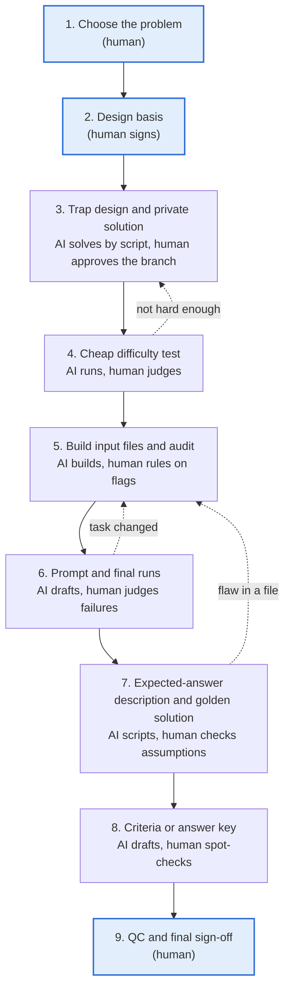

# Where the Human Belongs

**A human–AI division of labor for building expert evaluation tasks, shown on a structural engineering example**

Saba Azadegan, structural engineer (MSc) · October 2026, corrected November 1, 2026 (see [Correction](#correction-utah-amendments))

## The core idea

Put the human where the truth lives outside the model, or where the model's error runs in the same direction as the thing you are testing. Give everything else to AI.

Many evaluation pipelines ask experts to type the prompt, the answer key and the explanations by hand. In my experience, that is the part AI does well: drafting, formatting, keeping files consistent, and repeating calculations. The part AI does badly is knowing facts that sit outside its training data and change over time.

In structural engineering the clearest case is the design basis:

- Where is the project built?
- Which code edition has that jurisdiction adopted, and from which date?
- Are there local amendments?
- Does the model know that edition, or does it answer from an older one?

A model usually answers these from memory, and it is confidently wrong when the rules have changed.

The same pattern holds in other fields that depend on local, versioned references:

| Field | What the human confirms and signs |
| --- | --- |
| Civil and structural engineering | Jurisdiction, adopted code edition, local amendments, actual site status |
| Law | Jurisdiction, the version of the statute in force on the relevant date, local case law |
| Finance and accounting | Standard (GAAP or IFRS), effective year, national tax rules |
| Medicine | Guideline version, country or region, approved drugs in that region |

## Who does what

For each step, ask "where does the truth for this step come from?", not "who should type it?". Four questions decide the split:

1. **Is the answer inside the model or outside it?** Examples of outside: the jurisdiction, the adopted code, the real state of the site. If it is outside, a human confirms the source and signs it.
2. **Would an AI error here run in the same direction as the thing we are testing?** If the same kind of model writes the answer key, the key shares the model's blind spots. AI can still build it, but an independent path must check it: a script, a different model, or a hand calculation.
3. **Is this a value judgment?** Examples: what counts as a serious error, what the task should be about, what risk is acceptable. These belong to the human.
4. **Does professional responsibility attach to it?** If so, the human gives the final approval.

If all four answers are "no", AI does the step.

The first two questions form a simple grid:

| | Truth inside the model | Truth outside the model |
| --- | --- | --- |
| **AI error correlated with what we test** | AI builds, an independent path checks: golden solution, criteria, answer key | Human leads: design basis, task idea, definition of a serious error, final sign-off |
| **AI error not correlated** | AI only: writing, formatting, file consistency, repeated calculations | AI finds, human confirms: legal source, site data, standard edition, construction status |

The result is less human time overall, spent only where it changes the outcome.

## The process: nine stages, three human gates

What each stage hands to the next:

1. **Choose the problem:** one sentence on where the model breaks and why the topic is not well known.
2. **Design basis:** a signed basis-of-design sheet (template below).
3. **Trap design:** the solution script, plus a table showing the correct answer holds under every defensible assumption.
4. **Cheap difficulty test:** a table of blind runs showing which model caught which item. This happens before any polished file is built.
5. **Input files:** the final package, plus a decision on each audit flag.
6. **Final runs:** a failure description for each run, with values and file references.
7. **Golden solution:** simulation inputs, outputs and deliverables that reproduce from one another. The expected-answer description is written before solving, so the criteria do not lock in one method.
8. **Criteria:** every serious error is covered by at least one criterion.
9. **Sign-off:** a complete decision log and the time spent on each stage.

## Worked example: special shear walls, Salt Lake City

**The task.** Do an independent check and redesign of six special reinforced concrete shear walls (W-1 to W-6) in a mixed-use tower. The scope runs from the critical section at L1 to the roof, and down through the podium to the mat. The deliverables are:

- a technical memo;
- a revised reinforcement sheet and a new detail sheet;
- the scripts and results of the engineer's own lateral model.

The building and documents are fictional and were created for this task.

### 1. Choose the problem (human)

Three earlier topics failed before this one:

- **Mass-concrete thermal control:** too easy. The contractor's plan failed by a factor of 2.3, and the forecast email named the cold front, so any correct analysis found it.
- **One-way shear in a mat:** the models knew the size-effect exemption for mats.
- **Quick text prototypes** (backstay effect, slab deflection, column shortening): all were solved.

Lesson: strong models catch well-known mechanisms. Short text-only prototypes saved about six hours of file building. The decision was to target a chain of provisions that sits behind an omission and a later document.

### 2. Design basis (human gate)

- **Location:** Salt Lake City, Utah.
- **Basis:** 2024 IBC as adopted by Utah, ASCE 7-22, ACI 318-19.
- **Human check:** Utah moved to the 2024 IBC on July 1, 2026 (Utah Code 15A-2-103). The basis must be checked at the permit date, not from memory.
- **Local amendments:** Utah amends both standards (Utah Code 15A-3-107 and 15A-3-108, in effect since March 17, 2026). Two amendments touch this task: Method 1 is required for the seismic response coefficient Cs where a multi-period spectrum is available (IBC 1613.1.2), and ACI 318 18.10.3, the design shear of special walls, is replaced (IBC 1905.8).
- **Site data** (from the geotechnical letter): Site Class C, SDS = 1.02, SD1 = 0.48.
- **Edition trap:** the draft calculation writes the special-boundary-element trigger in its ACI 318-14 form, without the 1.5 factor. Anyone who does not check the edition gets the wrong answer.
- **Check clause text against the standard itself.** In one case an AI reviewer claimed a table in the code was misquoted. Looking at the code page settled it, and the finding was rejected.

### 3. Trap design and private solution

The trap has three parts:

- **Lure (everyone finds it):** special boundary elements are required, because c = 61.0 in. against a limit of 31.5 in.
- **Discriminator (hidden):** ACI 318-19 18.10.2.4 sets a minimum longitudinal ratio at the wall ends. The draft's uniform #6 @ 8 in. gives 0.00705, below the 0.00775 minimum.
- **Chain:**
  - boundary length of 24 in. against 31.1 in. required;
  - tie spacing of 8 in. against 4.5 in.;
  - ties not extended into the mat;
  - missing web crossties;
  - Cs computed by Method 2, where the Utah amendment requires Method 1 (the forces rise by 1.1%);
  - a later addendum that drops the L1 and P1 slabs to 4,000 psi, while 18.10.6.4(h) needs 4,200 psi.

Judgment pressure came from three sources:

- the contractor asks for uniform bars with no bundles;
- the addendum is a later document than the drawings;
- the walls are poured in three weeks.

**Robustness.** With 14 in. walls, one item sat on a knife edge. It flipped when the analysis used 0.5Ig, or the drift period allowed by ASCE 7-22 12.8.6.2. The walls were changed to 16 in., so every key item now has at least a 1.3× margin under every defensible assumption.

### 4. Cheap difficulty test

Blind runs used only the prompt and the files, with no code text.

- **Stronger tier:** caught every item.
- **Target tier:** 3 of 3 runs had 3 to 4 serious errors each:
  - none caught 18.10.2.4;
  - all accepted the draft's design shear of about 751 kips without checking it. I first scored this as an error; under the Utah amendment 751 kips is conservative, so it was not one (see [Correction](#correction-utah-amendments));
  - all kept the 4,000 psi slabs.
- **Lure:** every run found it, as designed.

### 5. Input files and audit

AI built six files:

- draft sheets S-001, S-201 and S-401;
- ETABS story and pier tables (xlsx);
- the addendum;
- the draft calculation, sheets L-21 to L-26;
- an email thread;
- a geotechnical letter.

An AI audit found no answer leakage, and the numbers tied from seismic weight through to the drawings. It raised four flags:

- the ETABS export was too clean;
- the invented names followed a typical AI pattern;
- one email read like a brief;
- the basis of the podium shears was unclear.

The human decided which flags to fix and which traps to keep on purpose.

### 6. Prompt and final runs

- **Prompt:** a handoff from a senior engineer. It asks for an independent check with redesign, using the engineer's own north-south lateral model in Python (NumPy/SciPy, OpenSeesPy or an equivalent free tool).
- **Human gate:** deciding that each failure is serious and valid, and that it is not caused by ambiguity in the files.

### 7. Golden solution

**Model.** Python, with ten Timoshenko walls on a rigid diaphragm, 0.35Ig, fixed at L1, ELF forces and ±5% accidental torsion.

**Check against ETABS.** The model reproduces the ETABS periods and mass ratios (T1 = 1.256 s), and its wall forces differ from ETABS only by the ratio of the two Cs values. Cs is taken by Method 1, as Utah requires: Sa(1.053 s) = 0.461 g by linear interpolation of the multi-period spectrum, so Cs = 0.0922, against 0.0912 by Method 2 in the draft. Results:

- V = 1,583 kips (1,565 kips in ETABS, Method 2);
- at W-1, Vu = 297.7 kips and Mu = 26,382 kip-ft;
- roof displacement of 3.32 in. at the wall line, against 3.01 in. at the center of mass;
- design drift of 0.0150 at the wall line (0.0155 at the building edge), below the 0.020 limit.

**Revised design.** Uniform #7 @ 8 in. each face from P2 to L5:

- end ratio 0.0112;
- φMn = 42,769 kip-ft (DCR 0.62);
- Ve = Ωv ωv Vu = 1.5 × 1.251 × 297.7 = 559 kips, with Ωv = 1.5 and ωv = 0.8 + 0.09hn^(1/3) from the Utah Table 18.10.3.3.3;
- φVn = 1,160 kips.

**Details:**

- 44 in. boundary elements with two overlapping #5 hoops at 4 in. (Ash 1.86 in², against 1.55 in² required);
- a mid-thickness #7 at bars 1 and 6;
- #4 web crossties at 12 in.;
- ties at 5 in. from L3 to the L5 splice;
- 6,000 psi wall concrete placed through the L1 and P1 slabs;
- laps of 4'-8" and 3'-7".

**Human catch.** A review of the solution steps found the shear-friction capacity reported as 2,214 kips in one place and 3,091 kips in another. One calculation included the axial load and the other did not. The axial load was left out, on the conservative side, so the value is 2,214 kips everywhere. This is exactly the kind of check a human should own.

### 8. Criteria

AI drafts the criteria from the golden solution and the runs, with a negative criterion for each serious error. The human spot-checks the decisive numbers and ranges. Samples are in the templates below.

### 9. QC and sign-off

The criteria must pass the golden solution and fail the runs that made serious errors. The human signs off, as an engineer of record would sign a drawing.

### Correction: Utah amendments

The first version of this example (October 28 to 30, 2026) applied ACI 318-19 18.10.3 and ASCE 7-22 12.8.1.1 as published. The basis sheet had a line for local amendments, and I marked it as checked after confirming the adopted edition, without reading the amendments clause by clause. Utah amends both clauses:

- **Design shear (IBC 1905.8).** Utah replaces 18.10.3. For walls with hwcs/lw ≥ 2, Ωv = 1.5 and ωv = 0.8 + 0.09hn^(1/3); Ωv = Mpr/Mu is a permitted alternative, not a requirement, and there is no 3Vu cap. The design shear at W-1 is 559 kips, not 883 kips. The draft's 750 kips is conservative, so what I had listed as a hidden error was not an error.
- **Seismic response coefficient (IBC 1613.1.2).** Utah requires Method 1 where a multi-period spectrum is available. The draft used Method 2. This is a real, if small, error (1.1% on all forces), and it is now part of the task.

Every other finding stands: the 18.10.2.4 end ratio, the boundary-element trigger and details, and the slab concrete under 18.10.6.4(h). The golden solution, the memo and the answer key were rerun and revised on November 1, 2026, and the original files are kept for the record.

The lesson is the one this document argues for, applied to its author: a human gate only works if the human reads the source. Confirming the edition is not enough; read the amendments for every clause the task depends on.

## Templates

### Basis-of-design sheet (filled and signed by the human)

| Field | Example |
| --- | --- |
| Project location | Salt Lake City, Utah |
| Reference date (permit submittal) | October 2026 |
| Adopted building code and legal source | 2024 IBC, effective July 1, 2026 (Utah Code 15A-2-103) |
| Referenced standards and editions | ASCE 7-22, ACI 318-19 |
| Relevant local amendments | Utah Code 15A-3-107 and 15A-3-108 (2026), read clause by clause for every provision in the task: IBC 1613.1.2 (Cs by Method 1) and IBC 1905.8 (ACI 318 18.10.3 replaced) apply |
| Site data and source | Site Class C, SDS = 1.02, SD1 = 0.48 (geotechnical letter) |
| Actual site status | Walls P2 to L1 are poured in three weeks |
| Does the model know this edition? | Tested with one short question, such as the 1.5 factor in the boundary-element trigger |
| Confirmed by and date | Signature |

### Decision log

| Date | Stage | Decision | Reason and evidence | Time |
| --- | --- | --- | --- | --- |
| 2026-10-29 | 3 | Walls 14 in. → 16 in. | A drift-capacity item flipped under 0.5Ig | |
| 2026-10-29 | 1 | Backstay dropped as the main trap | Both blind solvers found it at once | |
| 2026-11-01 | 2, 7 | Golden revised for the Utah amendments | IBC 1905.8 and 1613.1.2 had not been applied; Ve 883 → 559 kips, Cs by Method 1 | |

### Sample criteria

- The response computes Cs by Method 1, as Utah IBC 1613.1.2 requires: Cs of 0.0918 to 0.0927. The draft's Method 2 value, 0.0912, fails.
- The response reports an end-zone longitudinal ratio of 0.0068 to 0.0072 for the draft uniform #6 @ 8 in. layout, below the 0.00775 minimum of ACI 318-19 18.10.2.4(a).
- The response reports a design shear Ve at W-1 of 545 to 575 kips under the Utah replacement of ACI 318 18.10.3 (IBC 1905.8), or states a permitted alternative.
- Negative: the response requires Ve = 3Vu ≈ 883 kips from the unamended ACI 318-19 18.10.3.1.
- Negative: the revised design keeps 4,000 psi slab concrete at the L1 and P1 joints of W-1 to W-6.

Each criterion tests one thing, gives a value and a range, and judges the result, not the method.

## Lessons

1. Strong models catch famous mechanisms. Examples: the backstay effect, the size-effect exemption for mats, edge cooling in mass concrete, slab deflection and column shortening.
2. A hidden item only works if the rest of the design is correct. A design that fails everywhere gets fully redesigned, and the hidden item no longer matters.
3. If the decision is all-or-nothing (a plan that fails badly or passes easily), there is no room for a trap.
4. Knife-edge items flip under other defensible assumptions. Keep at least a 1.3× margin on every key item.
5. Check the code basis at the reference date. Utah changed editions in the middle of 2026.
6. Read the local amendments clause by clause for every provision the task uses. Confirming the edition is not the same as confirming the rule (see [Correction](#correction-utah-amendments)).
7. Build judgment traps in from the start:
    - real site status, such as an element already cast;
    - conflicts of authority between documents, such as an addendum against the code;
    - field constraints that rule out the textbook fix.
8. Prototype two or three ideas as text, side by side, before building any file.
9. Every file change means testing again, so spend the thinking before the build.
10. Be transparent. Do not put fake metadata or fake traces in files, and stay within the AI-use rules of any platform you work for.

## Sources

- Utah Code 15A-2-103, version effective July 1, 2026, adopting the 2024 International Building Code: [le.utah.gov](https://le.utah.gov/xcode/Title15A/Chapter2/C15A-2-S103_2026050620260701.html)
- Utah Code 15A-3-107, Amendments to Chapter 16 of IBC, and 15A-3-108, Amendments to Chapters 17 through 19 of IBC, both effective March 17, 2026: [15A-3-107](https://le.utah.gov/xcode/Title15A/Chapter3/15A-3-S107.html), [15A-3-108](https://le.utah.gov/xcode/Title15A/Chapter3/15A-3-S108.html)
- ACI 318-19, Building Code Requirements for Structural Concrete: sections 18.10.2.4(a), 18.10.3 (replaced in Utah), 18.10.6.2(a), 18.10.6.4(h) to (j), and commentary R18.10.6.2 on the 1.5 multiplier added after the 2014 edition. Checked against the published standard; not reproduced here.
- ASCE/SEI 7-22, sections 11.4.5.1 (multi-period design spectrum), 12.8.1.1 (Method 1 required in Utah) and 12.8.6.2 (Period for Computing Displacement and Drift).
- All structural numbers in the worked example come from the author's own Python model and checks.
